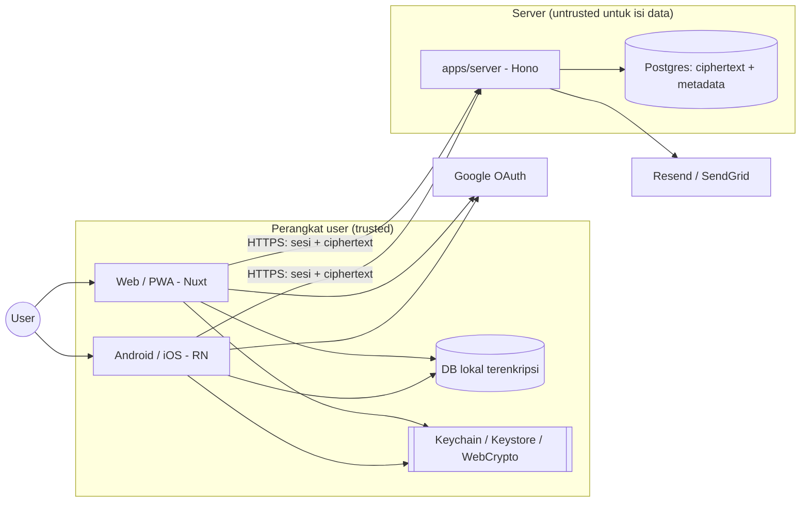
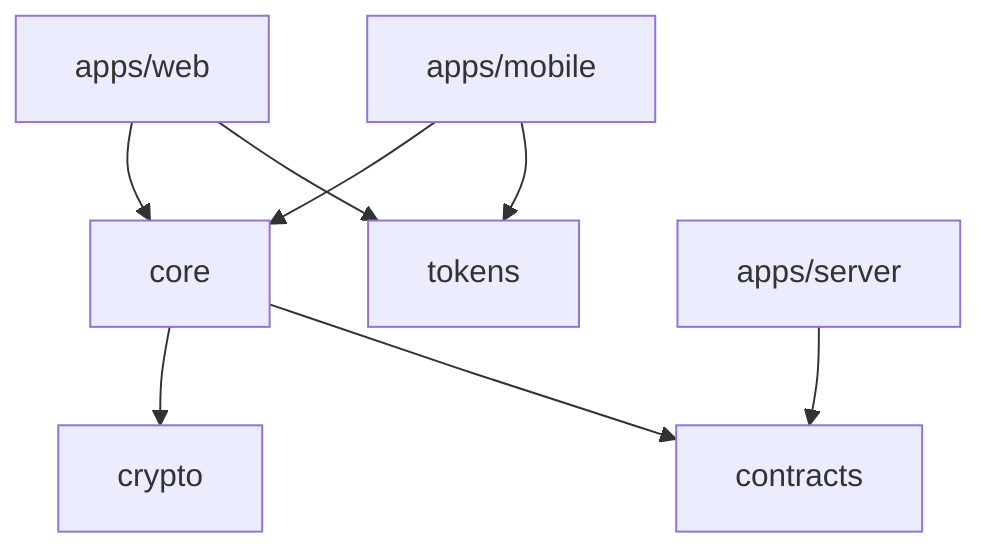
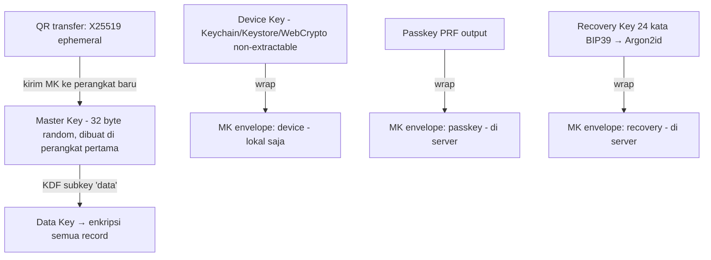
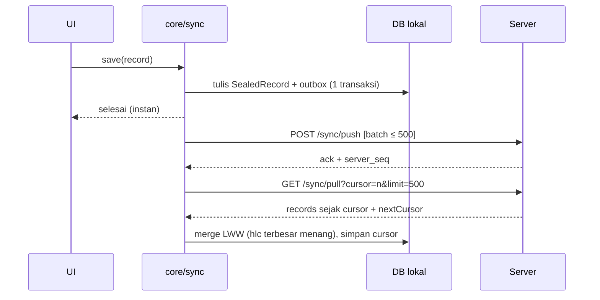

# Architecture — Improve Personal

Pegangan arsitektur. Sumber kebenaran produk: `docs/PRD.md`. Aturan tiga pilar: `CLAUDE.md` + `apps/<app>/.claude/rules/`.
Kalau dokumen ini bentrok sama kode, update salah satunya di PR yang sama - jangan dibiarkan beda.

---

## 0. Pertanyaan terbuka

### Butuh keputusan (ngaruh ke klaim "server nggak bisa baca data")

**Q1. Salinan kunci utama yang digembok OTP (F15 "Salinan 1") bikin E2EE bocor.**
OTP dibuat dan dikirim oleh server, jadi server tahu OTP-nya. Ruang OTP cuma 10⁶, jadi brute-force offline instan walau pakai Argon2id. Akibatnya server (atau siapa pun yang dapet DB + log email) bisa buka kunci utama.
- Opsi A (rekomendasi): hapus Salinan 1. OTP/Google cuma buat **login (autentikasi)**, bukan buat **buka kunci**. Perangkat baru buka kunci lewat: QR dari perangkat lama, passkey PRF, atau recovery key.
- Opsi B: tetap pakai Salinan 1, tapi klaim di Panduan diubah jadi "terenkripsi di server", bukan E2EE.
- Default kalau di-skip: **A**.

**Q2. Recovery key yang disimpan server "dienkripsi kunci terpisah" juga bocor.** Kunci terpisah itu dipegang server, jadi server bisa buka recovery key → kunci utama.
- Opsi A (rekomendasi): server nggak nyimpen recovery key sama sekali. Wajib backup ≥2 tempat (udah ada di PRD) jadi jaring pengamannya.
- Opsi B: server simpan recovery key yang dienkripsi pakai passkey PRF user (server tetap nggak bisa buka). Ribet, manfaat kecil.
- Default: **A**.

### Default (diasumsikan, bisa diganti)

| # | Topik | Rekomendasi = default |
|---|---|---|
| Q3 | Stack server | `apps/server`: Node + **Hono** + **PostgreSQL** + **Drizzle**. Tipis (auth + relay ciphertext), TypeScript bareng client, kontrak dari `packages/contracts`. |
| Q4 | Mobile | **Expo** (dev build, Expo Router, EAS Build/Update). |
| Q5 | Monorepo tool | **pnpm workspaces + Turborepo**. |
| Q6 | Library kripto | **libsodium** (`libsodium-wrappers-sumo` di web, `react-native-libsodium` di native) - API identik dua platform, ada XChaCha20-Poly1305 + Argon2id. |
| Q7 | Data lokal di web terenkripsi? | Ya: IndexedDB simpan ciphertext, plaintext cuma di memori setelah unlock. Native: SQLite + SQLCipher. |

---

## 1. Prinsip

1. **Local-first.** Semua baca/tulis ke DB lokal dulu → UI instan, jalan penuh offline. Server bukan sumber kebenaran.
2. **Zero-knowledge server.** Server cuma tahu: siapa user, perangkat apa, ID record, kapan berubah. Isi data selalu ciphertext.
3. **Login ≠ unlock.** Login (OTP/Google) = dapet sesi API. Unlock = dapet kunci utama di perangkat. Dua hal terpisah.
4. **Logika sekali, UI dua kali.** Domain, repository, sync, kripto ditulis sekali di `packages/*` (TS murni). Nuxt & RN cuma UI + adapter platform.
5. **Tiga pilar wajib** (keamanan, performa, kerapian) di setiap perubahan.

---

## 2. Konteks sistem



**Trust boundary:** semua yang keluar dari kotak "Perangkat" sudah terenkripsi, kecuali email (buat login), metadata sync, dan info perangkat.

---

## 3. Struktur monorepo

```
improve-personal/
├── apps/
│   ├── web/                 # Nuxt 4 - web desktop + PWA  (+ ARCHITECTURE.md, docs/PRD.md)
│   ├── mobile/              # Expo / React Native - Android + iOS  (+ ARCHITECTURE.md, docs/PRD.md)
│   └── server/              # Hono + Postgres - auth + sync relay
├── packages/
│   ├── core/                # domain + use case + repository interface + sync engine
│   ├── crypto/              # key hierarchy, encrypt/decrypt, recovery key (BIP39)
│   ├── contracts/           # schema zod API + DTO + versi protokol
│   ├── tokens/              # design token → CSS vars (web) & theme object (RN)
│   └── config/              # tsconfig, eslint, prettier, vitest preset bersama
├── docs/PRD.md              # sumber kebenaran produk - di-symlink ke docs/ tiap app
├── CLAUDE.md                # aturan bersama (per app: apps/<app>/CLAUDE.md)
├── ARCHITECTURE.md          # arsitektur root - cuma hal lintas app (per app: §10)
├── pnpm-workspace.yaml · turbo.json
└── .claude/                 # settings, agents
```

### Aturan dependensi



- `packages/*` **dilarang** import Vue, React, Nuxt, React Native, Node API (`fs`, `crypto` Node), atau DOM. Kebutuhan platform masuk lewat interface (lihat §5).
- `apps/server` **dilarang** import `core` / `crypto` - server nggak boleh punya kemampuan dekripsi.
- `apps/web` dan `apps/mobile` nggak saling import.
- Dicek otomatis di CI (`eslint-plugin-boundaries` atau `dependency-cruiser`).

---

## 4. `packages/core` - isi modul

```
packages/core/src/
├── domain/        # entitas + aturan murni: schedule, todo, eisenhower, pomodoro,
│                  # countdown, habit, memo, goal, sticker, decoration
├── recurrence/    # engine F1 (ekspansi per rentang, exception, edit 3 opsi)
├── calc/          # sisa waktu, countdown unit, streak, progress goal, agregasi Overview
├── repository/    # interface Repository<T> + query by range
├── sync/          # outbox, push/pull, HLC, LWW merge, status
├── io/            # import/export JSON + validasi skema + migrasi versi
└── ports.ts       # interface yang diimplementasi tiap platform
```

Semua fungsi di `domain/`, `recurrence/`, `calc/` **murni** (input → output, tanpa I/O, tanpa `Date.now()` langsung - waktu di-inject). Ini yang bikin unit test PRD (recurrence, streak, progress, dll) gampang dan deterministik.

---

## 5. Port & adapter

| Port (di `core/ports.ts`) | Web (Nuxt) | Mobile (Expo) |
|---|---|---|
| `StorageAdapter` | IndexedDB via `idb` | SQLite via `expo-sqlite` + SQLCipher |
| `SecureKeyStore` | WebCrypto non-extractable key di IndexedDB + WebAuthn | `expo-secure-store` (Keychain/Keystore) + biometrik |
| `CryptoProvider` | libsodium-wrappers | react-native-libsodium |
| `Clock` | `Date.now` + HLC | sama |
| `HttpClient` | `$fetch` | `fetch` |
| `Scheduler` | `setTimeout` + `visibilitychange` | `AppState` |

Satu **contract test suite** di `packages/core/test/adapters/` dijalankan ke tiap `StorageAdapter` - IndexedDB dan SQLite harus lolos test yang sama (AC T23).

---

## 6. Model data

### Envelope record (sama untuk semua entitas)

```ts
// lokal (setelah decrypt, cuma di memori)
type Record<T> = {
  id: string            // UUIDv7 (urut waktu, dibuat di client)
  type: EntityType      // 'todo' | 'schedule' | 'memo' | ...
  hlc: string           // hybrid logical clock: `${wallMs}-${counter}-${deviceId}`
  deleted: boolean      // tombstone
  schemaVersion: number
  data: T               // isi entitas
}

// yang disimpan di disk & dikirim ke server
type SealedRecord = {
  id: string
  hlc: string
  deleted: boolean
  blob: string          // XChaCha20-Poly1305(type + schemaVersion + data), AAD = id
}
```

- `type` ikut dienkripsi - server nggak tahu record itu memo atau todo.
- AAD = `id` → blob nggak bisa dipindah ke record lain.
- Index lokal untuk query rentang tanggal (kalender, overview) disimpan di **tabel index terpisah yang juga terenkripsi di disk** atau dibangun di memori saat unlock. Jalur panas = query index, bukan decrypt semua record.

### Entitas utama

`Schedule` (+ `ScheduleException`, `Occurrence` status) · `Todo` · `EisenhowerPlacement` · `PomodoroSession` · `PomodoroSettings` · `Countdown` · `Habit` (+ `HabitCheckin`) · `Memo` (mood, mention) · `Goal` (+ `Chapter`, `GoalLink`) · `Decoration` (per breakpoint) · `UserPrefs`.
Relasi pakai ID (`todo.scheduleId`, `goalLink.itemId`). Referensi ke record yang udah dihapus wajib ditangani aman (PRD: mention ke jadwal terhapus nggak error).

### Server (Postgres)

```
users(id, email, created_at)
devices(id, user_id, name, last_seen_at, last_ip_city, revoked_at)
sessions(id, device_id, token_hash, expires_at)
otp_challenges(id, email_hash, code_hash, expires_at, attempts)
key_envelopes(id, user_id, kind[device|passkey|recovery], wrapped_key, kdf_params, created_at)
records(user_id, id, hlc, deleted, blob, server_seq BIGSERIAL)   -- PK (user_id, id)
```

`server_seq` = cursor pull. Nggak ada kolom plaintext data user.

---

## 7. Kripto & kunci



- Semua envelope di server **cuma bisa dibuka di client** (passkey / recovery key). Server cuma simpan blob.
- Recovery key salah → rate limit di server (envelope cuma dikasih setelah sesi login valid, max 5x lalu lock).
- QR tambah perangkat: perangkat baru tampilkan QR berisi public key ephemeral + nonce; perangkat lama scan, kirim MK terenkripsi lewat server (relay), TTL ≤ 2 menit, sekali pakai.
- **Dilarang** bikin algoritma sendiri, log kunci/OTP/recovery key, atau kirim MK polos ke mana pun.
- Lupa semua pembuka = data hilang. Dijelaskan jujur di onboarding + Panduan.

---

## 8. Auth

- Email OTP: kode 6 digit, hash di DB, TTL ≤ 10 menit, sekali pakai, rate limit per email + per IP. Respons selalu generik (nggak bocorin email terdaftar).
- OTP fix `777777`: cuma kalau `APP_ENV ∈ {development, staging, test, preview}`. Env kosong/lain = production. Server **nolak start** kalau `APP_ENV=production` dan mode fix aktif. Ada test-nya.
- Google: Authorization Code + PKCE, validasi `state`, `nonce`, ID token (`aud`, `iss`, `exp`).
- Sesi: token opaque per perangkat (hash di DB). Web: cookie `HttpOnly; Secure; SameSite=Lax`. Mobile: `SecureStore`. Revoke per perangkat = hapus sesi.
- Setiap endpoint: `user_id` diambil dari sesi, **bukan** dari body/param.

---

## 9. Sync



- **Kapan sync:** saat app dibuka, setelah tulis (debounce ~2 dtk), tiap 5 menit di foreground, saat online lagi.
- **Konflik:** bandingkan `hlc` (HLC, bukan jam device mentah → aman dari jam HP yang ngaco). Tie → `deviceId` terbesar.
- **Server:** upsert hanya kalau `hlc` masuk > `hlc` tersimpan. Server tetap bisa bandingkan karena `hlc` plaintext metadata.
- **Hapus:** tombstone ikut sync. Purge tombstone > 90 hari (setelah semua perangkat aktif lewat cursor-nya).
- **Status UI:** `synced | pending | offline | error` dari `core/sync`, dipakai web & mobile.
- Sync jalan di background, nggak pernah blok UI. Decrypt batch besar di Web Worker (web) / di luar render (mobile).

### API (versi di path, schema di `packages/contracts`)

```
POST /v1/auth/otp/request      POST /v1/auth/otp/verify
GET  /v1/auth/google/start     GET  /v1/auth/google/callback
GET  /v1/devices               DELETE /v1/devices/:id
GET/PUT /v1/keys/envelopes     POST/GET /v1/keys/transfer/:id
POST /v1/sync/push             GET  /v1/sync/pull
DELETE /v1/account
```

---

## 10. Arsitektur per app

Detail tiap app ada di dokumennya sendiri. Root ini cuma nampung hal yang berlaku buat semua.

| App | Dokumen | Isi |
|---|---|---|
| `apps/web` (Nuxt 4) | [`apps/web/ARCHITECTURE.md`](apps/web/ARCHITECTURE.md) | Struktur `app/`, mode render, PWA, state (Pinia) |
| `apps/mobile` (Expo) | [`apps/mobile/ARCHITECTURE.md`](apps/mobile/ARCHITECTURE.md) | Struktur, adapter native, kunci app, build & OTA |
| `apps/server` (Hono) | belum dipisah - `apps/server` belum ada | Struktur target di bawah |

Aturan:

- Dokumen app boleh nambah detail, tapi **dilarang nulis ulang** hal root (§5–§9). Kalau bentrok, root yang menang dan selisihnya dibenerin di PR yang sama.
- Tiap app punya `docs/PRD.md` sebagai **symlink** ke `../../docs/PRD.md`, bukan salinan.
- Dokumen app nggak boleh nampung aturan lintas app (§11) - itu tetap di sini.

### `apps/server` (Hono)

```
src/
├── routes/         # per resource: auth, devices, keys, sync, account
├── services/       # logika (OTP, sesi, sync upsert)
├── db/             # drizzle schema + migrasi
├── middleware/     # auth, rate limit, request id, error handler
└── env.ts          # validasi env (zod) - gagal start kalau invalid
```

Pindah ke `apps/server/ARCHITECTURE.md` begitu app-nya dibuat.

---

## 11. Hal lintas fitur

- **Waktu:** simpan instan sebagai epoch ms UTC + simpan `tz` untuk jadwal berulang. Ekspansi recurrence pakai zona waktu perangkat. Minggu mulai Senin.
- **Timer global:** satu ticker per app (bukan per item) untuk sisa waktu / countdown (AC T5).
- **Teks user:** render sebagai teks. Markdown memo lewat sanitizer (DOMPurify di web, renderer markdown tanpa HTML di RN). Dilarang `v-html` / `dangerouslySetInnerHTML` dari input mentah.
- **Import:** validasi schema penuh + cek versi **sebelum** nulis apa pun. Batas ukuran file. Export kasih peringatan "file nggak terenkripsi".
- **Sticker:** aset statis per pack, lazy-load, di-precache untuk offline. Layer hias: `pointer-events: none` di luar mode hias, posisi dalam % relatif elemen, disimpan per breakpoint (HP/tablet/desktop).
- **Bahasa:** UI Indonesia; string tetap lewat i18n (`@nuxtjs/i18n` / `i18next`) biar gampang ditambah.

---

## 12. Environment & deploy

| Env | Web | Mobile | Server | OTP |
|---|---|---|---|---|
| development | `nuxi dev` | Expo dev build | lokal + Postgres docker | `777777` |
| preview | per PR | EAS internal | preview | `777777` |
| staging | staging URL | EAS internal/TestFlight | staging | `777777` |
| production | CDN statis | Play Store / App Store | production | random via email |

- Web = static/SPA build → CDN. Server = container (Dokploy). Postgres managed + backup harian.
- Secret cuma dari env/secret manager. `.env*` nggak di-commit.
- Mobile OTA (EAS Update) cuma JS; ditandatangani, channel per env.

---

## 13. Quality gate (CI)

Wajib lulus sebelum merge:
1. `pnpm lint` (termasuk aturan boundary §3) + `typecheck`
2. Unit test `packages/*` (recurrence, calc, crypto, sync, io) - coverage ≥ 80%
3. Contract test adapter storage (IndexedDB & SQLite)
4. Test server: auth, OTP per env (termasuk `777777` ditolak di production), ownership
5. Build web + PWA + Android + iOS
6. `pnpm audit` - High/Critical = blok
7. Budget performa sesuai `apps/<app>/.claude/rules/performance.md`

E2E (T16): Playwright (web/PWA) + Maestro (mobile), termasuk skenario 2 perangkat offline → online.

---

## 14. Keputusan arsitektur (ADR ringkas)

| # | Keputusan | Alasan | Trade-off |
|---|---|---|---|
| 1 | Local-first + server relay | Offline penuh, UI instan, privasi | Sync & konflik jadi tanggung jawab client |
| 2 | Login terpisah dari unlock | Klaim E2EE jujur (lihat Q1, Q2) | Perangkat baru butuh QR/passkey/recovery key |
| 3 | LWW per record pakai HLC | Cukup untuk 1 user, simpel | Edit bersamaan di 2 perangkat: satu kalah utuh |
| 4 | `type` ikut dienkripsi | Server nggak tahu pola pemakaian per fitur | Server nggak bisa filter per tipe (memang nggak perlu) |
| 5 | Logika di `packages/*` murni | Satu sumber logika web & mobile, test deterministik | Butuh disiplin port/adapter |
| 6 | Web app `ssr: false` | Data nggak ada di server, SSR cuma risiko | SEO cuma untuk halaman publik |
| 7 | Server terpisah (`apps/server`) | Dipakai web & mobile, deploy & skala independen | Satu deploy tambahan |
| 8 | libsodium di dua platform | Primitive identik, teruji | Ukuran bundle web +~200 KB (lazy-load setelah login) |
| 9 | Pinia di web sebagai **proyeksi reaktif**, bukan pemilik data | 16 fitur saling silang (task ↔ Eisenhower/kalender/Daily/goal/Overview) butuh satu sumber reaktif + getter turunan; `useState` per-key nggak punya getter, action, plugin, atau devtools, dan makin susah dirawat di skala ini | Ada satu lapisan cache lagi di atas repo → butuh disiplin: store nggak boleh nulis langsung ke DB, semua mutasi lewat use case `core` (kalau nggak, outbox & tombstone T21 bocor) |
