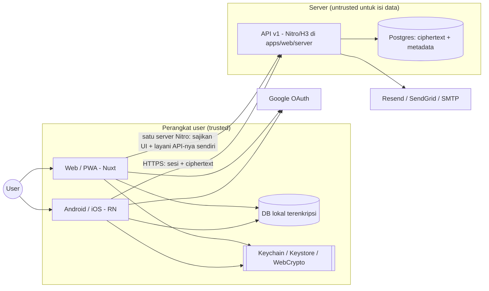
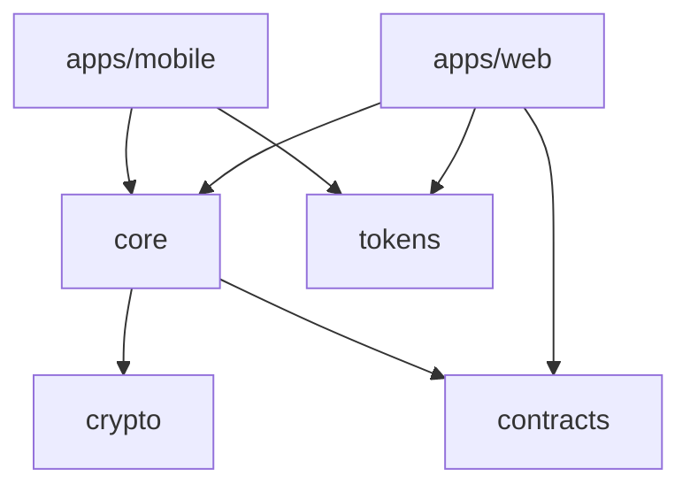
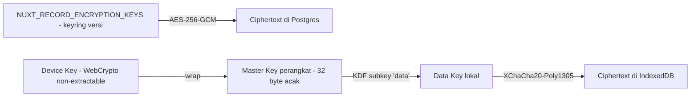
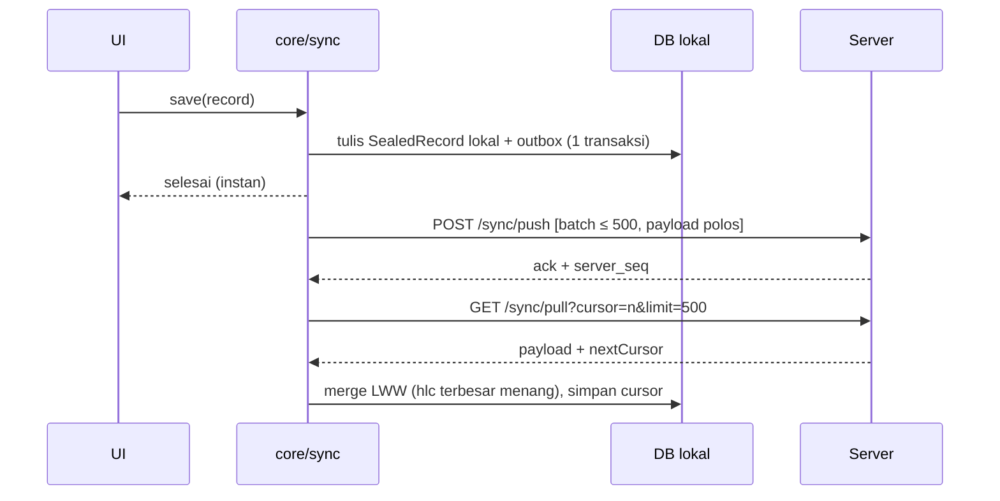

# Architecture — Improve Personal

Pegangan arsitektur. Sumber kebenaran produk: `docs/PRD.md`. Aturan tiga pilar: `CLAUDE.md` + `apps/<app>/.claude/rules/`.
Kalau dokumen ini bentrok sama kode, update salah satunya di PR yang sama - jangan dibiarkan beda.

---

## 0. Pertanyaan terbuka

### Sudah diputuskan (dulu daftarnya di sini)

**Q1/Q2 (recovery key & envelope kunci) sudah tidak relevan: tidak ada kunci user.**
Keputusan terbaru ada di ADR 14 - enkripsi at-rest dipindah ke server (AES-256-GCM, keyring di env),
dan salinan lokal dienkripsi kunci perangkat yang dibuat otomatis. Passkey, kode pemulihan 24 kata,
QR transfer, KID, dan tabel relay kunci dihapus. Konsekuensinya jujur: server bisa membaca data, dan
kunci env wajib di-backup terpisah karena ia satu-satunya pembuka database.

### Default (diasumsikan, bisa diganti)

| # | Topik | Rekomendasi = default |
|---|---|---|
| Q3 | Stack server | **Nitro/H3** di dalam `apps/web` (`server/routes/v1/**`) + **PostgreSQL** + **Drizzle**. Tipis (auth + relay ciphertext), TypeScript bareng client, kontrak dari `packages/contracts`. Nggak ada app server terpisah (ADR 7 direvisi). |
| Q4 | Mobile | **Expo** (dev build, Expo Router, EAS Build/Update). |
| Q5 | Monorepo tool | **pnpm workspaces + Turborepo**. |
| Q6 | Library kripto | **libsodium** (`libsodium-wrappers-sumo` di web, `react-native-libsodium` di native) untuk enkripsi salinan LOKAL (XChaCha20-Poly1305). Enkripsi at-rest server memakai `node:crypto` AES-256-GCM. |
| Q7 | Data lokal di web terenkripsi? | Ya: IndexedDB menyimpan ciphertext dengan kunci perangkat yang dibuat otomatis. Native: SQLite + SQLCipher. |

---

## 1. Prinsip

1. **Local-first.** Semua baca/tulis ke DB lokal dulu → UI instan, jalan penuh offline. Server bukan sumber kebenaran.
2. **Server memegang kunci at-rest.** Isi record disimpan ciphertext (AES-256-GCM) dengan kunci di env server. Server bisa membuka data; itu trade-off sadar supaya data tidak hilang saat perangkat berganti (ADR 14).
3. **Login = akses.** Login (OTP/Google) memberi sesi API, dan sesi itulah yang membuka data. Tidak ada langkah unlock atau kunci user yang perlu dipulihkan.
4. **Logika sekali, UI dua kali.** Domain, repository, sync, kripto ditulis sekali di `packages/*` (TS murni). Nuxt & RN cuma UI + adapter platform.
5. **Tiga pilar wajib** (keamanan, performa, kerapian) di setiap perubahan.

---

## 2. Konteks sistem



**Trust boundary:** transport memakai TLS; isi record disegel server sebelum masuk database. Server (dan pemegang kunci env) bisa membaca data - lihat ADR 14.

---

## 3. Struktur monorepo

```
improve-personal/
├── apps/
│   ├── web/                 # Nuxt 4 - web desktop + PWA; API v1 (auth + sync relay) jalan di server/ (Nitro/H3)  (+ ARCHITECTURE.md, docs/PRD.md)
│   └── mobile/              # Expo / React Native - Android + iOS  (+ ARCHITECTURE.md, docs/PRD.md)
├── packages/
│   ├── core/                # domain + use case + repository interface + sync engine
│   ├── (crypto lokal hidup di `apps/web/app/utils/crypto` sampai mobile mulai)
│   ├── contracts/           # schema zod API + DTO + versi protokol
│   ├── tokens/              # design token → CSS vars (web) & theme object (RN)
│   └── config/              # tsconfig, eslint, prettier, vitest preset bersama
├── docs/PRD.md              # sumber kebenaran produk - di-symlink ke docs/ tiap app
├── CLAUDE.md                # aturan bersama (per app: apps/<app>/CLAUDE.md)
├── ARCHITECTURE.md          # arsitektur root - cuma hal lintas app (per app: §10)
├── pnpm-workspace.yaml · turbo.json
└── .claude/                 # settings, agents
```

Nggak ada app server terpisah: `apps/server` tidak ada dan tidak akan dibuat - API (auth + relay ciphertext) tinggal di `apps/web/server/**` dan dilayani Nitro/H3 di app yang sama (ADR 7 direvisi). Karena itu `apps/web` di-build sebagai preset server (Node), bukan situs statis di CDN.

### Aturan dependensi



- `packages/*` **dilarang** import Vue, React, Nuxt, React Native, Node API (`fs`, `crypto` Node), atau DOM. Kebutuhan platform masuk lewat interface (lihat §5).
- Kode server di `apps/web/server/**` **cuma boleh** import `contracts` - **dilarang** import `core` / `crypto`, karena server nggak boleh punya kemampuan dekripsi. Nggak ada app server terpisah, jadi aturan ini berlaku untuk folder `server/` di dalam app web (ADR 7 direvisi).
- `apps/web` dan `apps/mobile` nggak saling import.
- Dicek otomatis di CI (`eslint-plugin-boundaries` atau `dependency-cruiser`).

---

## 4. `packages/core` - isi modul

```
packages/core/src/
├── domain/        # entitas + aturan murni: schedule, todo, eisenhower, pomodoro,
│                  # countdown, habit, memo, goal, sticker, decoration
├── recurrence/    # engine F1 (ekspansi per rentang, exception, edit 3 opsi)
├── calc/          # sisa waktu, countdown unit, streak, progress goal, agregasi Overview
├── repository/    # interface Repository<T> + query by range
├── sync/          # outbox, push/pull, HLC, LWW merge, status
├── io/            # import/export JSON + validasi skema + migrasi versi
└── ports.ts       # interface yang diimplementasi tiap platform
```

Semua fungsi di `domain/`, `recurrence/`, `calc/` **murni** (input → output, tanpa I/O, tanpa `Date.now()` langsung - waktu di-inject). Ini yang bikin unit test PRD (recurrence, streak, progress, dll) gampang dan deterministik.

---

## 5. Port & adapter

| Port (di `core/ports.ts`) | Web (Nuxt) | Mobile (Expo) |
|---|---|---|
| `StorageAdapter` | IndexedDB via `idb` | SQLite via `expo-sqlite` + SQLCipher |
| `SecureKeyStore` | WebCrypto non-extractable key di IndexedDB + WebAuthn | `expo-secure-store` (Keychain/Keystore) + biometrik |
| `CryptoProvider` | libsodium-wrappers | react-native-libsodium |
| `Clock` | `Date.now` + HLC | sama |
| `HttpClient` | `$fetch` | `fetch` |
| `Scheduler` | `setTimeout` + `visibilitychange` | `AppState` |

Satu **contract test suite** di `packages/core/test/adapters/` dijalankan ke tiap `StorageAdapter` - IndexedDB dan SQLite harus lolos test yang sama (AC T23).

### Aturan penyimpanan lokal (wajib)

Keamanan data di sini tidak datang dari pilihan library, tapi dari cara pakainya. Library yang benar tetap bisa kehilangan data kalau aturan ini dilanggar.

- **Server buta, client yang tahu.** Prinsip induk; semua aturan di bawah ikut dari sini.
- **Tulis lokal dulu, selalu.** UI tidak pernah menunggu jaringan. Kalau ragu antara kirim dulu atau simpan dulu - simpan dulu.
- **Record + outbox dalam SATU transaksi.** Kalau tidak, crash di antara keduanya bikin data tersimpan tapi tidak pernah terkirim - hilang diam-diam.
- **Satu penulis per origin di web** (`navigator.locks`, mis. lock `ip-writer`). IndexedDB tidak punya lock antar tab, jadi dua tab bisa saling menimpa. `BroadcastChannel` cuma memberi tahu, bukan mengunci.
- **Dilarang `await` non-IndexedDB di dalam transaksi** (fetch, timer, apa pun). Transaksi IndexedDB auto-commit begitu tidak ada request pending, jadi tulisan sisanya hilang tanpa error.
- **Durability transaksi tulis: `strict`.** Default Chrome sekarang `relaxed` - commit terakhir bisa hilang saat mati listrik, OS crash, atau disk penuh.
- **Mobile: `synchronous = FULL`** untuk transaksi record + outbox. WAL dengan `NORMAL` masih bisa kehilangan transaksi terakhir saat mati listrik.
- **`navigator.storage.persist()` wajib dipanggil** dan PWA didorong untuk di-install. Tanpa itu browser bisa menghapus storage (Safari membersihkan situs yang tidak dibuka ~7 hari kalau tidak di-install).
- **Tulis per record.** Dilarang pola hapus-semua-lalu-tulis-ulang.
- **Restore wajib diuji, bukan diasumsikan.** Drill: hapus total storage di perangkat bersih, login, lalu pastikan seluruh data kembali dari server. Salinan lokal boleh hilang; berkas export adalah jalur tambahan, bukan satu-satunya.
- Sync engine boleh memahami isi record karena server memegang kunci at-rest (ADR 14). Yang tetap dilarang: mengirim kunci perangkat ke server.

---

## 6. Model data

### Envelope record (sama untuk semua entitas)

```ts
// lokal (setelah decrypt, cuma di memori)
type Record<T> = {
  id: string            // UUIDv7 (urut waktu, dibuat di client)
  type: EntityType      // 'todo' | 'schedule' | 'memo' | ...
  hlc: string           // hybrid logical clock: `${wallMs}-${counter}-${deviceId}`
  deleted: boolean      // tombstone
  schemaVersion: number
  data: T               // isi entitas
}

// yang ditulis ke disk LOKAL (disegel kunci perangkat)
type SealedRecord = { id, hlc, deleted, blob }

// yang dikirim ke server (payload polos; server menyegelnya sendiri)
type SyncRecordDto = { id, hlc, deleted, payload }
```

- `type`/`schemaVersion`/`data` ada di dalam `payload`; server tidak menafsirkan isinya, hanya menyegel dan membukanya kembali.
- Metadata `id`, `hlc`, `deleted` ikut AAD ciphertext server, jadi baris tidak bisa dipindah ke akun/record lain atau diubah metadatanya tanpa membuat dekripsi gagal.
- Salinan lokal memakai blob v2 (XChaCha20-Poly1305, AAD mengikat KID lokal, akun, record, HLC, `deleted`, padding 256 B) - konstanta di `packages/contracts/src/record-format.ts`.
- Index lokal untuk query rentang tanggal disimpan di tabel index terpisah; jalur panas = query index, bukan decrypt semua record.

### Entitas utama

`Schedule` (+ `ScheduleException`, `Occurrence` status) · `Todo` · `EisenhowerPlacement` · `PomodoroSession` · `PomodoroSettings` · `Countdown` · `Habit` (+ `HabitCheckin`) · `Memo` (mood, mention) · `Goal` (+ `Chapter`, `GoalLink`, `GoalCategory`) · `Decoration` (per breakpoint) · `UserPrefs`.
Relasi pakai ID (`todo.scheduleId`, `goalLink.itemId`). Referensi ke record yang udah dihapus wajib ditangani aman (PRD: mention ke jadwal terhapus nggak error).

### Server (Postgres)

```
users(id, email, created_at)
devices(id, user_id, name, last_seen_at, last_ip_city, revoked_at)
sessions(id, device_id, token_hash, expires_at)
otp_challenges(id, email_hash, code_hash, expires_at, attempts)
records(user_id, id, hlc, hlc_wall_ms, hlc_counter, hlc_device, deleted,
        blob BYTEA, key_version SMALLINT, server_seq BIGSERIAL)   -- PK (user_id, id)
sync_watermarks(user_id, purged_seq)
rate_limits(scope, bucket, window_start, count)
```

`blob` = ciphertext AES-256-GCM milik server (`ips1 | key_version | iv | tag | ciphertext`).
`server_seq` = cursor pull. Tidak ada kolom plaintext data user.

---

## 7. Kripto & kunci



**Sisi server (at-rest).**
- `records.blob` = `"ips1" | keyVersion(u16) | iv(12) | tag(16) | ciphertext`, AES-256-GCM dari `node:crypto`.
- AAD = `ips1|keyVersion|userId|recordId|hlc|deleted` - mencegah baris dipindah ke akun/record lain dan metadata diubah tanpa terdeteksi.
- Kunci: keyring `versi:base64-32-byte` di `NUXT_RECORD_ENCRYPTION_KEYS`; versi aktif di `NUXT_RECORD_ENCRYPTION_ACTIVE_VERSION`. Versi lama tetap dibaca, jadi rotasi tidak mengunci data lama. Tidak ada kunci default; env hilang/invalid = server menolak start.
- Kunci env adalah SATU-SATUNYA pembuka data. Wajib disimpan di secret manager/backup terpisah dari database.

**Sisi perangkat (salinan lokal).**
- MK 32 byte acak per perangkat, dibungkus `CryptoKey` non-extractable (AES-KW). Turunannya dipakai menyegel `record` di IndexedDB.
- MK hilang (data situs dihapus) bukan kehilangan data: salinan lokal dibuang, kunci baru dibuat, lalu full pull dari server.
- Tidak ada passkey, recovery 24 kata, QR transfer, atau envelope kunci di server. KID hanya dipakai sebagai bagian AAD blob lokal, tidak pernah dikirim ke server.

**Dilarang:** log kunci/payload/ciphertext, mengirim kunci perangkat ke mana pun, atau membuat algoritma sendiri.

## 8. Auth

- Email OTP: kode 6 digit, hash di DB, TTL ≤ 10 menit, sekali pakai, rate limit per email + per IP. Respons selalu generik (nggak bocorin email terdaftar).
- Transport email: production pakai **Resend** (kode random); non-production pakai **SMTP lewat `NUXT_SMTP_URL`** kalau terisi (nodemailer) - juga kode random, jadi mode OTP fix mati otomatis begitu ada transport email. `NUXT_MAIL_FROM` wajib diisi kalau ada transport email (SMTP di non-production, Resend di production).
- OTP fix `777777`: cuma kalau `APP_ENV ∈ {development, staging, test, preview}` **dan** `NUXT_SMTP_URL` kosong. Env kosong/lain = production. Server **nolak start** kalau `APP_ENV=production` dan mode fix aktif.
- Production **nolak start** kalau `NUXT_SMTP_URL` ikut terisi - tanda berkas env non-production kebaca di deployment production. Ada test-nya.
- Google: Authorization Code + PKCE, validasi `state`, `nonce`, ID token (`aud`, `iss`, `exp`).
- Sesi: token opaque per perangkat (hash di DB). Web: cookie `HttpOnly; Secure; SameSite=Lax`. Mobile: `SecureStore`. Revoke per perangkat = hapus sesi.
- Setiap endpoint: `user_id` diambil dari sesi, **bukan** dari body/param.

---

## 9. Sync



- **Kapan sync:** saat app dibuka, setelah tulis (debounce ~2 dtk), tiap 5 menit di foreground, saat online lagi.
- **Konflik:** bandingkan `hlc` (HLC, bukan jam device mentah → aman dari jam HP yang ngaco). Tie → `deviceId` terbesar.
- **Server:** upsert hanya kalau `hlc` masuk > `hlc` tersimpan. Server menyegel `payload` sebelum insert dan membukanya saat pull.
- **Hapus:** tombstone ikut sync. Purge tombstone > 90 hari (setelah semua perangkat aktif lewat cursor-nya).
- **Status UI:** `synced | pending | offline | error` dari `core/sync`, dipakai web & mobile.
- Sync jalan di background, nggak pernah blok UI. Penyegelan lokal batch besar di luar render (web/mobile).

### API (versi di path, schema di `packages/contracts`)

```
POST /v1/auth/otp/request      POST /v1/auth/otp/verify
GET  /v1/auth/google/start     GET  /v1/auth/google/callback
POST /v1/auth/logout           GET  /v1/devices
DELETE /v1/devices/:id         GET  /v1/auth/session
POST /v1/sync/push             GET  /v1/sync/pull
POST /v1/account/deletion-otp  DELETE /v1/account
GET  /health
```

Tidak ada endpoint kunci: kunci at-rest milik server, jadi tidak ada envelope/transfer/KID yang perlu direlay. `x-expected-user-id` tetap wajib untuk klien berbasis cookie.

Bentuk respons seragam untuk SEMUA endpoint: sukses `{ data: <DTO> }`, gagal `{ error: { code, message, details? } }` dengan status dari `ERROR_HTTP_STATUS`; endpoint yang memang nggak punya body (logout, revoke perangkat, hapus akun, permintaan OTP) balas `204` tanpa body. Pembungkusan sukses terpusat di `apps/web/server/utils/api-error.ts` (bukan diulang di tiap route), dan schema-nya satu sumber di `packages/contracts/src/protocol.ts` (`apiDataEnvelopeSchema`, `apiErrorBodySchema`, `apiResponseSchema`) supaya web & mobile nggak merakit amplop sendiri.

Endpoint ini dilayani Nitro di dalam `apps/web` (`server/routes/v1/**`), bukan app terpisah.

---

## 10. Arsitektur per app

Detail tiap app ada di dokumennya sendiri. Root ini cuma nampung hal yang berlaku buat semua.

| App | Dokumen | Isi |
|---|---|---|
| `apps/web` (Nuxt 4) | [`apps/web/ARCHITECTURE.md`](apps/web/ARCHITECTURE.md) | Struktur `app/`, mode render, PWA, state (Pinia) |
| `apps/mobile` (Expo) | [`apps/mobile/ARCHITECTURE.md`](apps/mobile/ARCHITECTURE.md) | Struktur, adapter native, kunci app, build & OTA |
| API server (di dalam `apps/web`) | [`apps/web/ARCHITECTURE.md`](apps/web/ARCHITECTURE.md) | Struktur `server/**`, route `/v1/**`, auth, relay sync - nggak ada app terpisah (ADR 7 direvisi) |

Aturan:

- Dokumen app boleh nambah detail, tapi **dilarang nulis ulang** hal root (§5–§9). Kalau bentrok, root yang menang dan selisihnya dibenerin di PR yang sama.
- Tiap app punya `docs/PRD.md` sebagai **symlink** ke `../../docs/PRD.md`, bukan salinan.
- Dokumen app nggak boleh nampung aturan lintas app (§11) - itu tetap di sini.

### Server DI DALAM `apps/web` (Nitro/H3)

Nggak ada app server terpisah - API (auth + relay ciphertext) tinggal di `apps/web/server/**`.

```
server/
├── routes/         # endpoint /v1/** per resource: auth, devices, keys, sync, account
├── services/       # logika (OTP, sesi, sync upsert)
├── db/             # drizzle schema + migrasi
├── middleware/     # auth, rate limit, request id, error handler
├── utils/          # validasi env (zod) - gagal start kalau invalid
└── tasks/          # job terjadwal (purge tombstone, bersihkan OTP kedaluwarsa)
```

Detail struktur server ada di [`apps/web/ARCHITECTURE.md`](apps/web/ARCHITECTURE.md) §1.

---

## 11. Hal lintas fitur

- **Waktu:** simpan instan sebagai epoch ms UTC + simpan `tz` untuk jadwal berulang. Ekspansi recurrence pakai zona waktu perangkat. Minggu mulai Senin.
- **Timer global:** satu ticker per app (bukan per item) untuk sisa waktu / countdown (AC T5).
- **Teks user:** render sebagai teks. Markdown memo lewat sanitizer (DOMPurify di web, renderer markdown tanpa HTML di RN). Dilarang `v-html` / `dangerouslySetInnerHTML` dari input mentah.
- **Import:** validasi schema penuh + cek versi **sebelum** nulis apa pun. Batas ukuran file. Export kasih peringatan "file nggak terenkripsi".
- **Sticker:** aset statis per pack, lazy-load, di-precache untuk offline. Layer hias: `pointer-events: none` di luar mode hias, posisi dalam % relatif elemen, disimpan per breakpoint (HP/tablet/desktop).
- **Bahasa:** UI Indonesia; string tetap lewat i18n (`@nuxtjs/i18n` / `i18next`) biar gampang ditambah.

---

## 12. Environment & deploy

| Env | Web (Nitro: UI + API) | Mobile | Host server | OTP |
|---|---|---|---|---|
| development | `nuxi dev` (Nitro lokal, sekaligus API) | Expo dev build | lokal + Postgres docker | email via SMTP (Mailpit), atau `777777` kalau `NUXT_SMTP_URL` kosong |
| preview | per PR (Nitro Node) | EAS internal | preview | `777777`, atau email via SMTP kalau `NUXT_SMTP_URL` diisi |
| staging | staging URL (Nitro Node) | EAS internal/TestFlight | staging | `777777`, atau email via SMTP kalau `NUXT_SMTP_URL` diisi |
| production | Nitro Node server (sajikan UI + API `/v1/*`) | Play Store / App Store | host Node produksi + Postgres | random via email (Resend) |

- Transport email: `NUXT_SMTP_URL` (`smtp://…`/`smtps://…`, nodemailer) kalau terisi = email benar-benar dikirim, dan mode OTP fix `777777` **mati otomatis** di env itu. Kalau kosong, non-production balik ke `777777` tanpa kirim email; production tetap Resend (`NUXT_RESEND_API_KEY`) + `NUXT_MAIL_FROM`. `NUXT_MAIL_FROM` wajib diisi kalau ada transport email.
- **Konteks lokal:** Mailpit jalan sebagai container `local-mailpit` (axllent/mailpit) - SMTP `127.0.0.1:1025`, UI inbox `http://127.0.0.1:8025`. `apps/web/.env.example` memuat `NUXT_SMTP_URL=smtp://127.0.0.1:1025`.
- Web = satu Nitro Node server yang sajikan UI + API `/v1/*` (bukan static/SPA build di CDN) - konsekuensinya butuh host Node (container, mis. Dokploy), nggak bisa cuma CDN statis. Postgres managed + backup harian.
- Secret cuma dari env/secret manager. `.env*` nggak di-commit.
- Mobile OTA (EAS Update) cuma JS; ditandatangani, channel per env.

---

## 13. Quality gate (CI)

Wajib lulus sebelum merge:
1. `pnpm lint` (termasuk aturan boundary §3) + `typecheck`
2. Unit test `packages/*` (recurrence, calc, crypto, sync, io) - coverage ≥ 80%
3. Contract test adapter storage (IndexedDB & SQLite)
4. Test server: auth, OTP per env (termasuk `777777` ditolak di production), ownership
5. Build web + PWA + Android + iOS
6. `pnpm audit` - High/Critical = blok
7. Budget performa sesuai `apps/<app>/.claude/rules/performance.md`

E2E (T16): Playwright (web/PWA) + Maestro (mobile), termasuk skenario 2 perangkat offline → online.

---

## 14. Keputusan arsitektur (ADR ringkas)

| # | Keputusan | Alasan | Trade-off |
|---|---|---|---|
| 1 | Local-first + server relay | Offline penuh, UI instan, privasi | Sync & konflik jadi tanggung jawab client |
| 2 | ~~Login terpisah dari unlock~~ **digantikan ADR 14** | - | - |
| 3 | LWW per record pakai HLC | Cukup untuk 1 user, simpel | Edit bersamaan di 2 perangkat: satu kalah utuh |
| 4 | ~~`type` ikut dienkripsi~~ **digantikan ADR 14**: `payload` disegel server | Server tetap tidak menyimpan kolom tipe | Server bisa membuka payload dengan kunci env |
| 5 | Logika di `packages/*` murni | Satu sumber logika web & mobile, test deterministik | Butuh disiplin port/adapter |
| 6 | Web app `ssr: false` - **direvisi 2026-10-17** | Data user nggak ada di server, SSR cuma risiko. Revisi: halaman app tetap `ssr: false`, tapi output build web bukan lagi static - API `/v1/*` dilayani di app yang sama (`server/routes/v1/**`), jadi build-nya preset server (Node) | SEO cuma untuk halaman publik; `apps/web` nggak bisa lagi disajikan sebagai situs statis dari CDN - butuh host Node |
| 7 | Server terpisah (`apps/server`) - **direvisi 2026-10-17** | Dulu: dipakai web & mobile, deploy & skala independen. Revisi: API (auth + relay ciphertext) tinggal DI DALAM `apps/web` (`server/routes/v1/**`, Nitro/H3) - satu app, satu deploy, kontrak & sesi lebih gampang karena nggak ada boundary app. `apps/server` tidak ada dan tidak akan dibuat | Keuntungan: nggak ada deploy kedua. Kerugian: `apps/web` nggak bisa lagi disajikan sebagai situs statis dari CDN (butuh host Node), dan mobile bergantung pada API yang di-host bareng frontend web |
| 8 | libsodium di dua platform | Primitive identik, teruji | Ukuran bundle web +~200 KB (lazy-load setelah login) |
| 9 | Pinia di web sebagai **proyeksi reaktif**, bukan pemilik data | 16 fitur saling silang (task ↔ Eisenhower/kalender/Daily/goal/Overview) butuh satu sumber reaktif + getter turunan; `useState` per-key nggak punya getter, action, plugin, atau devtools, dan makin susah dirawat di skala ini | Ada satu lapisan cache lagi di atas repo → butuh disiplin: store nggak boleh nulis langsung ke DB, semua mutasi lewat use case `core` (kalau nggak, outbox & tombstone T21 bocor) |
 10 | ~~dihapus oleh ADR 14~~ | Kunci user tidak ada lagi | - |
 11 | ~~dihapus oleh ADR 14~~ | Kunci user tidak ada lagi | - |
 12 | ~~dihapus oleh ADR 14~~ | Kunci user tidak ada lagi | - |
| 13 | ~~KID + blob record v2 di server~~ **digantikan ADR 14**: KID hanya AAD blob lokal | Server tidak lagi memvalidasi KID | Tidak ada deteksi split-brain karena tidak ada kunci user |
| 14 | **Enkripsi at-rest di server** (AES-256-GCM, keyring di env) + salinan lokal berkunci perangkat; hapus passkey/recovery/QR/KID | Tujuan produk: data tidak boleh hilang karena user kehilangan kunci. E2EE membuat server tidak bisa memulihkan apa pun, dan menjaga kunci user adalah beban yang terus memakan korban | Server (pemegang env) bisa membaca data dan menjadi single point of failure; wajib backup kunci terpisah. Performa naik karena pull tidak perlu dekripsi di client untuk index |
