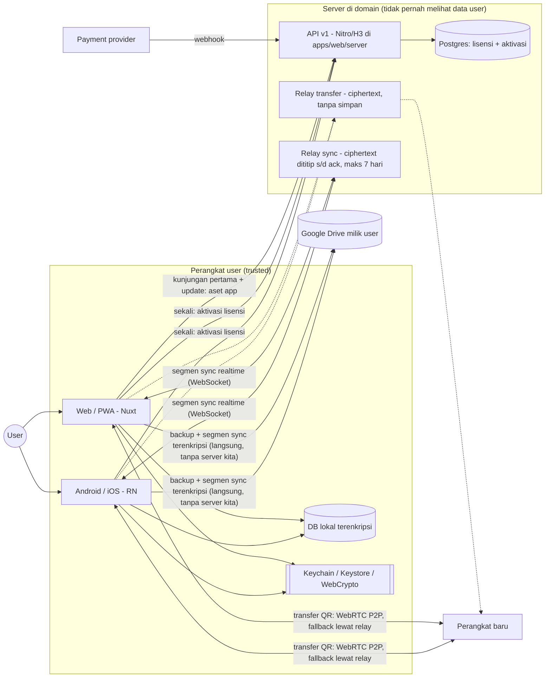
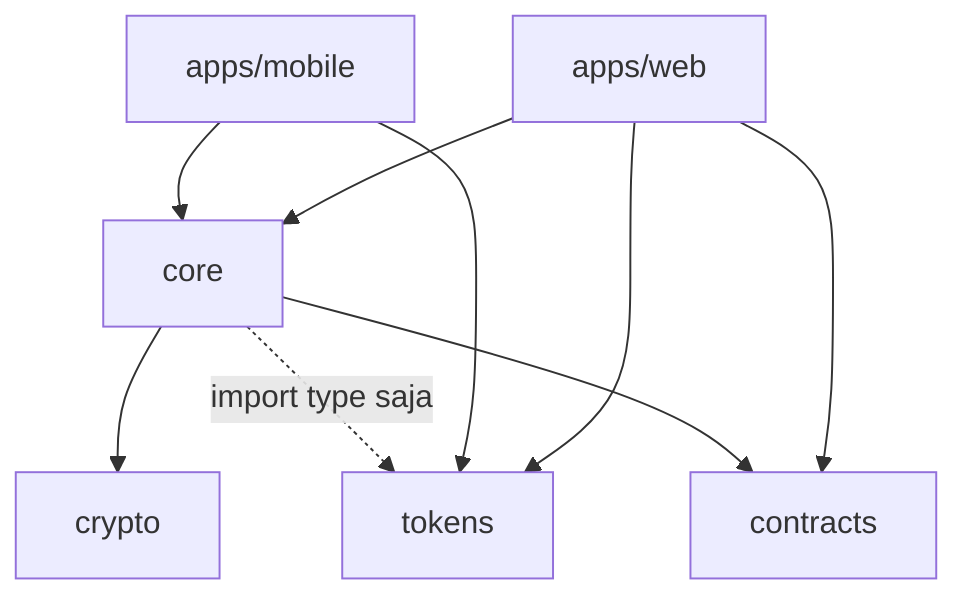
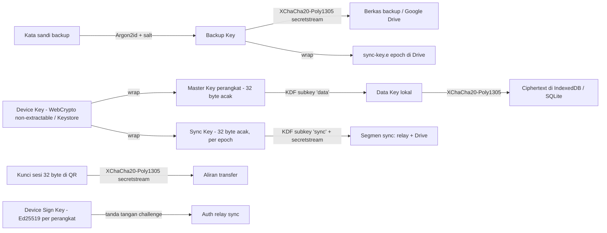
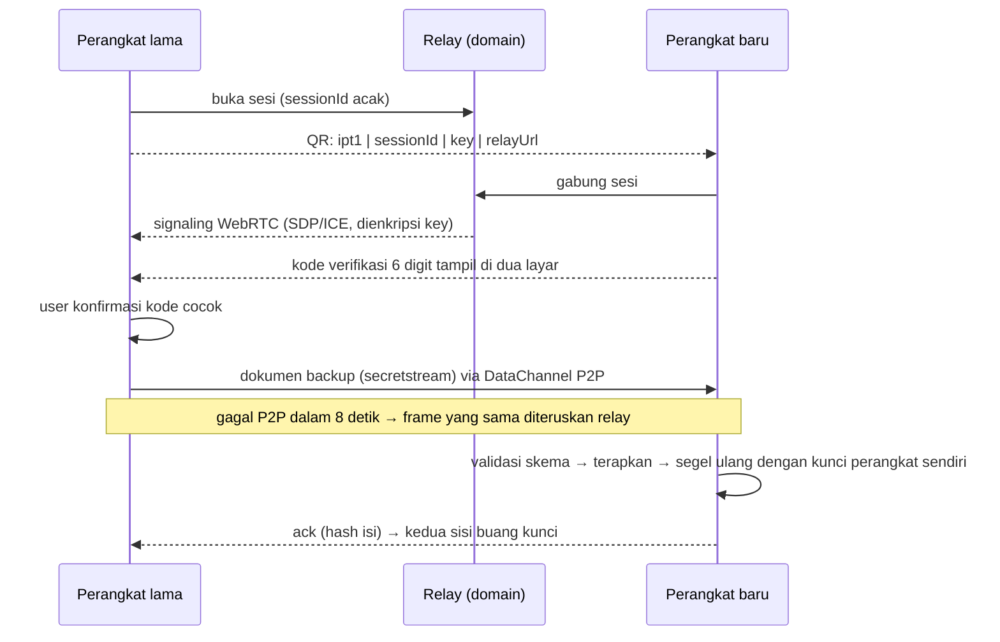

# Architecture — Improve Personal

Pegangan arsitektur. Sumber kebenaran produk: `docs/PRD.md`. Aturan tiga pilar: `CLAUDE.md` + `apps/<app>/.claude/rules/`.
Kalau dokumen ini bentrok sama kode, update salah satunya di PR yang sama - jangan dibiarkan beda.

---

## 0. Pertanyaan terbuka

### Sudah diputuskan (dulu daftarnya di sini)

**Keputusan terbaru: ADR 15 (2026-11-16) - local-only + E2E, dijual sekali beli.** Menggantikan ADR 14.
Data user tidak pernah meninggalkan perangkat dalam bentuk terbaca: tidak ada akun, tidak ada sync
server, tidak ada enkripsi at-rest di server. Domain tetap menyajikan app (kunjungan pertama + update)
dan menerbitkan lisensi; setelah itu app jalan penuh lokal. Pindah perangkat lewat **transfer QR**
(WebRTC + relay ciphertext, fallback animated QR full offline) atau **berkas backup terenkripsi kata
sandi**, plus **backup terjadwal ke Google Drive milik user**. Konsekuensinya jujur: perangkat hilang
tanpa backup = data hilang, dan tidak ada pihak yang bisa memulihkannya.

**Revisi harga: ADR 16 (2026-11-17) - tiga paket prabayar.** Bulanan Rp19.000 (30 hari), tahunan
Rp99.000 (365 hari), lifetime Rp249.000. Tanpa perpanjangan otomatis: perpanjang = beli lagi. Token
lisensi kini membawa tanggal habis; lisensi habis = app **baca-saja** (data tetap bisa dilihat,
diekspor, di-backup, dan dipindah), bukan terkunci. Bagian lain ADR 15 tetap berlaku.

**Sync antar perangkat: ADR 17 (2026-11-24) - sync E2E dua lapis.** Merevisi "tidak ada sync" di
ADR 15, prinsip E2E-nya tetap. DB lokal tetap sumber kebenaran tiap perangkat; perubahan disebar
sebagai **segmen terenkripsi Sync Key** (kunci bersama milik user, tidak pernah ke server) lewat dua
lapis: (1) **relay store-and-forward** di server kita (pola WhatsApp: ciphertext dititip sampai semua
perangkat ack, maks 7 hari, lalu dihapus; kuota fair use + saklar mati) untuk realtime, dan (2) **Google Drive milik user**
(`appDataFolder`) sebagai lapis tahan lama + backup. Merge tetap LWW HLC (ADR 3). Detail: §9.

### Default (diasumsikan, bisa diganti)

| # | Topik | Rekomendasi = default |
|---|---|---|
| Q3 | Stack server | **Nitro/H3** di dalam `apps/web` (`server/routes/v1/**`) + **PostgreSQL** + **Drizzle**. Tipis: webhook pembayaran + aktivasi lisensi via email OTP/Google + relay transfer (ciphertext, tanpa simpan) + relay sync (ciphertext titipan s/d ack, ADR 17) + proxy cuaca. Tidak ada data user yang terbaca. Nggak ada app server terpisah (ADR 7 direvisi). |
| Q4 | Mobile | **Expo** (dev build, Expo Router, EAS Build/Update). |
| Q5 | Monorepo tool | **pnpm workspaces + Turborepo**. |
| Q6 | Library kripto | **libsodium** (`libsodium-wrappers-sumo` di web, `react-native-libsodium` di native) untuk salinan lokal, berkas backup (Argon2id + XChaCha20-Poly1305), dan kanal transfer (`secretstream`). Server hanya memakai Ed25519 untuk menandatangani lisensi. |
| Q7 | Data lokal di web terenkripsi? | Ya: IndexedDB menyimpan ciphertext dengan kunci perangkat yang dibuat otomatis. Native: SQLite + SQLCipher. |

---

## 1. Prinsip

1. **Local-first.** DB lokal adalah sumber kebenaran tiap perangkat. Semua baca/tulis lokal → UI instan, jalan penuh offline. Sync hanya menyebar ciphertext antar perangkat milik user (ADR 17); server tidak pernah menjadi sumber data.
2. **Data tidak pernah keluar dalam bentuk terbaca.** Yang meninggalkan perangkat hanya ciphertext dengan kunci yang tidak pernah dipegang server: berkas backup (kunci dari kata sandi), segmen sync di relay & Google Drive (Sync Key), dan transfer QR (kunci sekali pakai di QR).
3. **Lisensi = akses.** Tidak ada akun yang membuka data. Login email (OTP/Google) hanya membuktikan email pembeli saat aktivasi; token lisensi ditandatangani server sekali, lalu diverifikasi offline dengan public key yang ditanam di app.
4. **Logika sekali, UI dua kali.** Domain, repository, sync, kripto ditulis sekali di `packages/*` (TS murni). Nuxt & RN cuma UI + adapter platform.
5. **Tiga pilar wajib** (keamanan, performa, kerapian) di setiap perubahan.

---

## 2. Konteks sistem



**Trust boundary:** server hanya tahu akun login (email), lisensi, perangkat yang diaktivasi, dan metadata sync (perangkat pengirim/penerima, ukuran, waktu). Isi data hanya terbaca di perangkat; semua salinan di luar perangkat (berkas backup, Drive, segmen sync, aliran transfer) dienkripsi dengan kunci yang tidak pernah dikirim ke server. Relay transfer tidak menyimpan apa pun; relay sync menitip ciphertext sampai semua perangkat ack (maks 7 hari).

---

## 3. Struktur monorepo

```
improve-personal/
├── apps/
│   ├── web/                 # Nuxt 4 - web desktop + PWA; API v1 (auth + sync relay) jalan di server/ (Nitro/H3)  (+ ARCHITECTURE.md, docs/PRD.md)
│   └── mobile/              # Expo / React Native - Android + iOS  (+ ARCHITECTURE.md, docs/PRD.md)
├── packages/
│   ├── core/                # domain + use case + repository interface + merge, io, transfer, license
│   ├── (crypto lokal hidup di `apps/web/app/utils/crypto` sampai mobile mulai)
│   ├── contracts/           # schema zod API + DTO + versi protokol
│   ├── tokens/              # design token → CSS vars (web) & theme object (RN)
│   └── config/              # tsconfig, eslint, prettier, vitest preset bersama
├── docs/PRD.md              # sumber kebenaran produk - di-symlink ke docs/ tiap app
├── CLAUDE.md                # aturan bersama (per app: apps/<app>/CLAUDE.md)
├── ARCHITECTURE.md          # arsitektur root - cuma hal lintas app (per app: §10)
├── pnpm-workspace.yaml · turbo.json
└── .claude/                 # settings, agents
```

Nggak ada app server terpisah: `apps/server` tidak ada dan tidak akan dibuat - API (lisensi + relay transfer + proxy cuaca) tinggal di `apps/web/server/**` dan dilayani Nitro/H3 di app yang sama (ADR 7 direvisi). Karena itu `apps/web` di-build sebagai preset server (Node), bukan situs statis di CDN.

### Aturan dependensi



- `core` boleh `import type` dari `tokens` (hanya tipe: `IconName`, `MemoPaperName`) - tanpa nilai runtime, jadi data ikon tidak ikut ke bundle core.
- `packages/*` **dilarang** import Vue, React, Nuxt, React Native, Node API (`fs`, `crypto` Node), atau DOM. Kebutuhan platform masuk lewat interface (lihat §5).
- Kode server di `apps/web/server/**` **cuma boleh** import `contracts` - **dilarang** import `core` / `crypto`, karena server nggak boleh punya kemampuan dekripsi. Nggak ada app server terpisah, jadi aturan ini berlaku untuk folder `server/` di dalam app web (ADR 7 direvisi).
- `apps/web` dan `apps/mobile` nggak saling import.
- Dicek otomatis di CI (`eslint-plugin-boundaries` atau `dependency-cruiser`).

---

## 4. `packages/core` - isi modul

```
packages/core/src/
├── domain/        # entitas + aturan murni: schedule, todo, eisenhower, pomodoro,
│                  # countdown, habit, memo, goal, sticker, decoration
├── planner/       # model presentasi + logika murni fitur harian (jadwal, to-do, habit, goal, countdown, pomodoro, memo, jurnal, overview); sub-path `@improve-personal/core/planner`, tidak di barrel karena nama bentrok dengan entitas `domain/`
├── recurrence/    # engine F1 (ekspansi per rentang, exception, edit 3 opsi)
├── calc/          # sisa waktu, countdown unit, streak, progress goal, agregasi Overview
├── repository/    # interface Repository<T> + query by range
├── sync/          # HLC + LWW merge, outbox, segmen sync, cursor per perangkat, snapshot Drive, Sync Key (ADR 17)
├── io/            # import/export JSON + berkas backup terenkripsi + validasi skema + migrasi versi
├── transfer/      # protokol transfer QR: payload QR, framing, fountain code animated QR (tanpa I/O)
├── license/       # verifikasi token lisensi Ed25519 (murni, public key di-inject)
└── ports.ts       # interface yang diimplementasi tiap platform
```

Semua fungsi di `domain/`, `recurrence/`, `calc/`, `planner/` **murni** (input → output, tanpa I/O, tanpa `Date.now()` langsung - waktu di-inject). Ini yang bikin unit test PRD (recurrence, streak, progress, dll) gampang dan deterministik.

---

## 5. Port & adapter

| Port (di `core/ports.ts`) | Web (Nuxt) | Mobile (Expo) |
|---|---|---|
| `StorageAdapter` | IndexedDB via `idb` | SQLite via `expo-sqlite` + SQLCipher |
| `SecureKeyStore` | WebCrypto non-extractable key di IndexedDB + WebAuthn | `expo-secure-store` (Keychain/Keystore) + biometrik |
| `CryptoProvider` | libsodium-wrappers | react-native-libsodium |
| `Clock` | `Date.now` + HLC | sama |
| `HttpClient` | `$fetch` | `fetch` |
| `Scheduler` | `setTimeout` + `visibilitychange` | `AppState` |

Satu **contract test suite** di `packages/core/test/adapters/` dijalankan ke tiap `StorageAdapter` - IndexedDB dan SQLite harus lolos test yang sama (AC T23).

### Aturan penyimpanan lokal (wajib)

Keamanan data di sini tidak datang dari pilihan library, tapi dari cara pakainya. Library yang benar tetap bisa kehilangan data kalau aturan ini dilanggar.

- **Perangkat adalah sumber kebenarannya sendiri.** Prinsip induk sejak ADR 15; sync (ADR 17) hanya menggabungkan perubahan dari perangkat lain ke DB lokal lewat merge yang sama, tidak pernah menimpa DB dari luar. Semua aturan di bawah ikut dari sini.
- **Tulis lokal dulu, selalu.** UI tidak pernah menunggu jaringan.
- **Satu penulis per origin di web** (`navigator.locks`, mis. lock `ip-writer`). IndexedDB tidak punya lock antar tab, jadi dua tab bisa saling menimpa. `BroadcastChannel` cuma memberi tahu, bukan mengunci.
- **Dilarang `await` non-IndexedDB di dalam transaksi** (fetch, timer, apa pun). Transaksi IndexedDB auto-commit begitu tidak ada request pending, jadi tulisan sisanya hilang tanpa error.
- **Durability transaksi tulis: `strict`.** Default Chrome sekarang `relaxed` - commit terakhir bisa hilang saat mati listrik, OS crash, atau disk penuh.
- **Mobile: `synchronous = FULL`** untuk transaksi tulis record. WAL dengan `NORMAL` masih bisa kehilangan transaksi terakhir saat mati listrik.
- **`navigator.storage.persist()` wajib dipanggil** dan PWA didorong untuk di-install. Tanpa itu browser bisa menghapus storage (Safari membersihkan situs yang tidak dibuka ~7 hari kalau tidak di-install).
- **Tulis per record.** Dilarang pola hapus-semua-lalu-tulis-ulang.
- **Restore wajib diuji, bukan diasumsikan.** Drill: hapus total storage di perangkat bersih, lalu pulihkan dari berkas backup terenkripsi, dari Google Drive, dan lewat transfer QR - ketiganya harus menghasilkan data identik. Tanpa server, backup adalah satu-satunya jaring pengaman.
- **Pengingat backup wajib.** App melacak waktu backup terakhir; lewat ambang (default 7 hari) → pengingat yang tidak bisa disembunyikan permanen. Gagal `persist()` → pengingat lebih keras.
- Dilarang mengirim kunci perangkat, kunci backup, atau plaintext record ke server mana pun.

---

## 6. Model data

### Envelope record (sama untuk semua entitas)

```ts
// lokal (setelah decrypt, cuma di memori)
type Record<T> = {
  id: string            // UUIDv7 (urut waktu, dibuat di client)
  type: EntityType      // 'todo' | 'schedule' | 'memo' | ...
  hlc: string           // hybrid logical clock: `${wallMs}-${counter}-${deviceId}`
  deleted: boolean      // tombstone
  schemaVersion: number
  data: T               // isi entitas
}

// yang ditulis ke disk LOKAL (disegel kunci perangkat)
type SealedRecord = { id, hlc, deleted, blob }
```

- Tidak ada DTO record ke server (ADR 15). Record keluar perangkat hanya di dalam berkas backup terenkripsi, aliran transfer terenkripsi, atau segmen sync terenkripsi (ADR 17), dengan bentuk isi record yang sama (`io/backup.ts`). Server hanya melihat segmen sebagai byte buram.
- Salinan lokal memakai blob v2 (XChaCha20-Poly1305, AAD mengikat KID lokal, profil, record, HLC, `deleted`, padding 256 B) - konstanta di `packages/contracts/src/record-format.ts`. Slot "akun" di AAD diisi ID profil lokal (dibuat sekali per perangkat), bukan `userId` server.
- Index lokal untuk query rentang tanggal disimpan di tabel index terpisah; jalur panas = query index, bukan decrypt semua record.

### Entitas utama

`Schedule` (+ `ScheduleException`, `Occurrence` status) · `Todo` · `EisenhowerPlacement` · `PomodoroSession` · `PomodoroSettings` · `Countdown` · `Habit` (+ `HabitCheckin`) · `Memo` (mood, mention) · `Goal` (+ `Chapter`, `GoalLink`, `GoalCategory`) · `Decoration` (per breakpoint) · `UserPrefs`.
Relasi pakai ID (`todo.scheduleId`, `goalLink.itemId`). Referensi ke record yang udah dihapus wajib ditangani aman (PRD: mention ke jadwal terhapus nggak error).

### Server (Postgres)

```
users(id, email, created_at)                                   -- login OTP/Google
devices(id, user_id, name, platform, installation_id, ...)     -- perangkat yang pernah login
sessions(id, device_id, token_hash, expires_at, ...)           -- sesi login (bukan akses data)
otp_challenges(id, email_hash, code_hash, expires_at, attempts)
oauth_states(...)                                              -- PKCE Google
purchases(id, email, plan, amount, status pending|paid|failed, mayar_id, payment_url, expires_at, paid_at)
licenses(id, email, edition, max_activations, expires_at, revoked_at, created_at, sync_epoch)  -- satu per email; expires_at NULL = lifetime; sync_epoch = epoch Sync Key terbaru yang dikirim lewat relay (naik-saja, pembanding epoch_stale)
license_grants(order_ref, license_id, plan, granted_at)        -- PK order_ref: pembelian lunas -> perpanjangan, idempoten
license_activations(license_id, device_id, activated_at, device_sign_pk)  -- PK (license_id, device_id); device_sign_pk = Ed25519 publik perangkat, base64 32 byte, NULL untuk aktivasi lama (auth relay sync, ADR 17)
sync_frames(id bigserial, license_id, sender_device_id, epoch, seq NULL, bytes bytea, size, created_at)  -- ciphertext segmen; seq NULL = snapshot (kind tidak disimpan); TTL 7 hari dari created_at
sync_pending(device_id, frame_id)                              -- PK (device_id, frame_id); penerima yang belum ack. Frame dihapus saat kosong / kedaluwarsa. Penerima dihitung saat frame diterima (broadcast = aktivasi lain; unicast = satu `to`), jadi kolom `to` tidak ada di frame
sync_expired(device_id, from_device_id, up_to_seq, noted_at)   -- PK (device_id, from_device_id); catatan "frame delta dari pengirim ini untuk perangkat ini dibuang karena TTL"; dikosongkan saat perangkat connect (`ready.expired`), dibuang setelah 90 hari
sync_usage(license_id, day, bytes_in, bytes_out)               -- PK (license_id, day UTC); dasar kuota kirim harian + metrik byte masuk/keluar; dibuang setelah 35 hari
rate_limits(scope, bucket, window_start, count)
```

Tidak ada isi data aplikasi yang terbaca: `sync_frames.bytes` adalah ciphertext Sync Key yang tidak pernah dipegang server, dan dihapus begitu semua penerima ack. Email disimpan apa adanya (keputusan 2026-11-16): login lama dipakai ulang
dan email asli dibutuhkan untuk support, refund, dan kirim ulang konfirmasi pembelian. `licenses`
dikunci ke email (bukan `users.id`) karena pembelian terjadi sebelum pembeli pernah login.
Sesi relay transfer hidup di memori server (TTL pendek), tidak pernah di database.

---

## 7. Kripto & kunci

Satu kunci untuk satu keperluan. Tidak ada kunci utama user, tidak ada kode pemulihan,
dan tidak ada kunci yang dipegang server (ADR 15). ADR 17 menambah Sync Key dan kunci tanda tangan perangkat.



**Salinan lokal (sudah ada).**
- MK 32 byte acak per perangkat, dibungkus `CryptoKey` non-extractable (AES-KW). Turunannya menyegel `record` di IndexedDB; native memakai SQLCipher + Keystore/Keychain.
- MK hilang (data situs dihapus) = salinan lokal tidak bisa dibuka. **Tidak ada full pull dari server lagi**; pemulihan hanya dari backup atau transfer.

**Berkas backup (`ip-backup-enc`).**
- Header polos: `format`, `version`, `kdf: { alg: 'argon2id13', opslimit, memlimit, salt }`, `createdAt`. Isi: dokumen `ip-backup` (format yang sama dengan export plaintext) → gzip → `crypto_secretstream_xchacha20poly1305` per chunk 64 KB. Header ikut sebagai AAD chunk pertama.
- Kata sandi minimal 12 karakter + meter kekuatan; parameter Argon2id minimal `OPSLIMIT_MODERATE`/`MEMLIMIT_MODERATE` (diuji di HP kelas bawah ≤ 3 detik).
- Backup terjadwal (Drive) butuh kunci tanpa mengetik kata sandi tiap kali: Backup Key hasil Argon2id disimpan lokal **dibungkus Device Key**, bukan kata sandinya. Ganti kata sandi = backup baru dengan salt baru.
- Export plaintext JSON tetap ada untuk keterbacaan, dengan peringatan lama.

**Kanal transfer.**
- Kunci sesi 32 byte acak dibuat perangkat lama, hanya ada di QR dan di memori kedua perangkat, dibuang setelah selesai atau 10 menit.
- Semua yang lewat relay/WebRTC (termasuk pesan kontrol setelah handshake) dienkripsi kunci ini. Kode verifikasi 6 digit = `BLAKE2b(key, 'ip-sas')` dipotong, ditampilkan di dua layar dan dikonfirmasi user di perangkat lama sebelum data dikirim.

**Sync Key (ADR 17).**
- SK 32 byte acak, dibuat perangkat pertama yang mengaktifkan sync, berlaku per `epoch` (bilangan bulat naik).
- Disimpan lokal **dibungkus Device Key**. Di Drive disimpan sebagai `sync-key.e<epoch>` yang dibungkus Backup Key (Argon2id dari kata sandi backup), jadi satu kata sandi user untuk backup + sync.
- Perangkat baru mendapat SK lewat kata sandi (unwrap dari Drive) atau transfer QR (SK + epoch ikut di kanal transfer). SK tidak pernah lewat relay sync.
- Subkey `sync` (KDF dari SK) menyegel segmen dengan `crypto_secretstream_xchacha20poly1305`; header segmen polos jadi AAD; isi dipadding ke kelipatan 256 B.
- **Cabut perangkat** (hilang/dijual) = server mencabut aktivasinya (akses relay langsung putus) + rotasi: epoch baru, SK baru, **kata sandi baru** (perangkat lama memegang Backup Key lama), snapshot ulang di Drive dengan epoch baru; perangkat tersisa membuka SK baru dengan kata sandi baru. Trade-off disengaja: lebih repot daripada distribusi kunci per perangkat, tapi server tidak pernah bisa menyisipkan kunci publiknya sendiri.

**Device Sign Key (ADR 17).** Keypair Ed25519 per perangkat, secret di Keystore/Keychain/WebCrypto non-extractable. Publiknya dikirim saat aktivasi (`license_activations.device_sign_pk`). Relay sync mengautentikasi koneksi dengan challenge acak yang ditandatangani kunci ini; token lisensi saja tidak cukup karena token bukan rahasia.

**Lisensi.** Server menandatangani token dengan Ed25519; private key hanya di env server, public key ditanam di build app.

**Dilarang:** log kunci/kata sandi/payload/ciphertext, mengirim kunci apa pun ke server, menyimpan kata sandi backup, atau membuat algoritma sendiri.

## 8. Lisensi

Tiga paket prabayar (ADR 16), semuanya berlaku di semua platform:

| Paket | Harga | Masa aktif |
|---|---|---|
| `monthly` | Rp19.000 | 30 hari |
| `yearly` | Rp99.000 | 365 hari |
| `lifetime` | Rp249.000 | tanpa batas |

Harga & masa aktif satu sumber di `packages/contracts` (`LICENSE_PLANS`); server tidak pernah menerima
nominal dari client. Identitas pembeli = **email yang dipakai saat membeli**; tidak ada kode lisensi
untuk diketik. Login di sini hanya membuktikan "email ini sudah membeli" - tidak membuka data dan tidak
membuat sesi.

- **Satu lisensi per email.** Setiap pembelian lunas mencatat `license_grants(order_ref)` (idempoten:
  webhook ulang tidak memperpanjang dua kali) lalu memperpanjang `licenses.expires_at` dari
  `max(sekarang, expires_at)` sebanyak masa aktif paket. `lifetime` men-set `expires_at = NULL` dan
  tidak bisa turun lagi. Tidak ada prorata: naik ke lifetime = bayar penuh Rp249.000.
- **Tanpa auto-debit.** QRIS/VA tidak bisa ditagih ulang otomatis; perpanjangan = checkout baru
  (endpoint & webhook yang sama, `plan` di body). Pengingat habis ditampilkan di app mulai H-7.
- **Lisensi habis = baca-saja**, tidak terkunci: data tetap bisa dilihat, diekspor, di-backup, dan
  dipindah perangkat; menambah/mengubah data diblokir sampai diperpanjang. Data tidak pernah dihapus
  atau disandera.

- **Beli (Mayar, pola Ergonio):** `/beli` (nama, email, nomor WA) → `POST /v1/purchase/checkout` (publik, rate limit per email & IP, nominal dari server) → baris `purchases` + payment request Mayar `hl/v1/payment/create` dengan `description` berakhiran `[wh:product=<NUXT_MAYAR_PRODUCT>;env=<NUXT_MAYAR_ENVIRONMENT>]` (produk default `improve-personal`) untuk webhook-gateway → pembeli bayar → `POST /v1/payments/webhook/mayar` (token rahasia dari `?token=`/Bearer/header "token", dibandingkan timing-safe; token kosong = tolak semua) → hanya `payment.received` + `SUCCESS`/`paid` + nominal ≥ harga yang melunasi (atomik) → `grantLicense(email, order_ref = purchases.id)`. Nomor WA hanya diteruskan ke Mayar, tidak disimpan. Manual/kompensasi: `license license-grant <email> <order-ref>`.
- **Aktivasi (sekali per perangkat, online):** login OTP/Google lama (`/v1/auth/**`) → `POST /v1/license/token` (sesi wajib, tanpa body) → server cari lisensi aktif untuk email sesi (kunci baris `FOR UPDATE`), catat `(license, device)` bila belum ada, cek batas (default 5) → token `{ v: 2, lid, did, iat, ed, plan, exp }` + tanda tangan Ed25519 (`exp` detik unix, `null` untuk lifetime). Perangkat yang sama minta ulang tidak memakai jatah.
- **Penyegaran (online, tanpa login ulang):** `POST /v1/license/refresh` dengan token lama sebagai bukti (tanda tangan dicek, `lid`+`did` harus masih tercatat di `license_activations`, lisensi belum dicabut) → token baru dengan `exp` terkini. App memanggilnya otomatis saat online kalau sisa masa aktif < 7 hari atau sudah habis, jadi perpanjangan dari perangkat lain langsung terbawa tanpa OTP.
- Email yang belum membeli → setelah OTP lolos, tampil "Email ini belum terdaftar membeli" + tombol beli. Status pembelian hanya terungkap ke pemilik email (sudah membuktikan OTP), jadi tidak bocor ke pihak lain; permintaan OTP sendiri tetap selalu dijawab generik.
- App menyimpan token lokal dan memverifikasinya **offline** di setiap start; `exp` dibandingkan dengan jam perangkat. Tidak ada heartbeat; satu-satunya panggilan online adalah penyegaran di atas.
- Jam perangkat bisa dimundurkan untuk memperpanjang paket bulanan/tahunan secara offline. Diterima sebagai risiko (sama seperti patch JS): lisensi menyasar user jujur, dan app tetap butuh online untuk transfer/backup Drive/update.
- Token tidak memuat email atau fingerprint; `did` hanya id baris `devices` di server. Token disimpan di `localStorage` (bukan rahasia; keaslian dijamin tanda tangan) dan diverifikasi dengan WebCrypto Ed25519 di `middleware/license.global.ts`.
- Transfer QR ikut membawa token lisensi, jadi perangkat baru yang menerima transfer tidak perlu aktivasi ulang.
- Pembajakan lewat patch JS diterima sebagai risiko: sasaran lisensi adalah user jujur, bukan DRM.
- **Native:** aktivasi dengan email yang sama. Risiko kebijakan toko (Apple 3.1.3(b) "multiplatform services" umumnya mensyaratkan produk yang sama juga tersedia lewat IAP; Google Play punya aturan serupa) wajib dicek ulang sebelum rilis native - bisa berarti IAP tetap disediakan sebagai jalur beli kedua yang menulis ke tabel `licenses` yang sama.
- Rate limit OTP per email + per IP (logika OTP lama dipakai ulang); kode `777777` tetap hanya non-production tanpa SMTP.

## 9. Sync, pindah perangkat & backup

Satu bentuk isi record (dokumen `ip-backup`), satu logika penerapan (`io/import.ts`: "ganti semua"
untuk perangkat kosong, "gabung" pakai LWW HLC - ADR 3). Sync (ADR 17) memakai jalur "gabung" yang
sama untuk setiap segmen yang masuk.

### Sync dua lapis (ADR 17)

```mermaid
sequenceDiagram
  participant A as Perangkat A
  participant S as Relay sync (domain)
  participant G as Google Drive user
  participant B as Perangkat B
  A->>A: tulis lokal + baris outbox (satu transaksi)
  A->>A: debounce → segmen seq n (secretstream, Sync Key)
  A->>S: frame segmen (WebSocket, sudah auth Device Sign Key)
  S->>S: simpan ciphertext + daftar penerima (perangkat aktif lisensi selain A)
  S-->>B: teruskan kalau B online, kalau tidak tunggu B connect
  B->>B: dekripsi → validasi zod → merge LWW HLC → segel ulang lokal
  B-->>S: ack (frame id) → S hapus B dari penerima; frame dihapus saat kosong
  A->>G: pack seq a..n (tiap 5 menit / saat ke background)
  B->>G: saat start: unduh pack/snapshot yang seq-nya belum pernah dilihat
```

**Unit data: segmen.** Header polos `{ format: 'ip-sync-seg', v, epoch, deviceId, seq, hlcMin, hlcMax, count }`
(jadi AAD) + isi = record envelope (`id, type, hlc, deleted, schemaVersion, data`) → gzip → secretstream
subkey `sync` → padding 256 B. Format yang sama dipakai di relay (frame, maks 256 KB) dan Drive
(pack = gabungan segmen seq a..b dari satu perangkat). Schema di `packages/contracts/src/sync.ts`.

**Kirim.**
- Tulis record dan baris outbox tetap satu transaksi (aturan §5). Flush outbox: debounce 2 detik kalau relay tersambung, 30 detik kalau tidak, dan selalu saat app ke background.
- Satu flush = satu segmen dengan `seq` naik per perangkat. Cursor lokal `relayAckedSeq` dan `driveUploadedSeq`; baris outbox dihapus setelah seq-nya tercatat di Drive, atau setelah relay ack kalau Drive belum disambungkan.
- Lisensi habis (baca-saja) → server menolak frame masuk dan app tidak membuat segmen; menerima tetap jalan.

**Terima.**
- Relay: saat connect, server mengirim semua frame yang menunggu perangkat ini, lalu frame baru secara langsung.
- Drive: saat start, saat kembali ke depan, dan tiap 15 menit kalau relay tidak tersambung. Cursor lokal `seen[deviceId] = seq` - segmen yang sudah dilihat dari jalur mana pun dilewati (dedup `deviceId + seq`).
- Merge idempoten dan tidak bergantung urutan, jadi segmen ganda atau terlambat aman.
- Dilarang menulis apa pun sebelum dekripsi + validasi zod + cek `epoch` dan batas ukuran lolos (aturan import §11).

**Celah (TTL lewat ≠ data hilang).** Relay hanya kurir; record asli tetap di perangkat pengirim (dan Drive).
- `seq` per perangkat berurutan. Segmen masuk dengan `seq > seen[deviceId] + 1` = celah. Saat connect, server juga mengirim pemberitahuan `expired` kalau ada frame untuk perangkat ini yang dibuang karena TTL.
- Celah ditutup berurutan: pack Drive pengirim → snapshot Drive → minta snapshot langsung ke perangkat pengirim lewat relay saat keduanya online. Selama celah belum tertutup, segmen yang sudah diterima tetap di-merge (aman karena LWW), tapi `seen[deviceId]` tidak dimajukan melewati celah.
- Perubahan lokal yang dibuat selama offline tetap di outbox dan dikirim saat online lagi.
- Perangkat yang terakhir sync lebih lama dari masa simpan tombstone (90 hari) **wajib rebase**: muat snapshot sebagai dasar (snapshot menang untuk record yang HLC-nya lebih tua dari titik sync terakhir perangkat itu), lalu hanya kirim perubahan dengan HLC setelah titik sync terakhirnya. Tanpa aturan ini record yang sudah dihapus di perangkat lain bisa hidup lagi.
- Satu-satunya jalur data hilang: perangkat pengirim rusak/hilang sebelum datanya sampai ke perangkat lain **dan** Drive tidak disambungkan - risiko yang sama dengan ADR 15, ditangani pengingat backup.

**Konflik.** LWW per record berdasarkan HLC (ADR 3). Untuk `Memo`/jurnal, versi yang kalah dengan isi
berbeda disimpan di tabel lokal `conflicts` selama 30 hari dan bisa dipulihkan dari UI - tidak dibuang
diam-diam.

**Relay sync (server).**
- `GET /v1/sync/ws` (upgrade WebSocket, Nitro `experimental.websocket`). Auth: server kirim nonce → perangkat balas `sign(nonce | lid | did)` dengan Device Sign Key + token lisensi; server cek tanda tangan ke `device_sign_pk` dan aktivasi masih tercatat. Semua kegagalan (token, tanda tangan, aktivasi dicabut, perangkat belum punya kunci) = close `unauthenticated` (4003) tanpa membedakan sebab. Belum auth dalam 10 detik = ditutup. Aktivasi dicabut saat terhubung: dicek ulang tiap kirim dan tiap 60 detik, lalu koneksi diputus.
- Aktivasi (`POST /v1/license/token`) menerima body opsional `{ deviceSignPk }` (base64 32 byte); client lama tanpa body tetap dilayani tapi belum bisa memakai relay. Aktivasi ulang yang membawa kunci menggantikan kunci tersimpan.
- `ready` memuat `epoch` = `licenses.sync_epoch`. Frame dengan epoch lebih besar menaikkan angka itu; yang lebih kecil ditolak `epoch_stale`. Server tidak bisa memverifikasi epoch (tidak memegang kunci), jadi perangkat mana pun dalam lisensi bisa menaikkannya - dianggap sama tepercayanya dengan perangkat itu memegang Sync Key.
- Routing: `delta` broadcast ke aktivasi lain; `snapshot` dengan `to` unicast ke satu perangkat; `to` yang bukan perangkat lisensi ini = diterima tanpa menyimpan apa pun (tidak membocorkan perangkat lisensi lain). `snapshot-request` hanya diteruskan ke koneksi online lisensi yang sama, tidak disimpan. Frame diteruskan ke koneksi online segera setelah commit; antrean yang menunggu dikirim setelah `ready`. Pengiriman ganda mungkin (aman: dedup `deviceId + seq`, ack idempoten).
- `expired` di `ready` dibaca-lalu-dihapus; kalau pesan itu hilang di jalan, celah `seq` di sisi penerima tetap penentu akhir (lihat "Celah").
- Penerima frame = aktivasi lisensi selain pengirim saat frame diterima. TTL **7 hari** (task terjadwal di `server/tasks`); Drive adalah lapis tahan lama, jadi relay tidak perlu menitip lebih lama.
- Kuota (fair use): frame ≤ 256 KB, kirim ≤ 20 MB per lisensi per hari UTC, antrean ≤ 50 MB per lisensi, rate limit (`sync:send` 120/menit per perangkat, `sync:connect` 60/5 menit per IP). Lewat kuota → frame ditolak dengan kode jelas (`quota_daily`, `quota_queue`, `frame_too_large`, `rate_limited`; koneksi tetap hidup), app turun ke Drive saja sampai kuota pulih. Pesan mentah dibatasi ukurannya sebelum di-parse.
- Relay hanya membawa record. Lampiran/berkas biner (kalau nanti ada) **dilarang** lewat relay - hanya lewat Drive.
- **Saklar mati:** `NUXT_SYNC_RELAY_ENABLED=false` (default nyala; nilai selain true/false/1/0 menggagalkan start) → `/v1/sync/ws` menerima handshake lalu menutup dengan kode `relay_disabled` (4001; ditutup setelah handshake supaya client bisa membaca kodenya); app otomatis turun ke sync Drive saja (jeda menit, tetap jalan). Janji produk = "data sinkron", bukan "selalu realtime".
- Server hanya import `contracts`, tidak pernah mendekripsi, tidak me-log `bytes`. Sesi koneksi di memori; frame di Postgres sehingga aman restart (multi-instance nanti lewat `LISTEN/NOTIFY`).
- Koneksi hanya saat app di depan (web: tab terbuka; mobile: `AppState` active). Tidak ada push notification di v1.
- Metrik wajib (tanpa isi): byte masuk/keluar per lisensi per hari (`sync_usage`) dan ukuran antrean (`SUM(sync_frames.size)` per lisensi) bisa dibaca langsung dari Postgres; koneksi bersamaan belum diekspor (belum ada sink metrik).
- TTL: task `sync-relay-purge` (`server/tasks`, cron host `cron:sync-relay-purge`, tiap jam) membuang frame > 7 hari dan mencatat `sync_expired`.

**Drive.**
- Scope `drive.appdata` (berkas tidak terlihat dan tidak bisa diubah app lain). Isi folder: `sync-key.e<epoch>`, `pack-<deviceId>-<seqFrom>-<seqTo>`, `snap-<epoch>-<hlc>`. Backup terjadwal tetap di `drive.file` (terlihat user), bukan di sini.
- Satu berkas hanya ditulis satu perangkat → tidak ada konflik tulis di Drive.
- Pemadatan: pack milik sendiri > 200 atau > 20 MB → tulis snapshot (seluruh state + tombstone < 90 hari), lalu hapus pack milik sendiri yang tercakup.
- Perangkat yang tertinggal lebih lama dari TTL relay memakai Drive (lihat "Celah" di atas): pack pengirim, atau snapshot terbaru lalu pack sesudahnya kalau pack sudah dipadatkan.
- Token Drive: web di memori (perbarui diam-diam lewat GIS; gagal → banner "Sambungkan ulang Drive", app tetap jalan); mobile lewat Google Sign-In native, token di SecureStore.

**Tombstone.** `deleted = true` disimpan minimal 90 hari dan sampai semua perangkat aktif sudah melewati seq-nya; setelah itu boleh dibuang saat pemadatan. Perangkat yang tertinggal lebih lama wajib rebase (lihat "Celah").

**Trade-off yang diterima.**
- Server melihat metadata: perangkat mana mengirim ke mana, ukuran, dan waktu. Isi tetap buram.
- Ada data titipan (ciphertext) di Postgres sampai 7 hari → backup DB server ikut membawanya; tanpa Sync Key tidak berguna.
- Biaya server naik sedikit (WebSocket saat app di depan + antrean). Perkiraan: record teks ~1–2 KB, pemakaian berat ~15 MB lalu lintas/user/bulan; satu VPS 2 vCPU/4 GB cukup untuk ribuan user aktif, jadi lisensi lifetime tetap untung. Batas atasnya dijaga kuota, TTL 7 hari, larangan lampiran, dan saklar mati.
- Perangkat yang offline > 7 hari tanpa Drive baru sinkron saat perangkat pengirim online bersamaan (telat, tidak hilang).
- Edit record yang sama di dua perangkat saat offline: satu menang utuh (jurnal punya salinan konflik).

### Transfer QR



- Relay: WebSocket di `apps/web/server`, sesi di memori, TTL 10 menit, maks 2 peserta, batas byte per sesi, rate limit per IP. Tidak menyimpan apa pun ke disk/DB dan tidak me-log isi frame.
- Tanpa TURN: fallback relay sudah menutup kasus NAT simetris.
- **Animated QR (full offline):** dokumen dikompres + dienkripsi, dipecah dengan fountain code (urutan scan tidak penting, frame hilang tidak perlu diulang), ditampilkan sebagai rangkaian QR. Kunci sesi ada di setiap frame header (setara QR tunggal), kode verifikasi tetap wajib. Dipakai kalau dua perangkat tidak bisa online.
- Perangkat baru tidak kosong → tanya "ganti semua" atau "gabung", sama seperti import.

### Backup

- **Manual:** unduh berkas `ip-backup-enc` (default) atau export plaintext (dengan peringatan).
- **Google Drive terjadwal:** OAuth Google Identity Services langsung dari client, scope `drive.file` (berkas `.ipbackup` tetap terlihat & bisa diunduh user dari Drive walau app tidak ada), token akses hanya di memori. Sync (ADR 17) meminta `drive.appdata` tambahan secara incremental saat sync diaktifkan. Berkas terenkripsi diunggah langsung browser → Drive, tidak lewat server kita. Simpan N versi terakhir (default 5).
- "Terjadwal" di web = dijalankan saat app dibuka kalau jadwalnya lewat (browser tidak bisa jalan di latar belakang secara andal); native memakai background task OS.
- Restore: pilih berkas / pilih versi dari Drive → kata sandi → preview jumlah data → terapkan.

### API (versi di path, schema di `packages/contracts`)

```
POST /v1/auth/otp/request         POST /v1/auth/otp/verify      GET /v1/auth/session
GET  /v1/auth/google/start        GET  /v1/auth/google/callback POST /v1/auth/logout
POST /v1/license/token            (sesi -> token lisensi)
POST /v1/license/refresh          (token lama -> token dengan exp terkini)
POST /v1/purchase/checkout        POST /v1/payments/webhook/mayar
POST /v1/payments/webhook        GET  /v1/transfer/relay   (upgrade WebSocket)
GET  /v1/sync/ws                 (upgrade WebSocket, auth Device Sign Key - ADR 17)
GET  /v1/weather                 GET  /health
```

Bentuk respons seragam untuk SEMUA endpoint: sukses `{ data: <DTO> }`, gagal `{ error: { code, message, details? } }` dengan status dari `ERROR_HTTP_STATUS`. Pembungkusan sukses terpusat di `apps/web/server/utils/api-error.ts`, schema-nya satu sumber di `packages/contracts/src/protocol.ts`.

Endpoint ini dilayani Nitro di dalam `apps/web` (`server/routes/v1/**`), bukan app terpisah.

---

## 10. Arsitektur per app

Detail tiap app ada di dokumennya sendiri. Root ini cuma nampung hal yang berlaku buat semua.

| App | Dokumen | Isi |
|---|---|---|
| `apps/web` (Nuxt 4) | [`apps/web/ARCHITECTURE.md`](apps/web/ARCHITECTURE.md) | Struktur `app/`, mode render, PWA, state (Pinia) |
| `apps/mobile` (Expo) | [`apps/mobile/ARCHITECTURE.md`](apps/mobile/ARCHITECTURE.md) | Struktur, adapter native, kunci app, build & OTA |
| API server (di dalam `apps/web`) | [`apps/web/ARCHITECTURE.md`](apps/web/ARCHITECTURE.md) | Struktur `server/**`, route `/v1/**`, lisensi, relay transfer - nggak ada app terpisah (ADR 7 direvisi) |

Aturan:

- Dokumen app boleh nambah detail, tapi **dilarang nulis ulang** hal root (§5–§9). Kalau bentrok, root yang menang dan selisihnya dibenerin di PR yang sama.
- Tiap app punya `docs/PRD.md` sebagai **symlink** ke `../../docs/PRD.md`, bukan salinan.
- Dokumen app nggak boleh nampung aturan lintas app (§11) - itu tetap di sini.

### Server DI DALAM `apps/web` (Nitro/H3)

Nggak ada app server terpisah - API (lisensi + relay transfer + proxy cuaca) tinggal di `apps/web/server/**`.

```
server/
├── routes/         # endpoint /v1/** per resource: license, payments, transfer, weather
├── services/       # logika (penerbitan & aktivasi lisensi, sesi relay di memori)
├── db/             # drizzle schema + migrasi (lisensi saja)
├── middleware/     # rate limit, request id, error handler
├── utils/          # validasi env (zod) - gagal start kalau invalid
└── tasks/          # job terjadwal (bersihkan rate limit kedaluwarsa)
```

Detail struktur server ada di [`apps/web/ARCHITECTURE.md`](apps/web/ARCHITECTURE.md) §1.

---

## 11. Hal lintas fitur

- **Waktu:** simpan instan sebagai epoch ms UTC + simpan `tz` untuk jadwal berulang. Ekspansi recurrence pakai zona waktu perangkat. Minggu mulai Senin.
- **Timer global:** satu ticker per app (bukan per item) untuk sisa waktu / countdown (AC T5).
- **Teks user:** render sebagai teks. Markdown memo lewat sanitizer (DOMPurify di web, renderer markdown tanpa HTML di RN). Dilarang `v-html` / `dangerouslySetInnerHTML` dari input mentah.
- **Import:** validasi schema penuh + cek versi **sebelum** nulis apa pun. Batas ukuran file. Berlaku sama untuk berkas backup, Drive, dan transfer QR (satu jalur `io/import.ts`). Export plaintext kasih peringatan "file nggak terenkripsi".
- **Sticker:** aset statis per pack, lazy-load, di-precache untuk offline. Layer hias: `pointer-events: none` di luar mode hias, posisi dalam % relatif elemen, disimpan per breakpoint (HP/tablet/desktop).
- **Bahasa:** UI Indonesia; string tetap lewat i18n (`@nuxtjs/i18n` / `i18next`) biar gampang ditambah.

---

## 12. Environment & deploy

| Env | Web (Nitro: UI + API) | Mobile | Host server | Lisensi |
|---|---|---|---|---|
| development | `nuxi dev` (Nitro lokal, sekaligus API) | Expo dev build | lokal + Postgres docker | keypair Ed25519 dev; webhook pembayaran mode sandbox |
| preview | per PR (Nitro Node) | EAS internal | preview | keypair dev, sandbox |
| staging | staging URL (Nitro Node) | EAS internal/TestFlight | staging | keypair staging, sandbox |
| production | Nitro Node server (sajikan UI + API `/v1/*`) | Play Store / App Store | host Node produksi + Postgres | keypair production; private key hanya di secret manager |

- Public key lisensi per env ditanam saat build; token dari env lain ditolak (fail-closed). Server **nolak start** kalau private key hilang/invalid atau kalau keypair dev kebaca di production.
- Email untuk OTP aktivasi + konfirmasi pembelian (Resend di production, SMTP/Mailpit di lokal - `NUXT_SMTP_URL`, `NUXT_MAIL_FROM`). Aturan OTP per env lama tetap berlaku: `777777` hanya non-production dengan `NUXT_SMTP_URL` kosong; production nolak start kalau `NUXT_SMTP_URL` terisi.
- `NUXT_LICENSE_SIGNING_KEY` (seed Ed25519, rahasia) + `NUXT_PUBLIC_LICENSE_PUBLIC_KEY` (ditanam di build) wajib berpasangan; tidak cocok = server nolak start. Buat dengan `license license-keygen`.
- **Konteks lokal:** Mailpit jalan sebagai container `local-mailpit` (axllent/mailpit) - SMTP `127.0.0.1:1025`, UI inbox `http://127.0.0.1:8025`.
- Web = satu Nitro Node server yang sajikan UI + API `/v1/*`; relay transfer butuh WebSocket, jadi tetap host Node (container, mis. Dokploy). Postgres managed + backup harian (isinya lisensi saja).
- **Domain wajib diperpanjang jangka panjang** (auto-renew + pengingat): origin yang jatuh ke pihak lain bisa memasang service worker baru dan membaca data lokal user. Ini komitmen produk ke pembeli, bukan sekadar urusan ops.
- Service worker: precache app shell + aset; update di latar belakang; tidak pernah cache respons `/v1/**`.
- Secret cuma dari env/secret manager. `.env*` nggak di-commit.
- Mobile OTA (EAS Update) cuma JS; ditandatangani, channel per env.

---

## 13. Quality gate (CI)

Wajib lulus sebelum merge:
1. `pnpm lint` (termasuk aturan boundary §3) + `typecheck`
2. Unit test `packages/*` (recurrence, calc, crypto, merge HLC, io + backup terenkripsi, transfer, license, sync: segmen/cursor/dedup/snapshot/epoch) - coverage ≥ 80%
3. Contract test adapter storage (IndexedDB & SQLite)
4. Test server: webhook (signature + idempoten), aktivasi via OTP/Google (batas, dicabut, email belum beli, `777777` ditolak di production), relay transfer (TTL, maks peserta, batas byte, tidak menyimpan isi), relay sync (auth tanda tangan perangkat, aktivasi dicabut = putus, TTL 7 hari + pemberitahuan `expired`, kuota frame/harian/antrean, saklar mati, lisensi habis = tolak kirim, frame dihapus setelah semua ack), keypair dev ditolak di production
5. Build web + PWA + Android + iOS
6. `pnpm audit` - High/Critical = blok
7. Budget performa sesuai `apps/<app>/.claude/rules/performance.md`

E2E (T16): Playwright (web/PWA) + Maestro (mobile), termasuk drill restore (berkas, Drive, transfer QR P2P, transfer lewat relay, animated QR), sync dua perangkat (web ↔ mobile lewat relay, lewat Drive saja, perangkat offline > TTL menutup celah tanpa kehilangan data, rebase > 90 hari tanpa record terhapus hidup lagi, cabut perangkat + rotasi) dan app jalan penuh dengan jaringan mati setelah aktivasi.

---

## 14. Keputusan arsitektur (ADR ringkas)

| # | Keputusan | Alasan | Trade-off |
|---|---|---|---|
| 1 | ~~Local-first + server relay~~ **digantikan ADR 15**: local-only | - | - |
| 2 | ~~Login terpisah dari unlock~~ **digantikan ADR 14** | - | - |
| 3 | LWW per record pakai HLC - **sejak ADR 15 dipakai untuk import/transfer "gabung"** | Cukup untuk 1 user, simpel | Record yang diedit di dua perangkat lalu digabung: satu kalah utuh |
| 4 | ~~`type` ikut dienkripsi~~ **digantikan ADR 14**: `payload` disegel server | Server tetap tidak menyimpan kolom tipe | Server bisa membuka payload dengan kunci env |
| 5 | Logika di `packages/*` murni | Satu sumber logika web & mobile, test deterministik | Butuh disiplin port/adapter |
| 6 | Web app `ssr: false` - **direvisi 2026-10-17** | Data user nggak ada di server, SSR cuma risiko. Revisi: halaman app tetap `ssr: false`, tapi output build web bukan lagi static - API `/v1/*` dilayani di app yang sama (`server/routes/v1/**`), jadi build-nya preset server (Node) | SEO cuma untuk halaman publik; `apps/web` nggak bisa lagi disajikan sebagai situs statis dari CDN - butuh host Node |
| 7 | Server terpisah (`apps/server`) - **direvisi 2026-10-17** | Dulu: dipakai web & mobile, deploy & skala independen. Revisi: API (auth + relay ciphertext) tinggal DI DALAM `apps/web` (`server/routes/v1/**`, Nitro/H3) - satu app, satu deploy, kontrak & sesi lebih gampang karena nggak ada boundary app. `apps/server` tidak ada dan tidak akan dibuat | Keuntungan: nggak ada deploy kedua. Kerugian: `apps/web` nggak bisa lagi disajikan sebagai situs statis dari CDN (butuh host Node), dan mobile bergantung pada API yang di-host bareng frontend web |
| 8 | libsodium di dua platform | Primitive identik, teruji | Ukuran bundle web +~200 KB (lazy-load setelah login) |
| 9 | Pinia di web sebagai **proyeksi reaktif**, bukan pemilik data | 16 fitur saling silang (task ↔ Eisenhower/kalender/Daily/goal/Overview) butuh satu sumber reaktif + getter turunan; `useState` per-key nggak punya getter, action, plugin, atau devtools, dan makin susah dirawat di skala ini | Ada satu lapisan cache lagi di atas repo → butuh disiplin: store nggak boleh nulis langsung ke DB, semua mutasi lewat use case `core` (kalau nggak, HLC & tombstone yang dipakai merge transfer bocor) |
 10 | ~~dihapus oleh ADR 14~~ | Kunci user tidak ada lagi | - |
 11 | ~~dihapus oleh ADR 14~~ | Kunci user tidak ada lagi | - |
 12 | ~~dihapus oleh ADR 14~~ | Kunci user tidak ada lagi | - |
| 13 | ~~KID + blob record v2 di server~~ **digantikan ADR 14**: KID hanya AAD blob lokal | Server tidak lagi memvalidasi KID | Tidak ada deteksi split-brain karena tidak ada kunci user |
| 14 | ~~**Enkripsi at-rest di server** (AES-256-GCM, keyring di env) + salinan lokal berkunci perangkat; hapus passkey/recovery/QR/KID | Tujuan produk: data tidak boleh hilang karena user kehilangan kunci. E2EE membuat server tidak bisa memulihkan apa pun, dan menjaga kunci user adalah beban yang terus memakan korban | Server (pemegang env) bisa membaca data dan menjadi single point of failure; wajib backup kunci terpisah. Performa naik karena pull tidak perlu dekripsi di client untuk index~~ **digantikan ADR 15** |
| 15 | **Local-only + E2E, sekali beli** (2026-11-16; **harga & model jual direvisi ADR 16**): tanpa akun/sync/at-rest server; pindah perangkat lewat transfer QR (WebRTC P2P, fallback relay ciphertext, fallback animated QR offline) + berkas backup terenkripsi kata sandi (Argon2id) + backup terjadwal ke Google Drive user; lisensi Ed25519 diverifikasi offline; satu pembelian (Rp99.000) untuk semua platform, aktivasi lewat email pembeli (OTP/Google lama dipakai ulang hanya untuk itu). Kode server lama (sesi, perangkat, akun, sync, at-rest, tabel `users/devices/sessions/records`) dihapus | Model jual sekali beli tidak cocok dengan biaya server yang berjalan terus; data jurnal/mood paling aman kalau tidak pernah ada di server; kewajiban UU PDP jauh lebih ringan | Perangkat hilang tanpa backup = data hilang permanen, support tidak bisa membantu; tidak ada sync otomatis antar perangkat; app bergantung pada domain tetap dimiliki (risiko origin takeover); lisensi web bisa dibajak dengan patch JS |
| 16 | **Tiga paket prabayar** (2026-11-17): bulanan Rp19.000 / tahunan Rp99.000 / lifetime Rp249.000, tanpa auto-debit; satu lisensi per email diperpanjang per pembelian (`license_grants` idempoten); token v2 membawa `plan` + `exp`; `POST /v1/license/refresh` menyegarkan token dengan token lama sebagai bukti; lisensi habis = baca-saja | Pendapatan berulang menutup biaya domain/relay/support yang berjalan terus, sementara lifetime tetap ada untuk yang tidak mau langganan; prabayar cocok dengan QRIS/VA yang tidak bisa auto-debit | Perpanjangan manual = churn lebih tinggi daripada auto-debit; `exp` dicek dengan jam perangkat sehingga bisa diakali offline; baca-saja tetap memberi akses data (disengaja: data milik user) |
| 17 | **Sync E2E dua lapis** (2026-11-24; merevisi "tanpa sync" di ADR 15): perubahan disebar sebagai segmen terenkripsi Sync Key lewat (1) relay store-and-forward di server (pola WhatsApp: ciphertext dititip sampai semua perangkat ack, TTL 7 hari, kuota fair use, saklar mati ke Drive saja) dan (2) Google Drive user (`appDataFolder`, pack per perangkat + snapshot); merge LWW HLC (ADR 3) + salinan konflik jurnal 30 hari; celah seq ditutup dari Drive/perangkat lain, rebase wajib setelah > 90 hari; auth relay dengan Device Sign Key Ed25519; cabut perangkat = rotasi epoch + kata sandi | Web + app mobile dipakai bersamaan butuh data yang sama tanpa pindah manual; relay memberi realtime, Drive memberi ketahanan + backup tanpa biaya server; server tetap tidak pernah memegang kunci | Server menyimpan ciphertext sementara + melihat metadata (perangkat, ukuran, waktu); biaya WebSocket + antrean; rotasi kunci saat cabut perangkat butuh kata sandi baru; edit offline di dua perangkat tetap satu menang |
