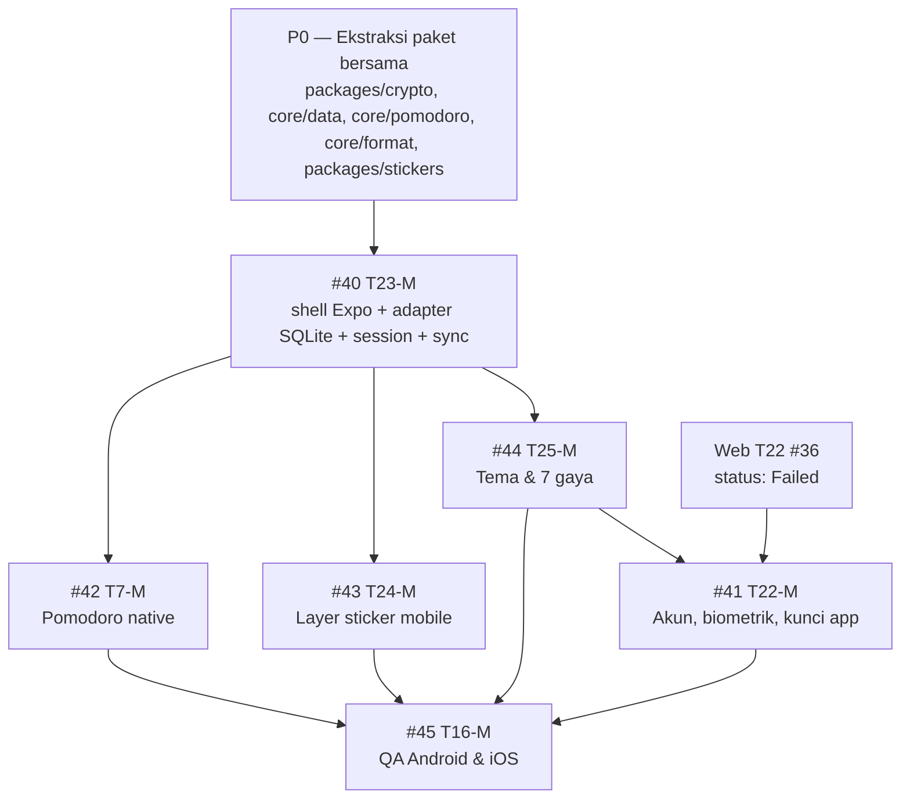
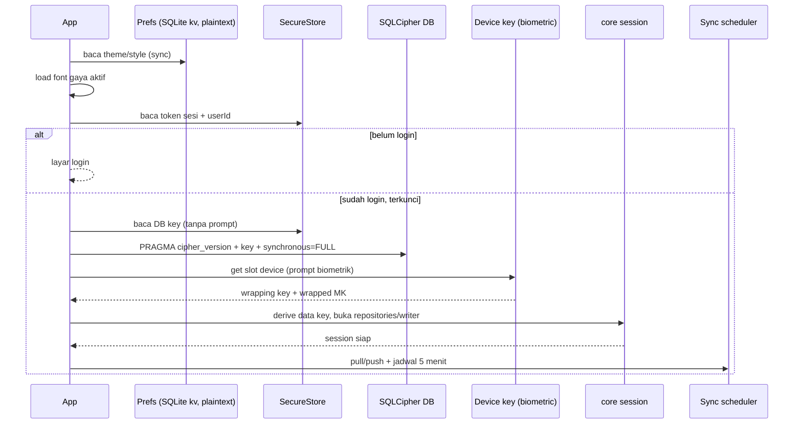

# Keputusan Mobile — T23-M, T22-M, T7-M, T24-M, T25-M, T16-M

Tanggal: 23 Oktober 2026 · Penulis: Yoga (System Analyst)
Status: **analisis saja** — tidak ada kode produk, `README`, `ARCHITECTURE.md`, `docs/**`, `.claude/**`, commit, atau status Ergonio yang diubah.

Scope: `apps/mobile` (belum ada kode, lihat `apps/mobile/ARCHITECTURE.md:13`) dan prasyarat di `packages/*` / `apps/web` yang harus dibereskan supaya `raka` bisa mengerjakan **#40–#45** tanpa menebak.

Sumber utama:

- `apps/mobile/ARCHITECTURE.md`, `apps/mobile/CLAUDE.md`, `apps/mobile/AGENTS.md`
- `apps/mobile/.claude/rules/{security,performance,code-quality}.md`
- `ARCHITECTURE.md` root (§3–§9, §14), `docs/PRD.md` (F14–F16, tabel requirement)
- `packages/{contracts,core,tokens}`, `apps/web/app/utils/{storage,crypto,pomodoro,account}`, `apps/web/shared/tech-identity.ts`
- Ergonio project `personal-productivity`: #40–#45 dan #36 (T22 web)

---

## 0. Ringkasan eksekutif

### 0.1 Tiga keputusan tertunda di `apps/mobile/ARCHITECTURE.md:82-88` sudah bisa ditutup

| # | Pertanyaan | Keputusan |
|---|---|---|
| 1 | Library state mobile | **Zustand 5** untuk state app/UI + **TanStack Query 5** hanya untuk data milik server (akun/perangkat). `core` tetap satu-satunya jalur tulis data lokal. |
| 2 | Bentuk navigasi | **Expo Router** (file-based, typed routes), bukan React Navigation manual. Aturan `code-quality.md` bagian Navigasi harus disesuaikan di PR #40. |
| 3 | Posisi file fitur | `app/` **hanya route**; logika & UI fitur di `src/features/<domain>/`; adapter platform di `src/platform/`; provider di `src/providers/`. Tidak ada `src/app/` dan tidak ada `src/navigation/` berisi definisi navigator. |

### 0.2 Temuan yang mengubah urutan kerja

1. **Logika bersama masih tinggal di `apps/web`.** `record-codec.ts`, `repository.ts`, `record-writer.ts`, `uuid.ts`, bagian generik `session.ts`, state machine `pomodoro/*` (kecuali `persistence.ts`), geometri `deco.ts`, katalog sticker, dan hampir seluruh `crypto/*` adalah TypeScript murni yang belum ada di `packages/*`. Kalau mobile menyalinnya, AC T23-M “tidak ada duplikasi logika data/kripto/sync” (`docs/PRD.md:1106`) langsung gagal.
   - Bukti: `apps/web/app/utils/crypto/provider.ts:14-18` sendiri menulis bahwa modul kunci “harus dipindah ke paket bersama, JANGAN disalin”.
   - `apps/web/ARCHITECTURE.md:82-88` masih menyebut `packages/core` “belum ada” dan logika masih di `app/utils/` — dokumen itu sudah stale, tetapi menunjukkan transisi yang belum selesai.
2. **Tidak ada `packages/crypto`.** Root `ARCHITECTURE.md:87` mencantumkannya, tetapi folder `packages/` hanya berisi `config`, `contracts`, `core`, `tokens`.
3. **Web T22 (#36) berstatus `Failed` di Ergonio.** Task #41 (T22-M) `BlockedBy: T22 (web), T23-M`; empat AC web T22 masih belum ada (lupa OTP, QR tambah perangkat, hapus akun, indikator sync — lihat `reports/qa-t22-ui-akun.md:13`). #41 belum bisa “sama dengan web” selama web T22 belum lulus.
4. **Contract test `StorageAdapter` mengimpor `vitest` langsung** (`packages/core/src/adapters/contract.ts:1`), sehingga tidak bisa dijalankan apa adanya di Jest/React Native. Perlu refactor kecil agar suite bisa dipakai di perangkat nyata.
5. **`apps/mobile` belum punya `package.json`, `app.config.ts`, `metro.config.js`, `tsconfig.json`, test setup, atau CI.** #40 benar-benar mulai dari nol; jangan anggap ini task “tambah adapter SQLite” saja. Root `package.json` `lint-staged` belum memuat `apps/mobile`, dan `turbo.json` belum punya output/task mobile — keduanya ikut #40.

### 0.3 Yang wajib diputuskan user sebelum baris kode pertama

Maksimal lima, detail di §5:

1. **Scope #41**: paritas penuh web (passkey + QR + lupa OTP + hapus akun + daftar perangkat) atau fase 1 (login OTP/Google + kunci biometrik + daftar perangkat + logout + indikator sync)?
2. **Arti “widget native” Pomodoro**: widget home screen (WidgetKit/App Widget) atau mini player in-app + notifikasi lokal?
3. **Fallback saat biometrik berubah/dibatalkan**: passkey/recovery/QR saja, atau boleh fallback ke kredensial perangkat (lebih lemah)?
4. **Persetujuan ekstraksi paket bersama** (`packages/crypto`, `packages/stickers`, `core/data`, `core/pomodoro`, `core/format`) sebagai prasyarat #40 — menambah waktu, tetapi tanpa ini AC “no duplication” tidak mungkin dipenuhi.
5. **Kredensial & perangkat build**: Apple Developer Program, keystore Android, EAS account, satu Android mid-range, satu iPhone fisik, dan domain staging untuk passkey/AASA.

---

## 1. Tabel keputusan

Legenda status: **Diputuskan** = analisis ini menetapkan default yang bisa langsung dieksekusi; **Butuh keputusan user** = blocking, tidak boleh ditebak.

### 1.1 Keputusan yang diminta `ARCHITECTURE.md`

| ID | Pertanyaan | Opsi | Rekomendasi | Alasan | Konsekuensi / risiko | Status |
|---|---|---|---|---|---|---|
| K-01 | Library state mobile | Zustand; Redux Toolkit; Jotai; Context + `useSyncExternalStore` | **Zustand 5** untuk session/lock/UI/appearance/sync + **TanStack Query 5** hanya untuk data server (akun, perangkat) | Selector sempit sesuai aturan re-render (`apps/mobile/.claude/rules/performance.md:39`); tanpa boilerplate provider; cocok dengan prinsip ADR 9 “store = cermin reaktif core, bukan pemilik data” (`ARCHITECTURE.md:383`) | Butuh disiplin: store tidak boleh menulis DB langsung. Tambah aturan review “mutasi data hanya lewat use case/core”. Jangan pakai `persist` untuk data sensitif. Context hanya untuk tema/locale yang jarang berubah. | **Diputuskan** |
| K-02 | Bentuk navigasi | Expo Router; React Navigation native-stack | **Expo Router**, typed routes, route groups `(auth)` / `(app)` | ADR Q4 (`ARCHITECTURE.md:30`); file-based, deep link, typed routes; tetap di atas React Navigation sehingga gesture native tetap ada | `apps/mobile/.claude/rules/code-quality.md:44` masih menyebut React Navigation dan `RootStackParamList`; harus diubah di PR #40. Nama file route mengikuti konvensi Expo Router (lowercase), screen di `src/features` tetap PascalCase. | **Diputuskan** |
| K-03 | Posisi file fitur | `app/` + `src/features`; `src/app` + `src/navigation`; per tipe | `app/` **hanya route**; `src/features/<domain>/{screens,components,hooks,store}`; `src/platform/`; `src/components/ui/`; `src/providers/`; `src/theme/`; `src/utils/` | Menghilangkan dua sumber navigasi; `features` per domain sesuai `apps/mobile/ARCHITECTURE.md:42`; `platform` memisahkan adapter native | Aturan `src/app/` dan `src/navigation/` di `code-quality.md:8-21` harus diganti. `app/` route tipis: hanya susun screen + validasi param. | **Diputuskan** |

### 1.2 Keputusan teknis tambahan yang harus disepakati sebelum implementasi

| ID | Pertanyaan | Opsi | Rekomendasi | Alasan | Konsekuensi / risiko | Status |
|---|---|---|---|---|---|---|
| K-04 | Versi runtime | Expo SDK 58 (RN 0.88, React 19.3); SDK 57; bare RN | **Expo SDK 58**, New Architecture + Hermes, `expo-dev-client`; pin versi lewat `expo install` | SDK 58 adalah versi stabil saat analisis ini; template resmi memakai RN 0.88/React 19.3; seluruh library inti (SQLite, SecureStore, Router, Notifications, Font) tersedia untuk SDK 58 | Library native harus kompatibel RN 0.88/New Arch. Wajib spike kompilasi sebelum fitur. Kalau blocker, turun satu SDK **dengan ADR**, bukan diam-diam. | **Diputuskan** (dengan spike) |
| K-05 | Storage lokal | `expo-sqlite` + SQLCipher; `op-sqlite` + SQLCipher; SQLite plaintext + enkripsi aplikasi | **`expo-sqlite` + `useSQLCipher: true`**, dev build (bukan Expo Go) | Root §5 menetapkan SQLite + SQLCipher (`ARCHITECTURE.md:142`); `expo-sqlite` resmi, mendukung SQLCipher di Android/iOS, tetapi **tidak** di Expo Go dan butuh `expo prebuild` | Build native wajib; `PRAGMA key` **tidak error** kalau binary tanpa SQLCipher (docs Expo), jadi wajib cek `PRAGMA cipher_version` dan menolak jalan kalau null. Ukuran APK naik. | **Diputuskan** |
| K-06 | Kunci database SQLCipher | Kunci acak di SecureStore; turunkan dari MK; passphrase user | **Kunci acak 32 byte per akun** di SecureStore (item tanpa `requireAuthentication`), dipakai sebagai `PRAGMA key = "x'<hex>'"` | DB boleh dibuka sebelum unlock; isinya tetap ciphertext; SQLCipher melindungi metadata (id, hlc, timestamp). Tidak menambah prompt biometrik kedua. Kunci DB terpisah dari MK. | Android uninstall menghapus SecureStore → DB tidak bisa dibuka; hapus DB lalu pull ulang. iOS Keychain bisa bertahan setelah uninstall; tangani DB hilang. Logout harus hapus DB + kunci DB. | **Diputuskan** |
| K-07 | SecureStore & biometrik | `expo-secure-store` `requireAuthentication`; SecureStore biasa + gate UI; `react-native-keychain` | **`expo-secure-store`** untuk slot `device`, `requireAuthentication: true`, `keychainAccessible: WHEN_UNLOCKED_THIS_DEVICE_ONLY` (iOS; Android mengikuti Keystore), prompt “Buka Improve Personal”. Token sesi di item terpisah **tanpa** `requireAuthentication` | Aturan security mobile melarang biometrik hanya `if (success) showData()` (`apps/mobile/.claude/rules/security.md:25`); akses item Keychain/Keystore yang diikat biometrik adalah kontrol yang sebenarnya. Token tidak perlu prompt tiap request; data tetap tidak bisa didekripsi tanpa slot `device`. | Perubahan biometrik (tambah fingerprint/face) **membuat item tidak bisa dibaca** (docs SecureStore). Wajib alur pemulihan. Prompt muncul saat buka app. Jangan simpan MK polos. | **Diputuskan**; fallback = D-3 user |
| K-08 | Paket kripto | Salin `apps/web/app/utils/crypto`; pindah ke `packages/crypto`; pakai modul web lewat alias | **Buat `packages/crypto`** berisi primitive murni + seam `SodiumModule`; adapter platform tetap di app | `provider.ts:14-18` memerintahkan pindah, bukan salin; format blob harus identik web/native (`ARCHITECTURE.md:189`) | Refactor web + test; `device-slot` web (WebCrypto AES-KW) dan mobile (libsodium) berbeda, tetapi itu envelope lokal sehingga boleh beda. Jangan pindahkan `webauthn.ts`/`key-store.ts` web. | **Diputuskan** |
| K-09 | Lapisan data generik | Salin `record-codec/repository/record-writer/uuid/session`; pindah ke core; biarkan di web | **Pindah ke `packages/core/src/data/`** (dan `session` generik), web memakai re-export shim | Modul-modul itu hanya bergantung pada `StorageAdapter`/`CryptoProvider`/`Clock`/HLC — tidak ada DOM. Menyalinnya melanggar AC T23-M dan aturan “logika sekali, UI dua kali” (`ARCHITECTURE.md:42`) | Perubahan lintas app; test web harus tetap hijau lewat shim. Ini **prasyarat #40**, bukan pekerjaan sampingan. | **Diputuskan** (prasyarat) |
| K-10 | Cara membuktikan adapter SQLite | Jest shim; refactor suite jadi runner-agnostic; on-device runner; lewati | **Refactor `runStorageAdapterContractTests` agar menerima runner** (tanpa import `vitest` di inti), lalu jalankan **di perangkat** lewat layar dev + Maestro; web tetap pakai wrapper Vitest | Suite asli mengimpor `vitest` (`contract.ts:1`); `expo-sqlite` asli tidak bisa jalan di Node. AC T23 menuntut adapter SQLite lolos suite yang sama, jadi bukti harus dari perangkat/SQLCipher nyata | Layar dev-only + flow Maestro; waktu CI bertambah. Alternatif Jest `moduleNameMapper` hanya menguji mock native, bukan SQLCipher — tidak cukup untuk AC. | **Diputuskan** |
| K-11 | Token desain & font | Import `packages/tokens` langsung; salin nilai; adapter RN | **Import data token** (`themes`, `palette`, `uiStyles`, `space`, `radius`, `typography`, `fontFamily`) + **adapter RN** di `src/theme/`; font dibundel dan di-lazy-load per gaya | Token adalah sumber tunggal web/mobile (`packages/tokens/package.json`); CSS variable tidak ada di RN | Nilai token berupa string CSS (`'16px'`, `'0 6px 0 var(--ink-shadow)'`) harus di-parse; font CSS stack harus dipetakan ke nama font Expo. 21 kombinasi gaya × tema harus diuji kontras & tampilan. | **Diputuskan** |
| K-12 | Penyimpanan hiasan/sticker | `decoration` record di core; localStorage seperti web; tabel lokal baru | **Tulis `decoration` record lewat core** dengan `breakpoint` sesuai lebar layar (`phone`/`tablet`), bukan `localStorage` | Entitas `decoration` sudah ada dan memang dirancang per breakpoint (`packages/core/src/domain/entities/decoration.ts:7-16`); PRD F14 menyebut data sticker “ringan buat sync” dan perangkat baru dapat hiasan sesuai ukuran layar (`docs/PRD.md:756-766`). Web saat ini masih `localStorage` (`apps/web/app/composables/useDeco.ts:12-15,45-55`) — itu utang web, bukan alasan mobile ikut salah. | Web belum membaca record ini; perlu follow-up migrasi web. Model web `DecoItem` (`page/bucket/anchor/px/py/w/rot/z`) beda dari `Decoration` (`breakpoint/anchorKey/posXPct/...`); perlu adapter/mapping bersama. | **Diputuskan** (dengan follow-up web) |
| K-13 | State machine Pomodoro | Salin dari web; pindah ke core; tulis ulang di mobile | **Pindah state machine murni ke `packages/core/src/pomodoro/`**; mobile memakai timestamp, bukan interval | State machine di `apps/web/app/utils/pomodoro` (kecuali `persistence.ts`) murni dan sudah diuji; AC T7-M butuh akurasi setelah background, yang berarti hitung dari `endsAt`/`startedAt` | Refactor web; test pindah. Timer background tetap tidak bisa jalan di iOS — selesaikan dengan timestamp + notifikasi lokal, bukan interval. | **Diputuskan**; arti widget = D-2 user |
| K-14 | Sync di background | `AppState` + timer foreground; `expo-background-task`; push notification | **Foreground saja**: buka app, debounce setelah tulis, tiap 5 menit saat foreground, saat online lagi. Tidak ada sync OS background di MVP | `ARCHITECTURE.md:268-273` memang mendefinisikan sync saat app dibuka/foreground; iOS menyuspend JS; kunci E2EE bisa terkunci saat background | Data tidak sync saat app tertutup. Kalau produk menuntut sync background, itu task terpisah dengan risiko kunci & baterai. Dokumentasikan jujur di Panduan. | **Diputuskan** |
| K-15 | Auth & redirect Google | Cookie; bearer; custom scheme; universal link | **Bearer token** dari `mobileSessionDtoSchema` (`packages/contracts/src/auth.ts:191-195`) di SecureStore; Google memakai browser sistem + **universal link/App Link** untuk redirect, bukan custom scheme | Kontrak sudah menyediakan token mobile; security mobile melarang login pihak ketiga di WebView (`security.md:23`) dan meminta universal/App Link untuk alur sensitif (`security.md:37`). PKCE tetap dipakai server. | `NUXT_GOOGLE_REDIRECT_URI_MOBILE` saat ini dicontohkan custom scheme (`apps/web/.env.example:64`); perlu diubah ke universal link di server env + AASA/assetlinks. App harus menukar `code`/`state` ke `GET /v1/auth/google/callback` untuk mendapat DTO mobile. | **Diputuskan** (perlu perubahan env server) |
| K-16 | i18n | `i18next`; pakai JSON web; hardcode | **`i18next` + `react-i18next`**, default `id`, string mobile terpisah; glosarium domain disamakan dengan web | Root §11 mewajibkan string lewat i18n (`ARCHITECTURE.md:335`); mobile butuh string yang berbeda konteks | Duplikasi string dengan web berisiko drift; mitisasi: glosarium istilah domain di `packages/core`/kontrak, string UI per app. | **Diputuskan** |
| K-17 | Test stack | Jest + RNTL; Vitest; keduanya | **Jest + RNTL + `jest-expo`** untuk app; **Vitest** untuk `packages/*`; **Maestro** untuk E2E | `apps/mobile/.claude/rules/code-quality.md:64-71` menetapkan Jest/RNTL; package tetap Vitest seperti sekarang | Dua runner; `jest-expo` harus seversi SDK 58. Mock native module terpusat di `jest.setup.ts`. | **Diputuskan** |
| K-18 | Build & OTA | EAS; build lokal; bare | **EAS Build + EAS Update**, profil `development`/`preview`/`production`, channel terpisah, code signing, `runtimeVersion` fingerprint | `apps/mobile/ARCHITECTURE.md:74-80`; OTA hanya JS dan wajib signed (`security.md:63-67`) | Butuh EAS account + kredensial. Build lokal tetap mungkin untuk debug, tetapi bukti AC harus build release/EAS. | **Diputuskan**; kredensial = D-5 user |
| K-19 | Hardening rilis | L2 penuh sekarang; bertahap | **Baseline sekarang**: HTTPS, `allowBackup=false`, no cleartext, `FLAG_SECURE`/screen-capture, overlay app switcher, hapus `console.*`, keystore di luar repo. **Pinning/root detection/Play Integrity** sebelum production, bukan di #40 | Security mobile §4/§8/§9; library pinning belum tentu New Arch-compatible dan menambah risiko build | Sebagian L2 ditunda; tulis trade-off di PR dan jadwalkan task hardening sebelum rilis store. | **Diputuskan** (bertahap) |
| K-20 | Scope #41 | Paritas penuh web; fase 1; login saja | **Fase 1** untuk #41, sisanya task lanjutan — kecuali user menuntut paritas penuh | Deskripsi #41 menyebut “alur akun yang sama dengan web”, tetapi AC-nya hanya menyebut sidik jari/Face ID, kunci app, Keychain/Keystore. Paritas penuh berarti passkey PRF, QR scanner, lupa OTP, hapus akun, daftar perangkat — ukurannya jauh lebih dari `M` | Kalau paritas penuh dipilih, #41 jadi `L`, dan web T22 (#36) harus lulus dulu. | **Butuh keputusan user** (D-1) |
| K-21 | Arti widget Pomodoro | Widget home screen; mini player in-app + notifikasi; notifikasi saja | **Mini player in-app + notifikasi lokal**; widget home screen jadi task terpisah | Widget home screen butuh iOS WidgetKit + Android App Widget, native code, App Group/SharedPreferences, dan tidak bisa membaca SQLCipher dengan mudah. AC T7-M hanya menuntut timer akurat setelah background. | Kalau user ingin widget home screen, tambah native module + extension iOS + build config; bukan pekerjaan `S` lagi. | **Butuh keputusan user** (D-2) |
| K-22 | Fallback biometrik berubah | Passkey/recovery/QR; kredensial perangkat; login ulang + OTP + recovery | **Passkey/recovery/QR**; OTP tidak boleh membuka kunci (ADR 10) | Mengikuti hierarki kunci `ARCHITECTURE.md:219-234`; OTP dibuat server sehingga tidak boleh jadi pembuka | User yang kehilangan biometrik dan tidak punya passkey/recovery akan kehilangan akses — harus dijelaskan di onboarding. | **Butuh keputusan user** (D-3) |
| K-23 | Ekstraksi paket bersama | Kerjakan sekarang; salin; tunda mobile | **Kerjakan sebagai prasyarat #40**, owner `bayu` (core) + `raka` (konsumsi) | Aturan Ergonio: perubahan `packages/core`/`contracts` dikerjakan lebih dulu, konsumen menyusul (`.claude/rules/ergonio-status-flow.md:86-87`) | Menambah 1 task/PR dan waktu; tanpa ini AC #40 gagal secara definisi. | **Butuh keputusan user** (D-4) |
| K-24 | Kredensial & perangkat bukti | Sudah tersedia; siapkan sekarang; tunda iOS | **Siapkan sebelum #40 selesai**: Apple Developer, keystore Android, EAS, 1 Android mid-range, 1 iPhone, domain staging | AC #40 “build APK & iOS jalan di perangkat nyata”; #45 “bukti di perangkat Android & iOS nyata” | Tanpa ini #40 hanya bisa dibuktikan di emulator/simulator; passkey/QR tidak bisa diuji tanpa domain + AASA/assetlinks. | **Butuh keputusan user** (D-5) |

---

## 2. Urutan implementasi, dependency, dan batas file

### 2.1 Dependency nyata



Catatan dependency:

- **#40** hanya bergantung pada T1/T2 web (sudah selesai) **plus P0** yang belum ada di repo.
- **#42/#43/#44** hanya butuh #40. Ketiganya independen dan boleh paralel.
- **#41** butuh #40 **dan** web T22. Karena #36 berstatus `Failed`, #41 adalah task terakhir yang realistis, bukan paralel dengan #42–#44.
- **#45** butuh semua.

### 2.2 Urutan yang disarankan

| Fase | Task | Isi | Kenapa di sini |
|---|---|---|---|
| P0 | **Prasyarat bersama** (dipecah dari #40 atau task baru) | Pindahkan `record-codec/repository/record-writer/uuid/session` ke `packages/core/src/data/`; pindahkan crypto murni ke `packages/crypto`; pindahkan Pomodoro murni ke `core/pomodoro`; pindahkan geometri deco + katalog sticker; pindahkan `TECH_IDENTITY`; tambah subpath export; web memakai re-export shim | Aturan Ergonio: perubahan bersama dulu. Tanpa ini mobile menyalin logika dan AC #40 gagal. |
| 1 | **#40 T23-M** | `package.json`/`app.config.ts`/Metro/TS/ESLint/Jest; Expo Router shell; adapter SQLCipher; `SecureKeyStore`; `CryptoProvider`; session; sync scheduler; satu vertical slice (mis. Daily read-only) untuk membuktikan core hidup; build APK/iOS | Fondasi. Semua task lain menumpang shell ini. |
| 2a | **#42 T7-M** | State Pomodoro (dari core) + ticker global + AppState + notifikasi lokal + riwayat sesi | Independen dari tema/deco. |
| 2b | **#43 T24-M** | Picker + layer hias RN + anchor registry + breakpoint `phone`/`tablet` + performa 100 sticker | Independen dari Pomodoro; butuh shell & token dasar. |
| 2c | **#44 T25-M** | `ThemeProvider` + adapter token + font + menu Tampilan + persist `user_prefs` + kontras 21 kombinasi | Harus selesai sebelum #41 karena auth gate butuh theme/provider. |
| 3 | **#41 T22-M** | Login OTP/Google, session, kunci app biometrik, daftar perangkat, logout, indikator sync; passkey/QR/lupa/hapus sesuai D-1 | Butuh #40, #44, dan web T22. |
| 4 | **#45 T16-M** | Matriks bukti AC per platform, Maestro, performa release, security checks | Butuh semua. |

### 2.3 Batas file per task

Tabel ini yang harus dipakai orchestrator untuk mencegah dua agent mengedit file yang sama.

| Task | Boleh menulis | Dilarang menyentuh (tanpa koordinasi) |
|---|---|---|
| **P0** | `packages/core/src/data/**`, `packages/core/src/pomodoro/**`, `packages/core/src/format/**`, `packages/crypto/**`, `packages/stickers/**`, `packages/core/package.json`, `packages/core/src/index.ts`, `packages/contracts/src/identity.ts` (jika dipilih), shim di `apps/web/app/utils/{storage,pomodoro,crypto,account}/**`, `apps/web/shared/tech-identity.ts` | `apps/mobile/**` (belum ada), komponen/UI web |
| **#40** | `apps/mobile/**` **kecuali** folder fitur milik #42/#43/#44/#41; `apps/mobile/package.json`, `app.config.ts`, `metro.config.js`, `tsconfig.json`, `eslint.config.mjs`, `jest.config.*`, `jest.setup.ts`, `eas.json`, `src/platform/**`, `src/providers/**`, `src/components/ui/Page.tsx`, `src/theme/index.ts` (placeholder), route placeholder; root `package.json` (`lint-staged`), `turbo.json` | `apps/web/**`, `packages/core/**` (kecuali sudah disepakati di P0), `docs/**`, `ARCHITECTURE.md`, `.claude/**` (kecuali update aturan navigasi di PR yang sama — lihat §2.5) |
| **#42** | `apps/mobile/src/features/pomodoro/**`, `apps/mobile/src/platform/notifications.ts`, `apps/mobile/src/providers/ticker.tsx`, `apps/mobile/app/(app)/(tabs)/focus.tsx`, `packages/core/src/pomodoro/**` (jika P0 belum memindahkannya) | `src/providers/index.tsx` (kecuali sudah ada slot), `src/theme/**`, `src/features/deco/**`, `src/features/account/**` |
| **#43** | `apps/mobile/src/features/deco/**`, `apps/mobile/src/components/ui/Deco*`, `apps/mobile/src/platform/decoAnchors.ts`, `packages/stickers/**`, `packages/core/src/domain/decoration/**` (geometri/registry, jika P0 belum), `apps/mobile/app/(app)/**` hanya untuk membungkus `Page` bila belum ada | `app/_layout.tsx`, `src/providers/index.tsx`, `src/theme/**`, `src/features/pomodoro/**` |
| **#44** | `apps/mobile/src/theme/**`, `apps/mobile/src/features/appearance/**`, `apps/mobile/src/providers/ThemeProvider.tsx`, `apps/mobile/app/(app)/pengaturan/tampilan.tsx`, `packages/tokens/src/**` (adapter RN-additive, jika perlu), `apps/mobile/assets/fonts/**` | `src/providers/index.tsx` (kecuali slot sudah disiapkan #40), `app/_layout.tsx` (kecuali slot), fitur lain |
| **#41** | `apps/mobile/src/features/account/**`, `apps/mobile/src/platform/{biometric,passkeys,pairing}.ts`, `apps/mobile/src/providers/SessionProvider.tsx`, `apps/mobile/app/(auth)/**`, `apps/mobile/app/(app)/akun/**`, `packages/crypto/src/{passkey,recovery,transfer,backup-code,encrypted-backup,recovery-file}.ts` (jika belum di P0) | `src/theme/**`, `src/features/pomodoro/**`, `src/features/deco/**`, `src/providers/index.tsx` (kecuali slot) |
| **#45** | `apps/mobile/e2e/**`, `reports/**`, test/fixture QA; **tidak boleh** mengubah kode produk | Semua kode produk |

Aturan tambahan:

- **Satu file bersama = satu pemilik.** `app/_layout.tsx`, `app/(app)/_layout.tsx`, `src/providers/index.tsx`, `package.json`, `app.config.ts`, `metro.config.js`, `tsconfig.json`, `jest.setup.ts` dimiliki #40. Task lain hanya boleh menambah file provider terpisah; #40 harus menyiapkan slotnya sejak awal.
- **#40 wajib membuat placeholder** untuk `ThemeProvider`, `SessionProvider`, `NotificationScheduler`, `TickerProvider`, dan `DecoLayer` supaya #41–#44 tidak perlu mengedit file bersama. Kalau placeholder belum ada, urutkan #44 → #41, dan #42/#43 setelahnya.
- **#41 dan #44 jangan paralel** jika keduanya harus mengedit `src/providers/index.tsx` atau `app/_layout.tsx`. Sesuai urutan di atas, #44 selesai dulu.
- **P0 dan #40 boleh mulai paralel untuk scaffold** (folder `apps/mobile` vs `packages/*` tidak bertabrakan), tetapi #40 **tidak boleh mengintegrasikan** `core`/`crypto`/katalog sampai P0 selesai dan web tetap hijau. Kalau ingin sederhana: P0 selesai dulu, baru #40.

### 2.4 Paralelisme yang aman

```
P0 (paket bersama)  ∥  scaffold #40
  └─ integrasi #40 setelah P0 hijau
       ├─ #42 ∥ #43 ∥ #44
       │        └─ #44 selesai
       ├─ #41 (setelah #44 + web T22 lulus)
       └─ #45 (setelah #42, #43, #44, #41)
```

Kalau web T22 diperbaiki lebih awal, #41 masih sebaiknya setelah #44 karena provider/theme. Kalau terpaksa paralel, #41 harus memakai file provider sendiri dan tidak menyentuh `src/theme/**`.

### 2.5 Perubahan aturan yang harus ikut di PR #40

Ini bukan kode produk, tapi wajib supaya aturan tidak bertentangan dengan keputusan:

- `apps/mobile/.claude/rules/code-quality.md:8-21`: ganti `src/app/` + `src/navigation/` menjadi `app/` (route) + `src/features` + `src/platform` + `src/providers`.
- `apps/mobile/.claude/rules/code-quality.md:44`: ganti “React Navigation native-stack atau Expo Router” menjadi **Expo Router**; `ParamList` → typed routes/`Href` + validasi param dengan zod.
- `apps/mobile/.claude/rules/code-quality.md:29`: screen di `src/features/**/screens` tetap PascalCase; file route di `app/` lowercase sesuai konvensi Expo Router.
- Root `ARCHITECTURE.md` §14: tambah ADR untuk state mobile, Expo Router, SQLCipher key, dan `packages/crypto` (dilakukan di PR yang sama, bukan di laporan ini).

Kalau aturan tidak diubah, reviewer akan menolak kode yang sebenarnya benar hanya karena dokumennya masih menyebut React Navigation.

---

## 3. Peta paket bersama → kode mobile

### 3.1 Apa yang bisa dipakai langsung

| Sumber | Dipakai langsung di mobile | Yang butuh adapter / belum ada | Catatan |
|---|---|---|---|
| `@improve-personal/contracts` | Schema zod, DTO auth/sync/devices/keys/account, `compareHlc`, `ERROR_CODES`, `apiResponseSchema` | Tidak ada | Mobile memakai `mobileSessionDtoSchema` (`packages/contracts/src/auth.ts:191-195`); platform `ios`/`android` sudah ada (`packages/contracts/src/devices.ts:34`). Tambah subpath export (`./auth`, `./sync`, dll.) untuk bundle. |
| `@improve-personal/core` — `domain/`, `recurrence/`, `calc/`, `io/`, `sync/`, `repository/types.ts`, `ports.ts` | Ya, seluruhnya TS murni | Adapter: `StorageAdapter`, `SecureKeyStore`, `CryptoProvider`, `Scheduler`, `HttpClient`, `Clock` | Barrel `core/src/index.ts:51-57` mengekspor semua; untuk bundle mobile sebaiknya pakai subpath (`@improve-personal/core/sync`, `/domain`, `/ports`) agar modul yang tidak dipakai tidak dievaluasi Metro. |
| `@improve-personal/core` — `data/` (**baru**) | `record-codec`, `createRepository`, `createRecordWriter`, `createUuidV7Generator` | Tidak ada, setelah dipindah dari web | Wajib dipindah (K-09). Web memakai shim agar import lama tetap jalan. |
| `@improve-personal/core` — `pomodoro/` (**baru**) | State machine murni Pomodoro | Timer/notification di mobile | Wajib dipindah (K-13). |
| `@improve-personal/core` — `format/` (**baru**) | `TECH_IDENTITY`, marker backup, nama DB | Tidak ada | Pindah dari `apps/web/shared/tech-identity.ts`; jangan salin konstanta format. |
| `@improve-personal/tokens` | `themes`, `palette`, `uiStyles`, `space`, `radius`, `border`, `shadow`, `fontFamily`, `typography` | **Adapter RN** (`src/theme/`) + font | `toCssVariables`/`./css` tidak dipakai mobile. Nilai px/shadow CSS harus di-parse. |
| `packages/crypto` (**baru**) | `envelope`, `master-key`, `provider`, `recovery`, `passkey` (dengan PRF di-inject), `transfer`, `kdf-limits`, `backup-code`, `encrypted-backup`, `recovery-file` | `SodiumModule` (web: `libsodium-wrappers-sumo`; mobile: `react-native-libsodium`), `PasskeyPrfProvider` (web: WebAuthn; mobile: `react-native-passkeys`) | Jangan pindahkan `webauthn.ts`, `key-store.ts`, `device-slot.ts` web — itu platform-specific. `packages/crypto` sengaja **tidak** mengimpor `core`; app yang merangkai primitive ini menjadi `CryptoProvider`. |
| `packages/stickers` (**baru**) | `STICKER_PACKS`, `STICKER_MASCOTS`, `MASCOTS`, lookup/search | Rendering: emoji `<Text>` / PNG mascot; bukan SVG web | Katalog harus satu sumber; ID sticker tidak boleh diarang di mobile. |
| `packages/config` | Base tsconfig/eslint/prettier | `tsconfig.rn.json`/eslint RN atau config mobile sendiri | `tsconfig.base.json` memakai `lib: ["ES2023"]`, `types: []`; RN butuh `expo/tsconfig.base` + strict flags. Jangan memaksa satu extends yang bentrok. |

### 3.2 Apa yang **tidak** boleh diimpor / disalin

| Modul web | Kenapa |
|---|---|
| `apps/web/app/utils/storage/indexeddb.ts` | IndexedDB/DOM; mobile pakai SQLite. |
| `apps/web/app/utils/crypto/key-store.ts` | IndexedDB + `CryptoKey` non-extractable; mobile pakai SecureStore. |
| `apps/web/app/utils/crypto/device-slot.ts` | WebCrypto AES-KW; mobile butuh implementasi libsodium + SecureStore. |
| `apps/web/app/utils/crypto/webauthn.ts` | `navigator.credentials`; mobile pakai `react-native-passkeys`. |
| `apps/web/app/composables/**` | Vue/Nuxt; mobile hooks harus RN. |
| `apps/web/app/components/**` | Vue SFC; mobile komponen RN. |
| `apps/web/app/utils/deco.ts` (bagian DOM/measure) | Hanya geometri murni yang boleh dipindah; `useDecoAnchors` DOM tidak. |
| `apps/web/app/utils/storage/session.ts` (utuh) | Orkestrasi web + `navigator.locks`; pindahkan bagian generik, sisakan shell web. |
| `apps/web/shared/tech-identity.ts` | Pindah ke core/format; jangan salin konstanta. |

### 3.3 Kontrak adapter yang harus disepakati lebih dulu

#### Sudah ada di `core/ports.ts` — jangan bikin interface baru

| Port | Implementasi mobile | Catatan kontrak |
|---|---|---|
| `StorageAdapter` (`ports.ts:116-182`) | `expo-sqlite` + SQLCipher | Transaksi serial, `synchronous=FULL`, record+index+outbox satu transaksi, `queryByRange` lewat index, `createdAtMs` dipertahankan, `updatedAtMs` dari index, `wipe` bersihkan semua tabel. |
| `SecureKeyStore` (`ports.ts:272-284`) | `expo-secure-store` | `put/get/remove` per slot `device`/`passkey`/`recovery`; material = JSON base64; `get` boleh memicu prompt biometrik; error prompt ≠ data rusak. |
| `CryptoProvider` (`ports.ts:305-310`) | `react-native-libsodium` | Format blob **wajib sama** dengan web: `base64(nonce[24] || ciphertext||tag)`, XChaCha20-Poly1305, AAD = `recordId`. |
| `Scheduler` (`ports.ts:365-373`) | `setTimeout`/`setInterval` + `AppState` | Hanya foreground; callback tidak boleh jalan saat app background; satu ticker global. |
| `HttpClient` (`ports.ts:381-389`) | `fetch` + `AbortController` | Tidak menyimpan token/base URL; pemanggil mengirim header; error non-2xx → `HttpError(status, code)` dari kontrak. |
| `Clock` (`ports.ts:334-350`) | `Date.now` + `performance.now` (fallback max) | `monotonicMs` tidak boleh mundur; HLC memakai ini. |

#### Kontrak baru yang perlu disepakati (mobile-local, jangan masuk core kalau tidak perlu)

```ts
// src/platform/biometric.ts — hanya capability, BUKAN gate boolean.
type BiometricSupport = {
  isAvailable(): Promise<boolean>
  // Prompt sebenarnya terjadi saat SecureStore.get('device') dengan requireAuthentication.
}

// src/platform/notifications.ts
type NotificationScheduler = {
  requestPermission(): Promise<'granted' | 'denied' | 'blocked'>
  scheduleAt(id: string, atMs: number, content: { title: string; body: string }): Promise<void>
  cancel(id: string): Promise<void>
}

// src/platform/net.ts
type NetStatus = {
  isOnline(): Promise<boolean>
  subscribe(listener: (online: boolean) => void): () => void
}

// src/features/deco/anchors.ts — registry semantik, bukan id DOM.
type AnchorRect = { x: number; y: number; w: number; h: number; kind: 'page' | 'header' | 'card' }
type AnchorRegistry = {
  register(anchorKey: string, ref: RefObject<View>): () => void
  measure(): Promise<Record<string, AnchorRect>>
}
```

#### Kontrak data yang perlu ditambah di core (additive)

`PullSummary` (`packages/core/src/sync/pull.ts:74-85`) saat ini hanya mengembalikan jumlah `applied`, bukan id yang berubah. Mobile butuh tahu store domain mana yang harus di-refresh setelah sync background. Rekomendasi: tambah field **additive** `changedRecordIds: readonly string[]` (atau `changedTypes`) ke `PullSummary`; web tidak terpengaruh karena hanya membaca field yang sudah ada. Tanpa ini, mobile harus re-query semua domain setiap pull, atau UI tetap basi.

### 3.4 Urutan boot yang harus sama di semua layar



Aturan:

- **Theme/font dibaca sebelum render pertama**; splash ditahan sampai font gaya aktif siap (`expo-font` + `SplashScreen`).
- **DB dibuka setelah userId diketahui**; isinya tetap ciphertext, jadi membuka DB bukan membuka data. Jangan menampilkan data sebelum data key ada.
- **Data key hanya di memori**; saat app background, zeroize dan kunci UI. Saat foreground, prompt biometrik lagi.
- **Jangan buka DB SQLCipher sebelum `PRAGMA cipher_version`**; kalau null, tampilkan error build, bukan menulis plaintext.
- **Definisi TTI untuk QA:** diukur sampai layar kunci siap menerima input, **bukan** setelah prompt biometrik selesai. Waktu unlock dicatat metrik terpisah supaya budget `performance.md` tidak mustahil.

### 3.5 Detail adapter yang paling mudah salah

**`StorageAdapter` SQLite**

- Gunakan **satu koneksi** + antrean/mutex async untuk semua operasi yang masuk transaksi. `expo-sqlite` punya `withTransactionAsync` yang “menelan” query lain yang berjalan bersamaan (docs Expo), dan `withExclusiveTransactionAsync` memakai koneksi terpisah yang PRAGMA-nya belum tentu ikut. Untuk kontrak ini, serialisasi di level aplikasi lebih aman.
- `PRAGMA journal_mode=WAL`, `PRAGMA synchronous=FULL`, `PRAGMA foreign_keys=ON` di-set saat buka. `FULL` wajib untuk record+outbox (`ARCHITECTURE.md:161`).
- `PRAGMA key = "x'<64 hex>'"` harus **statement pertama** setelah open; cek `PRAGMA cipher_version` lebih dulu.
- Tabel mengikuti `apps/web/docs/database.dbml:89-201`: `record`, `record_index`, `sync_outbox`, `sync_state`, `local_key_meta`, `sticker_recent`. Boolean → `INTEGER 0/1`; timestamp → `INTEGER` epoch ms; `blob` → `TEXT`.
- `queryByRange`: `range_start_ms <= toMs AND COALESCE(range_end_ms, range_start_ms) >= fromMs`; `range_start_ms IS NULL` tidak cocok untuk query rentang, tetapi ikut kalau `fromMs`/`toMs` sama-sama tidak diberikan (lihat `packages/core/src/repository/index-entry.ts:54-68`). Urut `range_start_ms ASC`, hormati `limit`.
- `putRecord` dengan `index = null` harus **menghapus** baris index lama (kontrak `contract.ts:215-231`).
- `createdAtMs` dipertahankan dari tulisan pertama; `updatedAtMs` = `index.updatedAtMs` atau `clock.nowMs()` kalau index null (mengikuti `indexeddb.ts:297-300`).
- `markOutboxFailure` menaikkan `attempts` dan menyimpan `last_error` generik; tidak pernah menyimpan blob/token.
- `wipe` dalam satu transaksi; jangan menghapus file DB (itu tugas logout/uninstall).

**`SecureKeyStore` mobile**

- Item `device` berisi JSON `{ wrappingKey: base64, wrappedMasterKey: base64 }`, disimpan dengan `requireAuthentication: true` dan `keychainAccessible: WHEN_UNLOCKED_THIS_DEVICE_ONLY`.
- Item token sesi terpisah, tanpa `requireAuthentication`, tetapi tetap `WHEN_UNLOCKED_THIS_DEVICE_ONLY`.
- Item DB key terpisah, tanpa `requireAuthentication` (lihat K-06).
- `get` harus membedakan: item tidak ada (`null`) vs prompt dibatalkan/invalidated (lempar `KeyUnavailableError` dengan alasan, bukan “data rusak”).
- `remove` saat logout harus menghapus semua item akun itu; `wipe` data tidak menghapus kunci (mengikuti prinsip web `key-store.ts:15-19`).
- Jangan pernah `console.log` material; zeroize `Uint8Array` setelah dipakai.

**`CryptoProvider` mobile**

- `react-native-libsodium` 1.7.0 menyediakan API yang mirror `libsodium-wrappers`; gunakan `crypto_aead_xchacha20poly1305_ietf_encrypt/decrypt`, `crypto_kdf_derive_from_key`, `crypto_pwhash` (Argon2id), `randombytes_buf`.
- `TextEncoder`/`TextDecoder` di Hermes harus diuji; kalau tidak ada, tambah polyfill di `src/platform/polyfills.ts` sebelum crypto diimpor.
- `crypto.getRandomValues` jangan diasumsikan ada; untuk UUID/outbox, inject `randombytes_buf` dari libsodium.
- `SecureKeyMaterial` mobile: `{ kind: 'raw-32', handle: Uint8Array }`. Jangan mengirim byte ke jaringan/log.
- `device-slot` mobile berbeda dari web: wrapping key 32 byte acak di SecureStore, MK dibungkus XChaCha20-Poly1305 (AAD `ip-envelope:device`). Envelope ini lokal, tidak dikirim.

**Deco/sticker**

- Kunci anchor kanonik: `<page>.<anchor>` (mis. `daily.prio`, `calendar.day`). Web memakai `data-anchor` hyphenated (`daily-prio`) dan `page` dari route; registry mobile wajib memetakan ke bentuk kanonik yang sama dengan `decoration.anchorKey`.
- `instanceKey` dipakai untuk anchor yang berulang (mis. id goal di list). `pageOfAnchor` di core (`decoration.ts:48-51`) yang menurunkan halaman, jangan hitung ulang di mobile.
- Geometri: `posXPct`/`posYPct`/`sizePct` relatif anchor; adapter mobile mengonversi dari model web `px/py/w` saat membaca data lama, dan menulis hanya model `Decoration` untuk data baru.
- Maskot: rasterisasi ke PNG @2x/@3x saat build; jangan render 100 `react-native-svg` sekaligus. Emoji pakai `<Text>`; `expo-image` untuk aset raster.

---

## 4. Risiko utama & mitigasi

| # | Risiko | Dampak | Mitigasi | Pemilik |
|---|---|---|---|---|
| R-01 | **Library native belum kompatibel RN 0.88/New Arch** (`react-native-libsodium`, `react-native-passkeys`, NetInfo, pinning) | Build gagal / crash runtime; #40 tidak bisa dibuktikan | Spike kompilasi di awal #40: pasang semua native module, `expo prebuild`, build Android + iOS, jalankan smoke test crypto/sqlcipher/passkey. Pin versi. Kalau blocker, turun SDK dengan ADR atau ganti library (bukan `patch-package`). | raka |
| R-02 | **Kunci E2EE di Keychain/Keystore tidak benar-benar non-extractable di RN** | Klaim keamanan web tidak bisa diulang persis | Terima sebagai batas platform: kunci tidak pernah ke disk polos, hanya di memori saat unlocked; zeroize; no logs; Hermes bytecode/R8; root detection sebagai sinyal. Tulis trade-off di PR/ADR. Jangan mengklaim “non-extractable” untuk mobile. | arif + raka |
| R-03 | **Biometrik berubah → item SecureStore invalid** | User tidak bisa membuka data setelah menambah fingerprint/face | Deteksi `KeyUnavailableError`; arahkan ke passkey/recovery/QR; jelaskan di onboarding. Jangan pernah membuat MK baru saat data sudah ada (lihat `session.ts:93-108`). Uji di perangkat nyata: tambah fingerprint lalu buka app. | raka + fajar |
| R-04 | **SQLCipher tidak aktif tanpa disadari** | DB tersimpan plaintext, melanggar security | `PRAGMA cipher_version` guard + refuse to run; build CI wajib `useSQLCipher`; test bahwa file DB tidak bisa dibuka SQLite biasa; `PRAGMA key` raw hex; jangan pakai Expo Go. | raka + fajar |
| R-05 | **Sync engine salah di SQLite** (transaksi, cursor, outbox, HLC) | Data hilang/duplikat, zombie resurrection | Contract suite di perangkat; uji crash/kill di tengah transaksi; uji 2 perangkat offline→online; `synchronous=FULL`; push idempoten; hormati `SYNC_RESET_REQUIRED` (`contracts/src/sync.ts`). | bayu + raka + fajar |
| R-06 | **Contract suite tidak bisa jalan di Jest/RN** | AC T23 tidak terbukti | Refactor runner-agnostic (K-10); layar dev-only + Maestro; verifikasi `cipher_version`; jalankan juga di #45. | bayu + fajar |
| R-07 | **iOS build & passkey butuh akun/domain** | #40/#41 tidak bisa dibuktikan di perangkat | Siapkan Apple Developer, bundle id, associated domains, AASA; Android `assetlinks.json` dengan fingerprint debug + release; staging domain sejak awal. | user + raka |
| R-08 | **Passkey PRF terbatas platform** (iOS 18+, Android Credential Manager) | Sebagian user tidak bisa memakai passkey sebagai pembuka utama | Cek dukungan; fallback ke passkey/recovery (bukan device key yang sedang invalid); jangan blokir onboarding; dokumentasikan. Uji di iOS 18 & Android nyata. | raka + arif |
| R-09 | **Timer background** (iOS suspend, Android Doze/exact alarm) | Pomodoro terlihat berhenti / notifikasi telat | Hitung dari `endsAt`/`startedAt`, bukan interval; jadwalkan notifikasi lokal; saat foreground rekonsiliasi; jangan janji notifikasi tepat detik di Android tanpa izin exact alarm. | raka |
| R-10 | **Widget home screen Pomodoro** | Scope meledak, butuh native extension + App Group | Default: tidak ada widget home screen (D-2). Kalau dipilih, task terpisah dengan desain storage khusus (SQLCipher tidak bisa dibaca widget begitu saja). | user |
| R-11 | **100 sticker tidak 60 FPS** | AC T24-M gagal | Satu `SharedValue` per sticker; `useAnimatedStyle`; `pointerEvents="none"` di luar mode hias; `React.memo`; maskot sebagai PNG (`expo-image`), bukan 100 SVG; ukur di Android mid-range release. | raka + fajar |
| R-12 | **Font 7 gaya membengkakkan bundle / kedip** | Gagal budget 30 MB / AC “tanpa kedip” | Subset latin; bundel semua font tapi hanya load 3 keluarga gaya aktif sebelum render; splash ditahan; ganti gaya tunggu font siap baru swap; ukur ukuran APK/AAB. | raka |
| R-13 | **Metro + workspace TS source** (`exports`, import `.ts`, symlink pnpm) | Build gagal / module tidak resolve | Konfigurasi monorepo Expo (`watchFolders`, `nodeModulesPaths`, package exports), uji import `@improve-personal/core` dari mobile di hari pertama; tambah subpath export; jangan menyalin source ke mobile. | raka |
| R-14 | **Web T22 masih `Failed`** | #41 tidak bisa “sama dengan web” | Perbaiki web T22 dulu (4 AC), atau turunkan scope #41 (D-1). Jangan menandai #41 selesai dengan AC web yang belum ada. | dimas + user |
| R-15 | **Hiasan mobile tidak terlihat di web** | Ekspektasi sync PRD F14 tidak terpenuhi | Tulis follow-up task migrasi web dari `localStorage` ke `decoration` record; sementara dokumentasikan bahwa web belum membaca hiasan mobile. | user + dimas |
| R-16 | **OTA salah channel / native berubah** | App crash setelah update | Code signing, channel per env, `runtimeVersion` fingerprint, larang OTA untuk perubahan native; uji update di preview sebelum production. | raka |
| R-17 | **Custom scheme OAuth dibajak** | Authorization code interception (PKCE mengurangi, bukan nol) | Pakai universal link/App Link untuk redirect Google; validasi `state`; tukar code di server; jangan menaruh token di URL. | arif + raka |
| R-18 | **`Intl` Hermes tidak lengkap** | Format tanggal/angka beda web/mobile | Uji `Intl.DateTimeFormat('id-ID')` di kedua platform; kalau kurang, pakai `date-fns` locale `id` (bukan `moment`). | raka |
| R-19 | **Argon2id di JS thread mobile** (recovery/backup) | UI freeze beberapa detik / OOM di perangkat rendah | Batasi `ops`/`mem` (sudah ada di `kdf-limits.ts`), tampilkan progress, jalankan hanya saat flow pemulihan, uji di Android mid-range; jangan panggil saat startup. Kalau perlu, evaluasi native thread/worker—jangan turunkan parameter keamanan diam-diam. | raka + arif |

---

## 5. Wajib diputuskan user sebelum baris kode pertama

### D-1 — Scope #41 (T22-M)

**Pertanyaan:** apakah #41 harus paritas penuh web (passkey onboarding + unlock, QR tambah perangkat, lupa OTP, hapus akun, daftar perangkat + revoke, Google SSO, kunci app biometrik, indikator sync), atau fase 1 saja?

- **Opsi A (rekomendasi): fase 1** — login OTP + Google, session bearer, kunci app biometrik, daftar perangkat + logout, indikator sync. Passkey/QR/lupa OTP/hapus akun jadi task lanjutan.
- **Opsi B: paritas penuh** — #41 berubah dari `M` ke `L`; **wajib** menunggu web T22 (#36) lulus dan menambah dependensi native (`react-native-passkeys`, `expo-camera`), domain/AASA.
- **Default kalau tidak dijawab:** Opsi A. AC #41 di Ergonio hanya menyebut sidik jari/Face ID, kunci app, dan Keychain/Keystore; paritas penuh tidak tertulis di AC.

**Konsekuensi:** Opsi B menambah waktu dan risiko build; Opsi A menunda fitur pemulihan lintas perangkat yang secara PRD penting. Jangan menandai #41 “selesai” untuk AC yang belum dikerjakan.

### D-2 — Arti “widget native” Pomodoro

**Pertanyaan:** yang dimaksud AC T7-M “widget native sesuai kebutuhan Pomodoro” itu widget home screen atau mini player di dalam app?

- **Opsi A (rekomendasi):** mini player in-app + notifikasi lokal saat fase selesai. Widget home screen = task terpisah.
- **Opsi B:** widget home screen iOS (WidgetKit) + Android (App Widget) — butuh native extension, App Group/SharedPreferences, desain storage yang bisa dibaca proses widget, dan build config tambahan.
- **Default kalau tidak dijawab:** Opsi A.

**Konsekuensi:** Opsi B bukan pekerjaan `S`; jangan masukkan ke #42 tanpa task/estimasi baru.

### D-3 — Fallback saat biometrik berubah/dibatalkan

**Pertanyaan:** kalau item SecureStore `device` tidak bisa dibaca (biometrik berubah, user membatalkan, lockout), apa jalurnya?

- **Opsi A (rekomendasi):** passkey → recovery key (`iprk1.*` + envelope) → QR dari perangkat lain. **OTP tidak boleh membuka kunci** (ADR 10).
- **Opsi B:** fallback ke kredensial perangkat (device passcode) — lebih mudah, tetapi melemahkan model “biometrik membuka item Keychain”.
- **Opsi C:** login ulang + OTP + recovery — OTP hanya untuk sesi, bukan kunci; tetap butuh recovery/passkey untuk data.
- **Default kalau tidak dijawab:** Opsi A.

**Konsekuensi:** Opsi A bisa membuat user kehilangan data kalau tidak punya passkey/recovery. Itu konsekuensi E2EE yang harus dijelaskan di onboarding, bukan bug.

### D-4 — Persetujuan ekstraksi paket bersama

**Pertanyaan:** boleh menambah pekerjaan prasyarat (P0) sebelum #40?

- **Opsi A (rekomendasi):** ya — pindahkan `core/data`, `core/pomodoro`, `core/format`, `packages/crypto`, `packages/stickers`; web memakai re-export shim; owner `bayu` untuk core/crypto, `raka` untuk konsumsi.
- **Opsi B:** salin logika ke mobile — **ditolak** karena melanggar AC #40 dan aturan “logika sekali, UI dua kali”.
- **Opsi C:** tunda mobile sampai web selesai migrasi — paling aman, tetapi menunda #40–#45.
- **Default kalau tidak dijawab:** Opsi A.

**Konsekuensi:** P0 menambah satu task/PR dan waktu, tetapi tanpa ini #40 tidak bisa lulus AC. Jangan biarkan `raka` memulai #40 tanpa P0 selesai.

### D-5 — Kredensial build & perangkat bukti

**Pertanyaan:** apakah sudah tersedia Apple Developer Program, keystore Android, EAS account, satu Android mid-range, satu iPhone fisik, dan domain staging?

- **Opsi A (rekomendasi):** siapkan semuanya sebelum #40 selesai; daftarkan bundle id/package id, associated domains, AASA/assetlinks.
- **Opsi B:** mulai #40 dengan emulator/simulator; tunda build perangkat — AC #40/#45 tidak bisa dibuktikan.
- **Default kalau tidak dijawab:** #40 boleh mulai coding, tetapi status “selesai” tidak boleh diklaim sampai build perangkat nyata ada.

**Konsekuensi:** passkey/QR tidak bisa diuji tanpa domain + AASA/assetlinks; iOS build tidak bisa tanpa akun Apple. Ini blocker eksternal, bukan teknis.

---

## 6. Lampiran — AC per task dan bukti yang harus dikumpulkan

| Task | AC inti | Bukti yang harus ada |
|---|---|---|
| **#40 T23-M** | Build APK & iOS di perangkat nyata; app memakai package inti yang sama dengan web (tidak ada duplikasi data/kripto/sync); adapter SQLite lolos suite yang sama dengan IndexedDB | Log build EAS/local + screenshot app di Android & iPhone; `rg`/review import yang menunjukkan `@improve-personal/core`/`contracts`/`tokens`/`crypto`; hasil contract runner (0 failed) + `PRAGMA cipher_version`; test bahwa file DB tidak bisa dibuka SQLite biasa; daftar file yang dipindah dari web. |
| **#41 T22-M** | Sidik jari/Face ID setup; kunci app biometrik; kunci di Keychain/Keystore; alur akun sama dengan web (sesuai D-1) | Video/screenshot setup biometrik + unlock; bukti SecureStore `requireAuthentication` (kode + perilaku); test invalidasi biometrik; login OTP + Google; daftar perangkat + logout; indikator sync; kalau paritas penuh: passkey/QR/lupa/hapus. |
| **#42 T7-M** | Timer akurat ±1 detik setelah background 5 menit; widget sesuai D-2 | Test otomatis state machine + timestamp; rekaman app background 5 menit lalu kembali; notifikasi lokal; riwayat sesi persist; ukur battery/JS |
| **#43 T24-M** | Hiasan HP tidak muncul di desktop dan sebaliknya; di luar mode hias tidak menangkap tap/drag; 100 sticker tetap mulus | Screenshot hiasan di phone vs tablet/desktop; test `pointerEvents`; FPS/iOS/Android release; test ID sticker tak dikenal → placeholder; bukti record `decoration` breakpoint terpisah |
| **#44 T25-M** | Token gaya/tema dari package bersama terpasang sebelum render pertama; ganti gaya tanpa restart; font lazy-load & offline; kontras AA 21 kombinasi | Screenshot first paint (no flash), ganti 7 gaya × 3 tema; test kontras; ukuran font/bundle; video ganti gaya; unit test adapter token |
| **#45 T16-M** | Semua AC mobile terverifikasi di Android & iOS nyata; nol blocker/mayor | Matriks AC × platform × bukti (screenshot/video/log); Maestro flows; hasil performa release; security checklist (DB cipher, no logs, screenshot, keychain); defect list |

---

## 7. Sumber fakta di repo

| Klaim | Sumber |
|---|---|
| `apps/mobile` belum ada kode; keputusan tertunda | `apps/mobile/ARCHITECTURE.md:13,82-88` |
| Struktur folder & navigasi yang masih React Navigation | `apps/mobile/.claude/rules/code-quality.md:8-21,44` |
| Port & adapter | `packages/core/src/ports.ts:116-182,272-284,305-310,334-373,381-389` |
| Contract suite mengimpor `vitest` | `packages/core/src/adapters/contract.ts:1,73` |
| Provider kripto web memerintahkan pindah, bukan salin | `apps/web/app/utils/crypto/provider.ts:14-18` |
| Key store web terpisah dari DB record | `apps/web/app/utils/crypto/key-store.ts:15-19` |
| Sesi web dipisah per akun | `apps/web/app/utils/storage/session.ts:41-53,93-108` |
| Logika data generik masih di web | `apps/web/app/utils/storage/{record-codec,repository,record-writer,uuid}.ts` |
| Dekorasi web masih `localStorage` | `apps/web/app/composables/useDeco.ts:12-15,45-55` |
| Entitas dekorasi per breakpoint & anchor semantik | `packages/core/src/domain/entities/decoration.ts:7-16` |
| Breakpoint phone/tablet/desktop | `packages/core/src/domain/enums.ts:166-177` |
| Token berupa string CSS / font stack | `packages/tokens/src/scale.ts:3-80`, `styles.ts:424-435` |
| AC T23/T7/T24/T25/T16 | `docs/PRD.md:1091,1096,1106-1108` |
| Sync: kapan & batas batch | `ARCHITECTURE.md:268-273`, `packages/contracts/src/sync.ts:34,51,90` |
| Mobile session DTO membawa token | `packages/contracts/src/auth.ts:191-195` |
| Platform device `ios`/`android` | `packages/contracts/src/devices.ts:34` |
| Hanya envelope passkey yang di server | `packages/contracts/src/keys.ts:27` |
| Tabel fisik SQLite | `apps/web/docs/database.dbml:89-201` |
| Google redirect mobile | `apps/web/.env.example:64`, `apps/web/server/services/google.ts:72-82`, `apps/web/server/routes/v1/auth/google/callback.get.ts:22-28` |
| Web T22 status `Failed` & 4 AC belum ada | Ergonio #36; `reports/qa-t22-ui-akun.md:13` |
| Aturan perubahan bersama dulu | `.claude/rules/ergonio-status-flow.md:86-87` |

Catatan versi/library: Expo SDK 58 (RN 0.88/React 19.3), `react-native-libsodium` 1.7.0, `react-native-passkeys` 0.4.2 (PRF iOS 18+/Android), `expo-secure-store`/`expo-sqlite` SDK 58 — dicek dari registry npm dan dokumentasi Expo pada 23 Oktober 2026. Versi final tetap harus dipin lewat `expo install` dan diverifikasi lewat spike build.

---

## 8. Rules dibaca

`AGENTS.md`, `CLAUDE.md` (root), `.claude/rules/{shared-security,shared-code-quality,ergonio-status-flow}.md`, `apps/mobile/AGENTS.md`, `apps/mobile/CLAUDE.md`, `apps/mobile/.claude/rules/{security,performance,code-quality}.md`, `apps/mobile/ARCHITECTURE.md`, `ARCHITECTURE.md`, `docs/PRD.md`, serta sumber `packages/*` dan `apps/web` yang dirujuk di atas. Tidak ada file selain laporan ini yang diubah.
