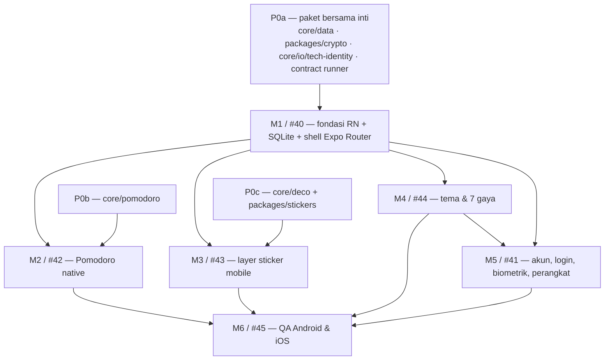

# Keputusan Arsitektur Mobile — state, navigasi, struktur fitur

Tanggal: 26 Oktober 2026 · Penulis: Yoga (System Analyst) · Task Ergonio #59
Status: **final, docs-only**. Tidak ada kode produk yang diubah. Keputusan berlaku untuk `apps/mobile` dan mengikat task fondasi berikutnya.

> **Catatan task Ergonio.** #40–#45 yang disebut di deskripsi #59 sudah **dihapus** dari project `personal-productivity` pada 23 Okt 2026 03:27 (activity log: `[T23-M]`, `[T22-M]`, `[T7-M]`, `[T24-M]`, `[T25-M]`, `[T16-M]`). Nomor di laporan ini adalah label kerja, bukan task yang bisa diambil sekarang. Orchestrator harus membuat ulang task-nya (atau memakai nama T23-M/T22-M/T7-M/T24-M/T25-M/T16-M) sebelum `raka` mulai. Tanpa itu, urutan di §4 tidak punya wadah status.

---

## 0. Ringkasan untuk `raka`

| # | Keputusan | Yang harus dipakai |
|---|---|---|
| 1 | **State** | `zustand@5.0.16`. Store = cermin reaktif `core`, bukan pemilik data. Tidak ada cache domain kedua; TanStack Query belum dipasang di fondasi. |
| 2 | **Navigasi** | **Expo Router** (`expo-router@58.0.26`, SDK 58), file-based, route groups `(auth)`/`(app)`, typed routes. Tidak ada `src/navigation/`, `RootStackParamList`, atau import `@react-navigation/*` langsung. |
| 3 | **Posisi fitur** | `app/` **hanya route**. Logika/UI di `src/features/<domain>/`. Adapter native di `src/platform/`. Store lintas fitur di `src/stores/`. Provider di `src/providers/`. |

**Aturan keras yang tidak boleh dilanggar:**

1. UI tidak pernah menulis SQLite/store domain langsung. Semua tulis lewat use case/repository `packages/core`; store hanya di-`set` dari hasil operasi core.
2. `app/**` maksimal berisi: import screen, parsing/validasi param, dan `_layout` yang menyusun provider. Tidak ada logika bisnis, fetch, atau akses `core` langsung.
3. Token, master key, dan material kunci **tidak pernah** masuk Zustand. Token di SecureStore; kunci hanya di memori saat unlocked.
4. Satu library navigasi: Expo Router. React Navigation hanya dependency transitif Expo Router dan tidak dipanggil langsung oleh kode app.
5. Import antar-fitur dilarang menembus internal. Pakai `src/features/<domain>/index.ts` sebagai public API; yang dipakai bersama naik ke `components/ui`, `hooks`, `stores`, atau paket shared.

**Blocker sebelum `raka` menulis baris pertama:**

- P0a (§4) belum ada: `core/data`, `packages/crypto`, `core/io/tech-identity`, dan contract runner yang bisa dipakai Jest/runner di perangkat. Tanpa ini #40 akan menyalin logika web dan gagal AC T23.
- Task #40–#45 sudah dihapus; harus dibuat ulang dulu.
- Build perangkat (Apple Developer, keystore, EAS, perangkat fisik) adalah blocker eksternal untuk klaim AC, bukan untuk mulai coding (§5 D-4).

---

## 1. Keputusan 1 — Library state mobile

### Opsi yang dipertimbangkan

| Opsi | Untung | Rugi | Putusan |
|---|---|---|---|
| **Zustand 5** | Selector sempit, tanpa provider, kecil, dukungan React Native eksplisit di package exports, devtools opsional | Tidak memaksa struktur; disiplin "store bukan pemilik data" harus dijaga review | **Dipilih** |
| Redux Toolkit | Struktur kuat, devtools matang, middleware jelas | Boilerplate slice/action, bundle lebih besar, overkill untuk satu user local-first | Ditolak |
| Jotai | Atom granular, re-render minimal | Model "satu store = cermin core" pecah jadi banyak atom; sulit menjamin satu jalur tulis | Ditolak |
| Context + `useSyncExternalStore` | Tanpa dependency | Selector/equality manual, rawan re-render seluruh subtree, tidak ada devtools | Ditolak untuk state global |
| TanStack Query sebagai "state library" | Cache server, retry, invalidasi | Domain data bukan milik server; cache kedua di atas SQLite = dua sumber kebenaran dan risiko data basi | Ditolak untuk domain |

### Keputusan

- Paket: **`zustand@5.0.16`** (registry npm, dicek 26 Okt 2026). Instalasi lewat `pnpm --filter @improve-personal/mobile add zustand@5.0.16`, lalu lockfile di-commit.
- **Belum memasang TanStack Query** di fondasi. Domain data dibaca dari repository `core` (SQLite). Kalau #41 butuh cache data milik server (mis. daftar perangkat), baru pakai `@tanstack/react-query@5.104.5` dan **hanya** untuk endpoint akun/perangkat — dilarang membungkus repository core.
- Satu store per concern, bukan satu store raksasa:
  - `src/stores/useSessionStore.ts` — status sesi (`loading | signedOut | locked | ready`), `userId`, aksi `reset()`.
  - `src/stores/useSyncStatusStore.ts` — `synced | pending | offline | error`, waktu sync terakhir.
  - `src/stores/usePrefsStore.ts` — preferensi yang sudah dimuat (tema/gaya aktif), bukan data user.
  - Store domain opsional di `src/features/<domain>/store/useXxxStore.ts` hanya untuk UI state yang dipakai lintas screen dalam fitur itu.
- Bentuk store minimum:

```ts
type SessionState = {
  status: 'loading' | 'signedOut' | 'locked' | 'ready'
  userId: string | null
  reset: () => void
}
```

- Aturan tulis:
  - Screen/hook memanggil aksi store atau use case core; **tidak** memanggil `useStore.setState` dari komponen.
  - Aksi store yang mengubah data memanggil `createRepository`/`createRecordWriter` dari core, lalu memperbarui cermin dari hasil yang dikembalikan core.
  - Dilarang `subscribe` store untuk menulis DB (itu jalur tulis kedua).
  - Dilarang `persist` middleware untuk data domain, token, atau PII. Preferensi persisten lewat `user_prefs`/`expo-sqlite/kv-store`, bukan Zustand persist.
- Reset saat logout/ganti akun: `useSessionStore.getState().reset()`, `useSyncStatusStore.getState().reset()`, kosongkan cache query (kalau ada), hapus DB + kunci DB sesuai prosedur logout. Store tidak boleh menyimpan master key, token, atau blob terdekripsi.
- Pembacaan store wajib selector sempit: `useSessionStore((s) => s.userId)`. Dilarang `useSessionStore()` tanpa selector di komponen yang sering render.

### Konsekuensi / trade-off

- Ada satu lapisan cache lagi di atas repository. Risikonya store drift dari DB; mitigasi: satu arah tulis (core → store), tidak ada tulis balik, dan test integrasi untuk aksi yang mengubah data.
- Zustand tidak memberi struktur. Review wajib menolak store yang menyimpan data server/domain mentah atau melakukan fetch sendiri.
- TanStack Query ditunda. Kalau nanti dipasang, batasnya harus jelas: server-owned data saja, bukan record lokal.

### Langkah konkret

1. Tambah `zustand@5.0.16` ke `apps/mobile/package.json` (via `pnpm ... add`, bukan edit manual tanpa lockfile).
2. Buat `src/stores/` dan tiga store di atas; semuanya tanpa `persist`.
3. Tambah aturan review di `apps/mobile/.claude/rules/code-quality.md` bagian "State" (sudah ada prinsip; tambah satu baris: store tidak menulis DB/fetch sendiri).
4. Test: unit test aksi store dengan repository palsu; test bahwa `reset()` mengosongkan session/sync dan tidak menyisakan `userId`.

---

## 2. Keputusan 2 — Bentuk navigasi

### Opsi yang dipertimbangkan

| Opsi | Untung | Rugi | Putusan |
|---|---|---|---|
| **Expo Router** | File = route, deep link terpusat, typed routes, route groups, code splitting per route, sudah dipilih ADR Q4 | File route bisa jadi "magic"; typed routes masih beta; kurva belajar konvensi folder | **Dipilih** |
| React Navigation manual | Kontrol penuh atas navigator, stabil, dokumentasi luas | Duplikasi definisi route + screen, `RootStackParamList` manual, deep link tersebar, boilerplate | Ditolak |
| Hybrid (Expo Router + stack manual) | Bisa untuk kasus khusus | Dua sumber navigasi, melanggar aturan "satu library" | Ditolak |

### Keputusan

- **Expo Router** (`expo-router@58.0.26`) dengan struktur root `app/`. React Navigation tetap menjadi mesin di bawahnya, tetapi **kode app tidak mengimpor `@react-navigation/*` secara langsung**.
- Route groups:
  - `app/_layout.tsx` — provider global (theme, session bootstrap, safe area, gesture handler), `Stack`/`Slot` root.
  - `app/(auth)/_layout.tsx` + `app/(auth)/login.tsx` (+ recovery/pairing bila masuk scope #41).
  - `app/(app)/_layout.tsx` — auth gate + app-lock gate; `Redirect` ke `(auth)` kalau belum sesi.
  - `app/(app)/(tabs)/_layout.tsx` — tab utama (Daily, Kalender, To-do, Fokus, Lainnya) sesuai produk.
  - `app/(app)/<domain>/...` — layar non-tab, mis. `jadwal/[id].tsx`, `goal/[id].tsx`.
- File route **tipis** (target ≤ 40 baris):
  1. import screen dari `src/features/<domain>/screens`,
  2. baca/validasi param dengan zod,
  3. render screen.
  Tidak ada fetch, `useEffect` data, akses SQLite, atau logika bisnis di `app/**`.
- Penamaan:
  - File route: lowercase/kebab sesuai URL (`to-do.tsx`, `import-export.tsx`, `[id].tsx`).
  - Komponen screen: PascalCase + suffix `Screen` (`TodoListScreen.tsx`), tetap di `src/features/<domain>/screens/`.
  - Route group `(auth)`/`(app)` tidak muncul di URL.
- Type safety:
  - Aktifkan `experiments.typedRoutes: true` di `app.config.ts`; `expo-env.d.ts` di-`.gitignore`.
  - Pakai `Href`, `useRouter`, `useLocalSearchParams` dari `expo-router`. Dilarang `router.push('/x' as never)` atau `as any`.
  - Param divalidasi runtime dengan zod sebelum dipakai; param hanya id/primitif kecil, bukan objek besar/fungsi.
  - Kalau typed routes beta memblokir `tsc --noEmit` di CI: fallback sementara ke konstanta route bertipe di `src/routes.ts` (bukan `src/navigation/`), catat alasannya di PR. Jangan kembali ke `RootStackParamList`.
- Deep link:
  - Konfigurasi terpusat di `app.config.ts` (`scheme`, `ios.associatedDomains`, `android.intentFilters`), bukan di tiap screen.
  - Universal Link/App Link untuk alur sensitif (auth, pairing); custom scheme hanya navigasi non-sensitif.
  - Semua param deep link divalidasi schema; route yang butuh login tetap cek sesi; aksi sensitif butuh konfirmasi.
- Auth gate dan lock gate ada di `app/(app)/_layout.tsx`, bukan di setiap screen. Screen tidak tahu apakah dia di dalam tab atau stack.

### Konsekuensi / trade-off

- `RootStackParamList`, `ParamList` per navigator, dan `src/navigation/` **dihapus dari aturan**. Tipe navigasi datang dari Expo Router.
- File-based routing membuat graf navigasi kurang eksplisit. Mitigasi: route group + `_layout` ownership + daftar route di PR; tidak ada `router.push` string liar tanpa `Href`.
- Typed routes masih beta. Mitigasi: CI `tsc --noEmit`; fallback `src/routes.ts`; jangan mengorbankan tipe.
- Expo Router membawa React Navigation sebagai dependency transitif. Jangan menambah `@react-navigation/native-stack` sendiri; kalau butuh opsi native, pakai `Stack.Screen` dari `expo-router`.

### Langkah konkret

1. `apps/mobile/app.config.ts`: `scheme`, `experiments.typedRoutes: true`, plugin `expo-router`, `ios.associatedDomains`, `android.intentFilters` (placeholder dulu, diisi saat domain staging ada).
2. `apps/mobile/app/_layout.tsx`, `app/(auth)/_layout.tsx`, `app/(app)/_layout.tsx`, `app/(app)/(tabs)/_layout.tsx`.
3. Hapus/ jangan buat `src/navigation/`; jangan definisikan `RootStackParamList`.
4. Ubah `apps/mobile/.claude/rules/code-quality.md` bagian Struktur folder, Penamaan, TypeScript, dan Navigasi (sudah dikerjakan di task ini).
5. Test: `tsc --noEmit`; test route param invalid → fallback/redirect; test auth gate redirect; test deep link param invalid ditolak.

---

## 3. Keputusan 3 — Posisi file fitur

### Opsi yang dipertimbangkan

| Opsi | Untung | Rugi | Putusan |
|---|---|---|---|
| **`app/` route + `src/features/<domain>/`** | Satu sumber route; fitur terisolasi; screen/komponen/hook/store satu tempat; `app/` tipis | Butuh disiplin public API per fitur; route file jadi indirection | **Dipilih** |
| `src/app/` + `src/navigation/` | Semua di `src/`, pola React Navigation klasik | Dua sumber navigasi; bertentangan dengan Expo Router; `src/` jadi campur route + logika | Ditolak |
| Organisasi per tipe (`screens/`, `components/`, `hooks/` di root) | Mudah dicari per tipe | Fitur tersebar; import lintas fitur susah dibatasi; scaling buruk | Ditolak |

### Keputusan

Struktur final `apps/mobile` sesuai §2 `ARCHITECTURE.md`, dengan dua penambahan: `providers/` dan `stores/`:

```
apps/mobile/
├── app/                    # Expo Router: file = route, tipis
├── src/
│   ├── features/<domain>/  # per domain produk, bukan per layar
│   │   ├── screens/        # layar: susun komponen + panggil hook
│   │   ├── components/     # komponen khusus domain
│   │   ├── hooks/          # useXxx - logika & data fetching domain
│   │   ├── store/          # opsional: Zustand khusus domain
│   │   └── index.ts        # public API fitur
│   ├── platform/           # adapter: SQLite, SecureStore, biometrik, notifikasi, HTTP, AppState
│   ├── providers/          # provider React lintas fitur (theme, session, query bila ada)
│   ├── stores/             # Zustand lintas fitur (session, sync, prefs)
│   ├── components/ui/      # primitif UI reusable (Button, Text, Card)
│   ├── hooks/              # hook lintas domain
│   ├── theme/              # token desain (dari packages/tokens)
│   └── utils/              # fungsi murni
├── assets/                 # font, gambar, ikon
├── docs/                   # symlink ke docs/ root
└── app.config.ts · eas.json · metro.config.js · tsconfig.json
```

Aturan:

- `<domain>` = domain produk, bukan satu layar: `schedule`, `todo`, `eisenhower`, `pomodoro`, `countdown`, `habit`, `memo`, `goal`, `deco`, `overview`, `daily`, `account`, `sync`, `appearance`. Satu layar boleh menyusun beberapa domain.
- `app/` hanya route. `src/features` tidak boleh mengimpor `app/`; `app/` boleh mengimpor `src/features/<domain>` lewat `index.ts`.
- Import antar-fitur hanya lewat `src/features/<domain>/index.ts`. Dilarang `import { x } from '../other-feature/components/...'`. Yang dipakai bersama naik ke `components/ui`, `hooks`, `stores`, `platform`, atau paket shared.
- `src/components/ui/**` dilarang memanggil API, membaca store global, atau mengimpor `features/*`.
- `src/platform/**` satu-satunya tempat import modul native (`expo-sqlite`, `expo-secure-store`, `expo-local-authentication`, `expo-notifications`, `react-native-libsodium`, dll.). Fitur memakai interface dari `core/ports.ts` atau tipe lokal, bukan modul native langsung.
- `src/utils/**` murni: tanpa React, tanpa I/O, tanpa `Date.now()` langsung (waktu di-inject).
- `src/theme/**` hanya adapter token + provider; nilai warna/spacing tidak boleh hardcode di komponen.
- Tidak ada folder generik baru (`helpers/`, `misc/`, `common/`).

### Konfirmasi §2

Struktur §2 `ARCHITECTURE.md` **final**, dengan koreksi berikut (sudah dicatat di dokumen):

- `src/navigation/` tidak ada dan tidak akan dibuat.
- `src/app/` tidak ada; `app/` berada di root `apps/mobile`.
- `src/providers/` dan `src/stores/` ditambahkan karena keputusan state di §1; keduanya lintas fitur.
- `platform/` menggantikan `services/` untuk adapter dunia luar.

### Konsekuensi / trade-off

- Route file menambah satu lapisan indirection. Mitigasi: batas 40 baris + review; kalau route file mulai berisi logika, itu bug struktur.
- Public API per fitur menambah `index.ts`. Mitigasi: hanya ekspor yang dipakai lintas fitur; jangan `export *` asal-asalan.
- Domain yang saling terkait (Daily memakai todo/habit/schedule) harus menyusun di layer screen/hook, bukan saling impor internal. Kalau butuh data gabungan, taruh agregasi di `core/calc` atau hook lintas domain.

---

## 4. Urutan implementasi dan batas file

### 4.1 Dependency nyata



Yang **memblokir** langkah lain:

- **P0a memblokir M1.** Tanpa `core/data` + `packages/crypto`, M1 hanya bisa scaffold; integrasi core akan menyalin logika web dan melanggar AC T23 (tidak ada duplikasi data/kripto/sync).
- **M1 memblokir M2–M5.** Shell, adapter, provider, dan route harus ada dulu.
- **M4 memblokir M5** kalau `src/providers/index.tsx` belum punya slot ThemeProvider. M1 wajib menyiapkan slot; kalau tidak, urutkan M4 sebelum M5.
- **M2–M5 memblokir M6.** QA tidak bisa membuktikan AC fitur yang belum ada.
- **P0b hanya memblokir M2; P0c hanya memblokir M3.** Keduanya boleh dikerjakan di PR yang sama dengan fiturnya, asal perubahan shared mendarat lebih dulu dan web tetap hijau.

### 4.2 Fase dan isi

| Fase | Label | Isi | Definisi selesai |
|---|---|---|---|
| **P0a** | prasyarat bersama | Pindahkan `record-codec`, `repository`, `record-writer`, `uuid`, bagian generik `session` ke `packages/core/src/data/`; buat `packages/crypto` (primitive murni, `SodiumModule` di-inject); pindahkan `TECH_IDENTITY`/marker backup ke `core/io/`; refactor contract suite agar menerima runner | Web tetap hijau lewat re-export shim; `packages/core` + `packages/crypto` test lulus; tidak ada import DOM/RN di paket |
| **M1** | #40 / T23-M | Scaffold Expo SDK 58 (dev build), `expo-router`, TS strict, ESLint/Prettier/Jest, `app.config.ts`, Metro monorepo; adapter `StorageAdapter` SQLite+SQLCipher; `SecureKeyStore`; `CryptoProvider`; `Scheduler`; `HttpClient`; session storage abstraction; sync wiring dengan fake HTTP di test; satu vertical slice baca/tulis (mis. Daily) | APK + iOS build di perangkat; contract suite SQLite lulus di perangkat; `PRAGMA cipher_version` guard; app memakai `@improve-personal/core`/`contracts`/`tokens` tanpa salinan; satu slice jalan |
| **M2** | #42 / T7-M | State machine Pomodoro dari core, ticker global, `AppState`, notifikasi lokal, riwayat sesi | Timer akurat ±1 detik setelah background 5 menit; test timestamp, bukan interval; notifikasi terjadwal |
| **M3** | #43 / T24-M | Picker + layer hias RN, registry anchor, breakpoint `phone`/`tablet`, performa 100 sticker | Hiasan HP vs desktop terpisah; `pointerEvents` benar di luar mode hias; FPS release terukur |
| **M4** | #44 / T25-M | `ThemeProvider`, adapter token RN, font, menu Tampilan, persist `user_prefs`, kontras 21 kombinasi | Gaya terpasang sebelum render pertama; ganti gaya tanpa restart/kedip; kontras AA; font offline |
| **M5** | #41 / T22-M | Login OTP/Google, session bearer, app lock biometrik, daftar perangkat, logout, indikator sync; passkey/QR/recovery sesuai D-1 | Sesi tersimpan aman; unlock biometrik membuka item SecureStore; logout menghapus token/cache/state; AC akun sesuai scope yang diputuskan |
| **M6** | #45 / T16-M | Matriks bukti AC per platform, Maestro, performa release, security checklist | Semua AC mobile terbukti di Android & iOS nyata; nol blocker/mayor |

### 4.3 Batas file per langkah

| Langkah | Boleh menulis | Dilarang menyentuh tanpa koordinasi |
|---|---|---|
| **P0a** | `packages/core/src/data/**`, `packages/core/src/io/**`, `packages/core/src/adapters/contract.ts`, `packages/core/src/index.ts`, `packages/core/package.json`, `packages/crypto/**`, shim di `apps/web/app/utils/{storage,crypto}/**`, test web terkait | `apps/mobile/**`, UI web, `packages/contracts` (kecuali subpath export yang disepakati) |
| **M1 / #40** | `apps/mobile/**` kecuali folder fitur M2–M5; `apps/mobile/{package.json,app.config.ts,metro.config.js,tsconfig.json,eslint.config.*,jest.config.*,jest.setup.ts,eas.json}`, `src/platform/**`, `src/providers/index.tsx`, `src/stores/**`, `src/components/ui/Page.tsx`, `src/theme/index.ts` (placeholder), route placeholder; root `package.json` (`lint-staged`), `turbo.json` | `apps/web/**`, `packages/core/**` (kecuali hasil P0a), `packages/contracts/**`, `docs/**`, root `ARCHITECTURE.md`, `.claude/**` |
| **M2 / #42** | `src/features/pomodoro/**`, `src/platform/notifications.ts`, `src/providers/TickerProvider.tsx`, `app/(app)/(tabs)/focus.tsx`, `packages/core/src/pomodoro/**` (kalau P0b belum) | `app/_layout.tsx`, `src/providers/index.tsx`, `src/theme/**`, `src/features/{deco,account}/**` |
| **M3 / #43** | `src/features/deco/**`, `src/components/ui/Deco*`, `src/platform/decoAnchors.ts`, `packages/stickers/**`, `packages/core/src/domain/entities/decoration*.ts` (geometri, kalau P0c belum), route yang hanya membungkus `Page` | `app/_layout.tsx`, `src/providers/index.tsx`, `src/theme/**`, `src/features/{pomodoro,account}/**` |
| **M4 / #44** | `src/theme/**`, `src/features/appearance/**`, `src/providers/ThemeProvider.tsx`, `app/(app)/pengaturan/tampilan.tsx`, `packages/tokens/src/**` (aditif adapter RN bila perlu), `assets/fonts/**` | `src/providers/index.tsx` (kecuali slot), `app/_layout.tsx` (kecuali slot), fitur lain |
| **M5 / #41** | `src/features/account/**`, `src/platform/{biometric,passkeys,pairing}.ts`, `src/providers/SessionProvider.tsx`, `app/(auth)/**`, `app/(app)/akun/**`, `packages/crypto/src/{passkey,recovery,transfer}*.ts` (kalau belum di P0a) | `src/theme/**`, `src/features/{pomodoro,deco}/**`, `src/providers/index.tsx` (kecuali slot) |
| **M6 / #45** | `apps/mobile/e2e/**`, `reports/**`, fixture/test QA | Semua kode produk |

Aturan tambahan:

- **Satu file bersama satu pemilik.** `app/_layout.tsx`, `app/(app)/_layout.tsx`, `app/(app)/(tabs)/_layout.tsx`, `src/providers/index.tsx`, `package.json`, `app.config.ts`, `metro.config.js`, `tsconfig.json`, `jest.setup.ts` milik M1. M2–M5 hanya menambah file provider terpisah; M1 wajib menyiapkan slot (`ThemeProvider`, `SessionProvider`, `TickerProvider`, `NotificationScheduler`, `DecoLayer`) sejak awal.
- **P0a dan scaffold M1 boleh paralel** karena folder berbeda; integrasi core di M1 menunggu P0a hijau. Kalau ingin sederhana: P0a selesai dulu.
- **M2, M3, M4 boleh paralel** setelah M1 dan prasyarat masing-masing. **M5 setelah M4** kecuali slot provider sudah disiapkan.
- **Web dan mobile tidak saling import.** Semua yang dipakai bersama harus lewat `packages/*`.

### 4.4 Paket bersama yang dipakai

| Paket | Dipakai untuk | Status | Pemilik perubahan |
|---|---|---|---|
| `@improve-personal/contracts` | DTO/schema auth, sync, devices, error; `mobileSessionDtoSchema` untuk token bearer | Ada | `bayu` (kalau ada perubahan) |
| `@improve-personal/core` | `domain`, `recurrence`, `calc`, `repository`, `sync`, `io`, `ports`; setelah P0a: `data/` | Ada; `data/` belum | `bayu` |
| `packages/crypto` (baru) | Primitive XChaCha20-Poly1305, KDF, envelope, recovery, passkey PRF (di-inject) | Belum ada | `bayu` + `arif` review |
| `packages/tokens` | `themes`, `palette`, `uiStyles`, `space`, `radius`, `typography`, `fontFamily` | Ada | `dimas`/`raka` untuk adapter RN |
| `packages/stickers` (baru) | Katalog sticker + maskot, satu sumber ID | Belum ada | `raka` (M3) |
| `@improve-personal/config` | Base tsconfig/eslint/prettier | Ada | `raka` untuk config mobile |

Catatan: jangan menambah subpath export di `core`/`contracts` tanpa bukti bundle. Pakai barrel dulu; ukur dengan `expo export`/Metro. Kalau budget 6 MB terlampaui, baru pecah subpath dan catat di PR.

### 4.5 Detail teknis yang paling mudah salah (wajib dibaca `raka`)

**SQLite / SQLCipher**

- `expo-sqlite@58.0.14` + plugin `useSQLCipher: true`; **tidak didukung Expo Go** (docs Expo). Wajib `expo prebuild` + dev build.
- `PRAGMA key` **tidak error** kalau binary tanpa SQLCipher; DB jadi plaintext. Guard wajib: `PRAGMA cipher_version` harus mengembalikan baris, kalau null → refuse to run.
- `PRAGMA journal_mode=WAL`, `PRAGMA synchronous=FULL`, `PRAGMA foreign_keys=ON` saat buka. `FULL` wajib untuk record + outbox.
- Satu koneksi + mutex/antrean aplikasi. `withTransactionAsync` memasukkan query lain yang berjalan bersamaan ke transaksi; `withExclusiveTransactionAsync` memakai koneksi terpisah. Serialisasi di level aplikasi lebih aman untuk kontrak `StorageAdapter`.
- `putRecord` menulis record + index + outbox dalam satu transaksi; `index=null` menghapus baris index lama; `'keep'` tidak menyentuh index. Ikuti `packages/core/src/ports.ts` dan `packages/core/src/adapters/contract.ts`.
- `createdAtMs` dipertahankan; `updatedAtMs` dari index/clock. `markOutboxFailure` tidak boleh menyimpan blob/token.

**SecureStore / biometrik**

- Slot `device` (wrapping key + wrapped MK) pakai `requireAuthentication: true` dan `keychainAccessible: WHEN_UNLOCKED_THIS_DEVICE_ONLY`. Token sesi di item terpisah tanpa prompt.
- Bedakan "item tidak ada" vs "prompt dibatalkan/invalidated". Jangan menyimpulkan data rusak dari pembatalan.
- Perubahan biometrik dapat membuat item tidak bisa dibaca; alur pemulihan wajib (passkey/recovery/QR), bukan membuat MK baru.
- Logout: hapus token, DB, kunci DB, state store, cache; jangan meninggalkan data user.

**Contract suite**

- `packages/core/src/adapters/contract.ts:1` mengimpor `vitest` langsung. Refactor P0a: ekspor `runStorageAdapterContractTests(factory, runner)`; web membungkus Vitest, mobile memakai Jest/runner di perangkat.
- `expo-sqlite` asli tidak jalan di Node. Bukti AC T23 harus dari perangkat/SQLCipher nyata: layar dev-only + flow Maestro, bukan mock Jest.

**Metro / monorepo**

- Konfigurasi `watchFolders` + `nodeModulesPaths` untuk pnpm workspace; uji import `@improve-personal/core` dari mobile di hari pertama.
- `expo-router` punya peer `react-native-safe-area-context`, `react-native-screens`, `react-native-gesture-handler`, dan `react-native-reanimated`; pasang lewat template `create-expo-app`/`expo install`, jangan pin manual tanpa mengecek kompatibilitas SDK 58.
- `react-native-libsodium@1.7.0` menyediakan API mirror libsodium; `TextEncoder`/`TextDecoder` dan `crypto.getRandomValues` di Hermes harus diuji/polyfill sebelum crypto diimpor.
- Jangan menyalin source paket ke `apps/mobile`; kalau Metro tidak resolve, perbaiki konfigurasi.

**Token desain**

- `packages/tokens` berisi nilai CSS (`'16px'`, shadow string, font stack). Adapter RN di `src/theme/` harus mem-parse ke angka/nama font Expo; jangan hardcode ulang warna/spacing.
- Font gaya aktif harus siap sebelum render pertama; splash ditahan sampai font siap, lalu swap tanpa kedip.

---

## 5. Yang masih butuh keputusan user

Tiga keputusan arsitektur di atas **tidak** menunggu user. Item berikut adalah scope produk/eksternal yang tidak boleh ditebak:

### D-1 — Scope akun mobile (#41 / T22-M)

**Pertanyaan:** paritas penuh PRD F15 (login OTP/Google, passkey onboarding + PRF, QR tambah perangkat, lupa OTP, hapus akun, daftar perangkat + revoke) atau fase 1 (login OTP/Google, passkey onboarding, app lock biometrik, daftar perangkat, logout, indikator sync) dengan QR/recovery/hapus akun sebagai task lanjutan?

- **Rekomendasi (default):** fase 1 **tetap termasuk passkey onboarding** karena PRD F15 mewajibkan passkey setelah login pertama. QR, lupa OTP, dan hapus akun boleh task lanjutan, tetapi jangan menandai #41 selesai untuk AC PRD yang belum ada.
- **Dampak kalau salah pilih:** paritas penuh membuat #41 menjadi `L` dan menambah dependensi native (`react-native-passkeys`, `expo-camera`) serta domain/AASA; fase 1 tanpa passkey melanggar PRD dan membuat pemulihan lintas perangkat tidak mungkin.
- **Catatan:** web T22 (#36) sudah `done` (23 Okt 2026 03:37), jadi paritas penuh tidak lagi terblokir web.

### D-2 — Arti "widget native" Pomodoro

**Pertanyaan:** AC T7-M "widget native" berarti widget home screen (WidgetKit/App Widget) atau mini player in-app + notifikasi lokal?

- **Rekomendasi (default):** mini player in-app + notifikasi lokal. Widget home screen = task terpisah.
- **Dampak kalau salah pilih:** widget home screen butuh native extension iOS, App Widget Android, App Group/SharedPreferences, dan desain storage yang bisa dibaca proses widget. SQLCipher tidak bisa dibaca widget begitu saja; ini bukan pekerjaan `S`.

### D-3 — Fallback saat biometrik berubah/dibatalkan

**Pertanyaan:** kalau item SecureStore `device` tidak bisa dibaca, jalurnya apa?

- **Rekomendasi (default):** passkey → recovery key + envelope → QR dari perangkat lain. **OTP tidak boleh membuka kunci** (ADR 10).
- **Dampak kalau salah pilih:** fallback ke kredensial perangkat (device passcode) lebih mudah tetapi melemahkan model "biometrik membuka item Keychain". Tanpa passkey/recovery, user bisa kehilangan data — itu konsekuensi E2EE yang harus dijelaskan di onboarding, bukan bug.

### D-4 — Kredensial build & perangkat bukti

**Pertanyaan:** apakah Apple Developer Program, keystore Android, EAS account, satu Android mid-range, satu iPhone fisik, dan domain staging sudah tersedia?

- **Rekomendasi (default):** siapkan sebelum M1 selesai; daftarkan bundle/package id, associated domains, AASA/assetlinks.
- **Dampak kalau salah pilih:** tanpa ini M1 hanya bisa dibuktikan di emulator/simulator; AC "build APK & iOS di perangkat nyata" dan passkey/QR tidak bisa lulus. Coding boleh mulai, klaim selesai tidak.

---

## 6. Risiko dan edge case

| # | Risiko | Dampak | Mitigasi |
|---|---|---|---|
| R-01 | SQLCipher tidak aktif tanpa disadari | DB plaintext, melanggar security | `PRAGMA cipher_version` guard; `useSQLCipher`; prebuild; test file DB tidak bisa dibuka SQLite biasa |
| R-02 | Store Zustand jadi sumber kebenaran kedua | Data beda dengan SQLite, outbox/tombstone bocor | Satu arah tulis core → store; larang fetch/tulis DB dari store; test integrasi |
| R-03 | Typed routes beta memblokir CI | `tsc` gagal, mendorong cast `as any` | CI typecheck; fallback `src/routes.ts` bertipe; larang cast |
| R-04 | File route jadi gemuk | Logika bisnis tersebar, sulit dites | Batas 40 baris; review; screen di `features` |
| R-05 | Import antar-fitur menembus internal | Coupling, circular import | Public `index.ts`; lint boundaries bila tersedia; promosi ke shared |
| R-06 | Metro tidak resolve workspace TS | Build gagal | `watchFolders`/`nodeModulesPaths`; uji import hari pertama; jangan salin source |
| R-07 | Library native belum kompatibel New Arch/RN 0.88 | Build/crash | Spike kompilasi di M1; pin versi; kalau blocker, turun SDK dengan ADR |
| R-08 | Biometrik berubah → item SecureStore invalid | User tidak bisa buka data | `KeyUnavailableError`; alur passkey/recovery/QR; uji di perangkat |
| R-09 | Timer background iOS/Android | Pomodoro terlihat berhenti | Hitung dari `endsAt`/`startedAt`; notifikasi lokal; rekonsiliasi saat foreground |
| R-10 | Logout tidak membersihkan semua | Data user tertinggal | Satu fungsi logout: token, DB, kunci DB, store, cache; test |
| R-11 | 100 sticker tidak 60 FPS | AC T24-M gagal | SharedValue per sticker; `useAnimatedStyle`; `pointerEvents="none"`; PNG maskot |
| R-12 | Font 7 gaya membengkakkan bundle/kedip | Gagal budget/AC | Subset latin; load font aktif sebelum render; ukur APK/AAB |
| R-13 | Deep link/auth redirect tidak divalidasi | Bypass sesi/aksi sensitif | Validasi zod; cek sesi di layout; konfirmasi aksi sensitif; universal link |
| R-14 | Task #40–#45 tidak ada | Rencana tidak punya wadah status | Orchestrator membuat ulang task sebelum eksekusi |

---

## 7. Verifikasi task ini

- `pnpm exec prettier --check reports/mobile-decisions.md apps/mobile/ARCHITECTURE.md apps/mobile/.claude/rules/code-quality.md` → exit 0.
- `pnpm check:agent-docs` → dicek; kalau gagal, dilaporkan ke orchestrator (tidak menjalankan `pnpm sync:agents`).
- Tidak ada perubahan kode di `apps/mobile/**`, `apps/web/**`, atau `packages/**`.
- `git diff --stat` hanya memuat tiga file docs di atas.

**Rules dibaca:** `CLAUDE.md` (root), `.claude/rules/{shared-security,shared-code-quality,ergonio-status-flow}.md`, `apps/mobile/AGENTS.md`, `apps/mobile/CLAUDE.md`, `apps/mobile/.claude/rules/{security,performance,code-quality}.md`, `apps/mobile/ARCHITECTURE.md`, `ARCHITECTURE.md` (root), `docs/PRD.md` (F15/F16, tabel requirement, PARALEL), serta sumber `packages/{core,contracts,tokens}` dan `apps/web` yang dirujuk.

---

## 8. Sumber fakta

| Klaim | Sumber |
|---|---|
| `apps/mobile` belum ada kode; tiga keputusan tertunda (sekarang final di §7) | `apps/mobile/ARCHITECTURE.md` (status & §7) |
| Aturan struktur & navigasi lama (React Navigation) | `apps/mobile/.claude/rules/code-quality.md` bagian Struktur folder, TypeScript, Navigasi |
| Port & adapter `StorageAdapter`/`SecureKeyStore`/`CryptoProvider`/`Scheduler`/`HttpClient`/`Clock` | `packages/core/src/ports.ts` |
| Contract suite mengimpor `vitest` | `packages/core/src/adapters/contract.ts:1` |
| Provider kripto web memerintahkan pindah, bukan salin | `apps/web/app/utils/crypto/provider.ts:14-18` |
| Logika data generik masih di web | `apps/web/app/utils/storage/{record-codec,repository,record-writer,uuid}.ts` |
| Session web memisahkan orkestrasi platform | `apps/web/app/utils/storage/session.ts` |
| Dekorasi web masih `localStorage` | `apps/web/app/composables/useDeco.ts` |
| Entitas dekorasi per breakpoint/anchor | `packages/core/src/domain/entities/decoration.ts` |
| Token berupa string CSS/font stack | `packages/tokens/src/{scale,styles}.ts` |
| AC T23/T25/T16 | `docs/PRD.md:1094-1096` |
| Sync: kapan & batas batch | `ARCHITECTURE.md:268-273`, `packages/contracts/src/sync.ts` |
| Mobile session DTO membawa token | `packages/contracts/src/auth.ts:212-221` |
| Hanya envelope passkey yang di server | `ARCHITECTURE.md:219-234` |
| Tabel fisik SQLite | `apps/web/docs/database.dbml` |
| Google redirect mobile masih custom scheme | `apps/web/.env.example:64` |
| Task #40–#45 dihapus | Ergonio activity log project `personal-productivity`, 23 Okt 2026 03:27 |
| Web T22 #36 selesai | Ergonio task #36, `completedAt` 23 Okt 2026 03:37 |
| Versi paket | registry npm, dicek 26 Okt 2026: `expo@58.0.19`, `expo-router@58.0.26`, `expo-sqlite@58.0.14`, `expo-secure-store@58.0.2`, `zustand@5.0.16`, `@tanstack/react-query@5.104.5`, `react-native-libsodium@1.7.0`, `react-native-passkeys@0.4.2`, `jest-expo@58.0.12`, `@testing-library/react-native@14.1.0` |
| SQLCipher tidak didukung Expo Go; `PRAGMA key` tidak error tanpa SQLCipher | Dokumentasi Expo SQLite v58 |
| Typed routes masih beta, diaktifkan `experiments.typedRoutes` | Dokumentasi Expo Router "Typed routes" |
