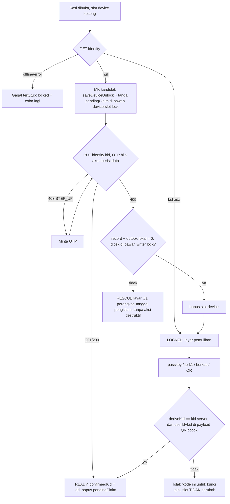

# Spec #120 - Identitas kunci (KID), blob record v2, dan pencegahan split-brain (v2)

> **HISTORIS - DISUPERSEDE.** Dokumen ini ditulis untuk app yang SUDAH launching dengan data asli yang harus
> dimigrasikan (rollout F0-F3, coexistence v1/v2, job re-seal, OTP step-up, split-brain rescue S7, dll). User
> mengonfirmasi app belum launching dan tidak ada data asli/staging/beta sama sekali, jadi seluruh mekanisme
> kompatibilitas-mundur di dokumen ini (§2.3 step-up, §2.4 retire berjenjang, §3 migrasi/split-brain, §4.5 job
> re-seal, §5 rollout F0-F3, S5, S7, S8) **DIBUANG** dan TIDAK diimplementasikan. Yang benar-benar dibangun jauh
> lebih sederhana: KID + registry satu-KID-aktif (S1, S2 versi ringkas), blob v2 tanpa jalur v1 ganda (S1, S3, S4),
> klaim KID sebelum sesi `ready` dengan rollback-ke-`locked` saat konflik pada kunci baru (S4 + fix lockout), dan
> karantina `reject`/`foreign` di controller sync (S6) - lihat komentar task Ergonio #120 untuk detail & hasil
> verifikasi final. Bagian di bawah ini tetap dipertahankan sebagai referensi desain lengkap (mis. layout byte §4.1,
> AAD kanonik §4.2 - keduanya SAMA dengan yang dipakai implementasi nyata), tapi JANGAN dibaca sebagai deskripsi
> sistem yang berjalan hari ini untuk bagian rollout/migrasi/rescue.

Penulis: Yoga (system analyst). Status: SPESIFIKASI v2 (historis - lihat catatan di atas).
Revisi v2 menyerap seluruh review `arif` (`reports/security-120-key-identity.md`: 0C/5H/6M/4L) dan keputusan user atas
Q1-Q6. Isi v1 yang tidak dibantah review tetap dipakai. Sumber: ARCHITECTURE.md §3/§5-§9/§14 dan kode yang dirujuk
`path:line`. `apps/mobile` belum punya `src/` dan `packages/crypto` belum ada, jadi format yang dikunci di sini tinggal di
`packages/contracts` supaya mobile nanti cukup memakainya.

## 0. Keputusan final & sisa pertanyaan terbuka

Q1-Q6 sudah **DIPUTUSKAN** user (komentar task "Keputusan user atas pertanyaan terbuka"), P1/P2 menyusul (komentar "Keputusan
final P1/P2" + verifikasi putaran 2 arif). Bagian ini tidak menawarkan opsi lagi.

| # | Keputusan (mengikat) | Dipakai di |
|---|---|---|
| Q1 | Split-brain: user memilih di layar khusus yang menampilkan perangkat + tanggal pengklaim. Tidak ada aksi destruktif sampai rescue selesai. | §3, S7 |
| Q2 | Reset identitas **diperketat**: syarat "0 record ber-header KID itu" (bukan "0 record + 0 envelope"), wajib step-up OTP, email pemberitahuan, cooldown 24 jam yang bisa dibatalkan perangkat ber-`confirmedKid`. | §2.4, S2, S5 |
| Q3 | Rotasi MK ditunda. Copy UI jujur: "mencabut perangkat menghentikan sesinya, tidak memutar kunci". | §8, S5 |
| Q4 | `userId` masuk AAD. Konsekuensinya export/import wajib re-seal. | §4, S1, S4 |
| Q5 | Antar fase minimal 14 hari, dan sebelum naik fase telemetri agregat per hari (tanpa userId/KID) harus < 1% error. Grace cutoff 7 hari hanya toleransi jam, **bukan** kontrol keamanan. | §5, S8 |
| Q6 | Minimisasi isi tombstone dijadikan task terpisah, dikerjakan belakangan. | out of scope |
| L3 | Padding: **ya**, bucket 256 B (`sodium.pad` di dalam plaintext sebelum seal, tanpa header baru). Masuk layout v2 dan vektor emas S1. | §4, S1, S4 |
| P1 | Min-version SW: **HANYA andalkan pipeline** (build pra-R1 dihapus dari pipeline deploy setelah F2) ditambah `426`. Tidak ada min-version check di SW: SW lama tidak bisa memveto SW baru dan pra-R1 tidak punya pengecekan versi (security putaran 2 §6). | §5.2, S8 |
| P2 | Karantina `tamper`: disimpan sampai user menghapusnya, dengan batas jumlah (500 blob/akun) **dan** batas byte total (~20 MB/akun), supaya server tidak bisa mengisi 500 x 1 MB (`sync.ts:62`) dan menghabiskan kuota record (jalur #108). Penggusuran tertua (server bisa membanjiri untuk menghapus bukti) diterima dan dicatat. Karantina ikut terhapus saat hapus akun/data lokal (UU PDP). | §4.4, S6 |

Tidak ada pertanyaan terbuka tersisa di level spec. Desain mekanisme swap S7 (W4a/W4b) masih harus diputuskan (AC S7).

## 1. Ringkasan & scope

Akar masalah ada tiga:
(a) Penjaga "akun sudah punya kunci" hanya keberadaan envelope passkey (`useLocalData.ts:81-89`, `:146`;
`session.ts:180-187`). Tanpa passkey, perangkat kedua membuat MK baru (`session.ts:233-248`), dan `putEnvelope` menimpa
envelope tanpa syarat (`server/services/keys.ts:67-100`, `:85`).
(b) AAD blob hanya berisi `recordId` (`provider.ts:90-103`), sementara `hlc`/`deleted` adalah metadata polos
(`contracts/src/sync.ts:105-112`). Server bisa me-rollback isi atau membalik `deleted`, dan jalur #111 menerapkan
tombstone tanpa dekripsi (`core/src/sync/pull.ts:46-51, 227, 316-322`).
(c) Tidak ada KID, sehingga "kunci lain" tidak bisa dibedakan dari "rusak" (heuristik `keyProven`, `controller.ts:489-530`).

**In scope:** KID + registry satu-KID-aktif per akun, klaim dengan step-up untuk akun berisi data, jalur retire (Q2), blob
v2 (header + AAD kanonik + padding), keputusan pull berbasis (prefix, KID) + `v1Closed`, job re-seal v1 dorman,
`write`/cutoff monoton di client, rollout F0-F3 dengan 426 untuk push **dan** pull, rescue split-brain, vektor uji emas.
**Out of scope:** rotasi MK (format disiapkan, §8), minimisasi tombstone (Q6), pemindahan provider ke `packages/crypto`,
dan perlindungan terhadap withholding/snapshot lama seluruh akun (§7).

## 2. Identitas kunci

### 2.1 KID
- `kid = crypto_kdf_derive_from_key(16, subkey_id=1, ctx="ip-keyid", MK)`. Konteks berbeda dari `ip-data-`
  (`master-key.ts:37-40`) dan `ip-passk` (`passkey.ts:41`).
- BLAKE2b berkunci adalah PRF, jadi KID tidak membocorkan MK atau data key. Panjang 16 B memberi second-preimage 2^128.
- `deriveKid` dihitung **sebelum** `zeroKey` (`session.ts:189-192`) atau lewat `withMasterKey`.
- Wire: base64url tanpa padding, 22 karakter (`kidSchema` `^[A-Za-z0-9_-]{22}$`).
- **KID bukan bukti kepemilikan kunci.** Siapa pun yang melihat satu blob tahu KID-nya, jadi server DILARANG memperlakukan
  "mengirim KID yang benar" sebagai autentikasi.
- **KID adalah pengenal pseudonim (L1, UU PDP).** DILARANG di-log, dikirim ke Sentry/analytics, atau ditaruh di URL.

### 2.2 Registry server (`account_keys`) dan CAS
```
account_keys(user_id uuid FK users ON DELETE CASCADE,
             kid bytea NOT NULL CHECK (octet_length(kid) = 16),          -- Postgres tidak punya bytea(16)
             status key_status('active','retired') NOT NULL DEFAULT 'active',
             created_by_device_id uuid NULL FK devices ON DELETE SET NULL,
             created_at timestamptz NOT NULL, retired_at timestamptz NULL,
             retire_after timestamptz NULL, retire_requested_by_device_id uuid NULL FK devices ON DELETE SET NULL,
             PRIMARY KEY (user_id, kid))
CREATE UNIQUE INDEX uq_account_keys_active ON account_keys(user_id) WHERE status = 'active'   -- SQL tangan, pola 0001
account_key_devices(user_id, kid, device_id FK devices ON DELETE CASCADE, confirmed_at, PRIMARY KEY(user_id,kid,device_id))
records.kid bytea NULL CHECK (kid IS NULL OR octet_length(kid) = 16)    -- diisi saat push v2; v1 = NULL
CREATE INDEX ix_records_user_kid ON records(user_id, kid) WHERE kid IS NOT NULL
```
Penambahan kolom nullable tanpa default hanya mengubah metadata di Postgres, sehingga tidak menulis ulang tabel `records`.
`records.kid` dibutuhkan supaya syarat "0 record ber-KID itu" (Q2) bisa dihitung lewat indeks, bukan dengan mem-parse
semua blob.

**CAS `PUT /v1/keys/identity {kid, otp?}` (M5): dua statement dalam satu transaksi, bukan satu statement ajaib.**
1. `INSERT INTO account_keys(...) VALUES (...) ON CONFLICT DO NOTHING RETURNING kid`, **tanpa** target konflik. Dengan
   begitu tabrakan di partial index maupun PK sama-sama jatuh ke DO NOTHING. Kalau target dipasang, predikatnya wajib persis
   `WHERE status='active'`, jadi lebih aman tanpa target. Di READ COMMITTED, INSERT menunggu baris konflik yang belum commit,
   sehingga dua klaim tidak bisa sama-sama menang.
2. Kalau ada baris kembali: `201`, lalu catat `account_key_devices`. Kalau tidak ada:
   `SELECT kid FROM account_keys WHERE user_id=$1 AND status='active'`.
   - KID sama -> `200` (idempoten) dan catat `account_key_devices`.
   - KID beda -> `409 KEY_IDENTITY_CONFLICT`. Body tidak memuat KID lawan, hanya `claimedAt` + label perangkat pengklaim
     (untuk Q1).
   - Tidak ada baris aktif (bertabrakan dengan finalisasi retire), atau konflik PK dengan baris `retired` ber-KID sama ->
     ulangi transaksi **sekali**, lalu `409`. KID yang sudah di-retire tidak bisa diklaim ulang; itu disengaja, karena kunci
     yang di-retire dianggap hilang.
- Finalisasi retire yang jatuh tempo dijalankan **di transaksi terpisah sebelum** CAS (§2.4), supaya CAS tetap dua statement.
- `GET /v1/keys/identity` -> `{ kid|null, claimedAt|null, claimedByDeviceLabel|null, retireAfter|null,
  recordFormat: { write: 1|2, v1CutoffMs: number|null } }`. Client memperlakukan `recordFormat` sebagai **petunjuk** (§5.2).
- Guard tambahan (defense in depth):
  1. Guard `putEnvelope` memeriksa KID aktif lalu meng-upsert dalam **satu transaksi**. Envelope tanpa `kdfParams.kid`, atau
     dengan `kid` yang salah, ditolak `409` setelah identitas ada. `kdfParams` adalah record bebas
     (`contracts/src/keys.ts:64-73`) dan client lama hanya membaca `kdf`/`ver` (`passkey.ts:169`).
  2. Push blob v2 yang KID header-nya bukan KID aktif -> `rejected`. Parser header ada di `packages/contracts`
     (ARCHITECTURE §3: server hanya mengimpor contracts).
- Rate limit scope `keys:identity` per user berlaku untuk PUT, DELETE, dan POST otp.
- **CSRF:** route identity hidup di `/v1` dengan method mutasi, jadi otomatis tercakup `server/middleware/10-csrf.ts:57-68`
  (cek `Sec-Fetch-Site`/`Origin` bila ada cookie sesi). AC S2 menguji hal ini secara eksplisit, supaya route baru tidak
  menjadi pengecualian.

### 2.3 Step-up untuk klaim pada akun berisi data (H2)
- Server menganggap akun **berisi data** kalau punya >= 1 baris `records` atau >= 1 envelope. Klaim pada akun seperti ini
  wajib menyertakan OTP ber-`purpose` baru `key_identity`, berumur <= 10 menit, dengan pola sama seperti `deletion-otp`
  (`server/routes/v1/account/deletion-otp.post.ts`: email dari SESI, `204`, rate limit per akun). Tanpa OTP -> `403
  STEP_UP_REQUIRED`.
- Endpoint baru `POST /v1/keys/identity/otp`. Nilai enum `otp_purpose` saat ini `['login','delete_account']`
  (`schema.ts:62`, `contracts/src/account.ts:23`). `ALTER TYPE ... ADD VALUE` dijalankan di migrasi tersendiri, karena nilai
  baru tidak bisa dipakai di transaksi yang sama.
- Setelah klaim sukses di akun berisi data, server mengirim email "kunci akun ditetapkan dari perangkat X pada T", tanpa KID.
- Akun kosong (onboarding) tidak butuh step-up. Pencuri sesi masih bisa melakukan DoS onboarding, dan jalan keluarnya §2.4.
- Trade-off: semua user lama sekali saja diminta OTP untuk klaim retroaktif (friksi satu kali). Ini diterima, karena tanpa
  step-up pemegang cookie curian bisa mengunci akun lama secara permanen (H2).

### 2.4 Retire / reset identitas (Q2 final)
- `POST /v1/keys/identity/retirement {otp}` hanya bisa jalan kalau OTP `key_identity` valid **dan**
  `count(records WHERE user_id AND kid = kid_aktif) = 0`. Kalau syarat terpenuhi, server mengisi `retire_after = now()+24h`,
  mengirim email "permintaan reset kunci; batalkan dari perangkat yang memegang kunci", lalu menjawab `202`. Kalau ada
  >= 1 record -> `409 KEY_IDENTITY_IN_USE`.
- `DELETE /v1/keys/identity/retirement` membatalkan. Pembatalan hanya diterima dari sesi perangkat yang tercatat di
  `account_key_devices` untuk KID itu (perangkat ber-`confirmedKid`). Ini bukan bukti kepemilikan kunci, tapi perangkat
  yang dicabut kehilangan sesinya.
- Finalisasi berjalan lazy, tanpa cron: di awal `GET`/`PUT identity`, transaksi
  `UPDATE ... SET status='retired', retired_at=now() WHERE status='active' AND retire_after<=now() AND NOT EXISTS (record
  ber-KID itu)`. Kalau ada record yang muncul selama cooldown, retire dibatalkan otomatis dan email dikirim.
- **Batas jujur:** penyerang yang punya sesi aktif bisa terus mem-push record ber-KID-nya untuk menggagalkan retire. Jalan
  keluarnya: cabut sesi/perangkat itu dulu (fitur yang sudah ada), lalu retire. Pemilik email adalah pemilik akun dalam
  model auth ini, dan ia juga bisa menghapus akun, jadi OTP tidak menambah kuasa baru.

### 2.5 Alur perangkat (onboarding, pemulihan)

- Urutannya disengaja: simpan lokal dulu, baru klaim. Crash sesudah klaim cukup diselesaikan dengan klaim ulang (`200`).
  Selama `pendingClaim` (L4), app boleh menulis lokal (local-first), push digerbang, dan UI menampilkan "kunci belum
  terkonfirmasi". Kalau klaim kalah, perangkat masuk RESCUE dan slot tidak dihapus, kecuali record + outbox = 0.
- `confirmedKid` disimpan lokal secara sticky. Kalau server melaporkan KID lain (termasuk hasil retire), perangkat
  **berhenti sync** dan menampilkan peringatan. Tidak ada pindah diam-diam.
- **Gerbang push:** tidak ada push selama `confirmedKid !== session.kid`.
- Semua jalur pulih (`useKeyRecovery.ts:123-140`, `useDevicePairing.ts:185-220`) memverifikasi KID **sebelum**
  `saveDeviceUnlock`. Payload QR (`transfer.ts`) membawa `userId`+`kid` di dalam sealed message (L2). Envelope passkey baru
  memakai AAD `ip-envelope:passkey||userId||kid`; pembaca lama tetap didukung, dan `kdfParams.kid` hanya petunjuk.
- Copy saat user dilarang membuat kunci: "Akun ini sudah punya kunci di perangkat lain. Buka dengan passkey, kode pemulihan
  (`iprk1.`), berkas cadangan, atau pindai QR dari perangkat lama." Tidak ada tombol "buat kunci baru". Tombol reset (§2.4)
  hanya muncul kalau server melaporkan KID itu punya 0 record.

## 3. Migrasi akun v1 & split-brain

Klaim retroaktif hanya dilakukan perangkat yang sudah unlock, setelah full pull tuntas, dan selalu lewat step-up §2.3 (akun
pasti berisi data). Hitungan: `U` = record lokal yang gagal dibuka karena kunci, `R` = record yang terbaca.
- `U = 0` -> klaim.
- `R = 0, U > 0` -> perangkat ini minoritas: jangan klaim, arahkan ke pemulihan.
- `R > 0, U > 0` -> **split-brain**. Jangan klaim otomatis. Tampilkan layar Q1 ("bisa membuka N data, M data milik kunci
  lain"). Kalau KID server sudah ada, layar juga menampilkan perangkat + tanggal pengklaim dari `GET identity`, supaya user
  bisa mengenali klaim yang bukan miliknya (H2.3).

**Rescue (re-seal) di perangkat B yang tidak dipilih sebagai kunci akun:**
1. B memperoleh KA lewat QR/passkey/`iprk1` A, lalu memverifikasi `deriveKid(KA) == kid server`. KA tidak pernah dipasang
   otomatis.
2. **Pertukaran slot atomik (M6):** fungsi baru `swapDeviceToLegacy(kaUnlock)` di `device-slot.ts` berjalan di bawah
   `withDeviceSlotLock` (`device-slot.ts:58, 84-95`), lock bernama sama dengan #113. KB dipindah ke slot `legacy` dan KA
   ditulis ke `device` dalam **satu transaksi IndexedDB** (mekanismenya belum ada: W4a/W4b di AC S7). `legacy` dibungkus non-extractable seperti `device`. Tidak ada API
   umum "timpa slot device": `DeviceSlotOccupiedError` (`:66-73`) tetap berlaku untuk semua jalur lain.
3. Reset cursor ke 0, lalu full pull dengan KA (blob ber-KID KB dibuka lewat slot `legacy`, §4.4).
4. Orphan yang hanya terbuka dengan KB **dan** HLC-nya lebih tinggi dari versi KA di server di-seal ulang dengan KA lewat
   `RecordWriter` (HLC baru = edit biasa), lalu masuk outbox. Orphan yang kalah LWW dibuang (ADR 3).
5. Slot `legacy` baru dihapus setelah semua orphan `applied` **dan** user mengonfirmasi. Sampai saat itu, banner "penyelamatan
   belum selesai" tetap tampil, dan tidak ada aksi destruktif lain (Q1).
- Batas: orphan hanya bisa diselamatkan di perangkat yang masih memegang KB. Envelope passkey mungkin membungkus kunci yang
  kalah, jadi setelah resolusi perangkat KA wajib mengaktifkan ulang passkey (PUT dengan `kid`).

## 4. Format blob record v2

### 4.1 Layout byte (definitif, dikunci di S1)
```
offset 0  : magic   3 B = 0x69 0x70 0x72 ("ipr")
offset 3  : version 1 B = 0x02
offset 4  : kid    16 B
offset 20 : nonce  24 B   (XChaCha20-Poly1305 IETF, acak)
offset 44 : ciphertext(padded_plaintext) || tag 16 B
padded_plaintext = sodium.pad(plaintext, 256)   -- ISO/IEC 7816-4, selalu menambah >= 1 B
```
- Panjang blob = `60 + 256 * ceil((n + 1) / 256)`. Overhead tetap 60 B (`SEALED_RECORD_V2_OVERHEAD_BYTES`), konstanta
  `RECORD_PAD_BLOCK_BYTES = 256`.
- Batas plaintext ditegakkan writer **sebelum** menulis lokal: `256*ceil((n+1)/256) <= SEALED_RECORD_MAX_BLOB_BYTES - 60`
  (`sync.ts:62`, 1 048 576). Hasilnya `n <= 1 048 319`.
- Kalau `sodium.unpad` gagal setelah AEAD lolos, itu bug writer -> `'reject'` (karantina, §4.4). Tidak pernah dibaca sebagian.
- Header tidak bertambah. Padding hanya menyamarkan panjang sampai 256 B; HLC/aktivitas tetap bocor (§7).

### 4.2 AAD v2 (biner kanonik)
```
AAD = "ip-record" (9 B) || 0x00 || header[0..20) || userId (16 B) || recordId (16 B)
      || wallMs (u64 BE) || counter (u32 BE) || len(devId) (u8) || devId (ASCII ternormalisasi) || deleted (u8)
```

`deleted` adalah `0x00` untuk `false` dan `0x01` untuk `true` (byte terakhir AAD) - bukan sekadar "u8" yang bisa ditafsirkan beda. Dikunci vektor emas `record-format.test.ts` ("flag deleted di-pin literal"; temuan M1, review S1).
Yang diikat adalah tuple LWW yang sudah dinormalisasi (`hlc.ts:131-160`; `uuidSchema` me-lowercase, `protocol.ts:239`).
Encoding ini injektif: devId `^[a-z0-9]{1,64}$` (`hlc.ts:39`), counter <= 2^31-1 (`hlc.ts:36`), dan field terakhir panjang
tetap. `type`/`schemaVersion` tetap di dalam ciphertext (ADR 4).

### 4.3 State lokal per akun (monoton)
- `confirmedKid` (§2.5), `pendingClaim` (L4).
- `writeFormat` 1|2: sticky naik, tidak pernah turun (§5.2).
- `v1CutoffMs`: min(konstanta build, nilai server), hanya boleh turun (§5.2).
- `v1Closed`: boolean sticky, sekali `true` tidak pernah `false` (§4.5).
- `formatEpoch` 1|2: penanda reset cursor sekali (§5.3).

### 4.4 Tabel keputusan pull: basis (prefix, KID) (M1)
"Prefix v2" = magic+versi cocok dan panjang >= 60. "KID sendiri" = KID dari slot `device`. "KID legacy" = slot `legacy`
selama rescue.

| Prefix | KID | `v1Closed` | Cara buka | Hasil |
|---|---|---|---|---|
| v2 | sendiri | apa pun | **v2 saja, tanpa fallback v1** (peluang v1 asli = 2^-160) | sah -> entry/`null`; payload tak dikenal -> `'keep'`; AEAD/unpad gagal -> **`'reject'`** |
| v2 | legacy | apa pun | v2 dengan kunci legacy | sah -> entry (orphan rescue); gagal -> `'reject'` |
| v2 | lain | false | coba v1 (tabrakan 2^-32) | terbuka -> aturan baris "v1"; gagal -> **`'foreign'`** |
| v2 | lain | true | - | `'foreign'` |
| tidak ada | - | false | v1 | terbuka & `wallMs <= v1CutoffMs+grace` -> entry; terbuka di atas cutoff -> `'reject'`; tak terbuka -> `'keep'` (**#111 utuh**) |
| tidak ada | - | true | - | **`'reject'`** |

Perilaku core per keputusan (`ports.ts:53`, `pull.ts:113-119` diperluas dari tiga nilai menjadi lima):
- `entry`/`null`/`'keep'`: seperti sekarang. Tombstone `'keep'` v1 tetap diterapkan lewat LWW (#111).
- **`'reject'` (M2): blob TIDAK dibuang.** Blob mentah disimpan di object store IndexedDB baru `quarantinedBlobs`
  (metadata di `quarantine.ts`, alasan `tamper`; localStorage tidak cocok untuk blob sampai 1 MB). Blob tidak ditulis ke
  record, tidak menimpa versi lokal, dan tidak di-`observe`. Cursor tetap maju, dan UI menampilkan jumlahnya ("N data
  ditolak karena tidak sah"). Batas 500 blob **dan** ~20 MB total per akun (P2); kalau salah satu penuh, yang tertua digeser dan hitungannya tetap dicatat.
- `'foreign'`: record hidup diperlakukan seperti `'keep'`. Tombstone **tidak** menimpa versi lokal; kalau belum ada versi
  lokal, blob disimpan sebagai `opaque` untuk rescue. Tidak di-`observe`.
- **Bayangan LWW (M3):** record lokal yang tersimpan tanpa bisa dibuka (`'keep'`/`'foreign'` tanpa versi lokal,
  `pull.ts:41-45`) diberi tanda `opaque: true` di record lokal. Remote yang **terbaca dan terautentikasi** (v2 KID
  sendiri/legacy yang sah, atau v1 terbuka sebelum `v1Closed`) **menang atas record `opaque` berapa pun HLC-nya**, sehingga
  HLC tinggi dari server tidak bisa membayangi versi sah selamanya. Aturan ini hanya menambah cabang untuk `local.opaque`
  di `recheckCandidates`/merge (`pull.ts:308-323`, `merge.ts:47`). Cabang #111 (tombstone v1 tak terbaca melawan lokal yang
  **tidak** opaque, dan `'keep'` hidup tidak menimpa lokal) tidak berubah. Test `pull.unreadable*.test.ts` wajib hijau tanpa
  diedit.

### 4.5 Job re-seal v1 dorman + `v1Closed` (H1)
Masalahnya: HLC v1 tidak terautentikasi, jadi cutoff saja tidak melindungi record yang terakhir diedit sebelum F2.
- **Pemicu:** controller sync menjalankan job ini di perangkat yang memenuhi `writeFormat=2`, `confirmedKid === session.kid`,
  full pull tuntas sejak `formatEpoch=2`, dan tidak ada rescue yang belum selesai. Tidak ada lease di server: setiap
  perangkat yang memenuhi syarat boleh menjalankannya, dan duplikasinya aman (lihat HLC di bawah).
- **Menemukan record dorman:** pindai store record lokal secara bertahap, cari blob tanpa prefix v2 yang **bisa dibuka**
  dengan KID sendiri. Blob v1 yang tak terbaca tidak ikut (bukan milik kunci ini).
- **Re-seal:** method baru `RecordWriter.resealAt(id, hlc)` di bawah writer lock. HLC yang dipakai = **penerus minimal dari
  HLC lama** (`wallMs` sama, `counter+1`, deviceId perangkat ini; kalau counter sudah 2^31-1, `wallMs+1`, counter 0), bukan
  `hlc.now()`. Ini menyimpang dari saran arif ("HLC baru"), dengan alasan: HLC `now()` bisa mengalahkan edit offline sah dari
  perangkat lain yang wallMs-nya lebih tua. Penerus minimal tetap > HLC di server, jadi push `applied`, tapi kalah dari edit
  asli mana pun yang lebih baru. Kalau dua perangkat me-re-seal record yang sama, tie-break deviceId menentukan pemenangnya,
  yang kalah mendapat `stale`, dan isinya identik.
- **Batas & retry:** batch 100 record, dengan jeda idle (`requestIdleCallback`/`setTimeout`) di antara batch supaya jalur panas
  tetap lancar. Kegagalan (offline, kuota, 5xx) diulang di siklus sync berikutnya dengan backoff controller yang sudah ada.
  Batas waktu operasional: harus tuntas sebelum F3 (>= 14 hari). Server menyediakan metrik agregat harian "jumlah record v1
  tersisa", tanpa userId, sebagai syarat naik F3 (§5.1).
- **`v1Closed = true`** di-set setelah full pull tuntas dengan 0 record v1 lokal yang terbaca, 0 baris outbox ber-blob v1,
  dan tidak ada rescue yang belum selesai. Sejak itu blob tanpa prefix = `'reject'`. Flag ini per perangkat per akun dan
  tidak pernah kembali `false`.
- Perangkat baru: full pull pertama sudah v2 semua -> `v1Closed` langsung `true`. Jendela sebelum full pull pertama tuntas
  adalah risiko sisa (§7).

### 4.6 Edit, tombstone, upgrade outbox
- Setiap tulis/hapus meng-seal ulang dengan HLC baru (`record-writer.ts:108-124, 191-203`), jadi v2 mengikat `hlc`+`deleted`
  tanpa alur baru. Tombstone v2 dengan KID sendiri yang asli selalu terbaca. Tombstone yang tidak terbaca berarti palsu
  (`'reject'`) atau berasal dari kunci lain (`'foreign'`).
- **Upgrade outbox v1 -> v2 dengan HLC SAMA adalah KEPUTUSAN DISENGAJA, bukan bug. S2/S3/S4 DILARANG "memperbaikinya".**
  Push mengirim blob dari tabel record (`push.ts:104-108`), dan server menjawab `stale` untuk HLC sama
  (`server/services/sync.ts:142-145`). Kalau ack sebelumnya hilang dan server sudah menyimpan HLC itu dalam v1, hasilnya
  `stale`, baris outbox resolved (`push.ts:191-199`), dan isinya identik, jadi tidak ada data-loss. Salinan v1 itu kemudian
  diambil job §4.5. HLC baru justru akan mengubah upgrade menjadi edit yang bisa mengalahkan edit sah perangkat lain.
- **Re-seal sebelum SETIAP push (M4):** selama `writeFormat=2`, langkah pertama push (di bawah writer lock, sebelum batch
  disusun) adalah meng-upgrade baris outbox ber-blob v1 dengan HLC sama. Upgrade tidak menunggu boot, dan tidak menunggu
  push gagal. Baris `OUTBOX_ERROR_REJECTED` (`push.ts:186-188`) ber-blob v1 di-re-seal dan diantrekan ulang **sekali**
  (tanda `resealRetried`). Kontrak hasil push tidak ditambah kode alasan (client lama `.strict()`).
- Export/import (Q4): import selalu re-seal dengan `userId` akun tujuan.

## 5. Kompatibilitas & rollout

Hanya web yang beredar, dan kontraknya `.strict()` (`sync.ts:121-128`), jadi field DTO baru akan mematahkan pull client lama
(`pull.ts:189-192`). Karena itu versi dan KID ada di dalam blob, dan tidak dibutuhkan `/v2/sync`. Kode error baru
(`KEY_IDENTITY_CONFLICT`, `KEY_IDENTITY_IN_USE`, `STEP_UP_REQUIRED`, `CLIENT_UPGRADE_REQUIRED`) diterima client lama sebagai
error generik dan gagal tertutup (`protocol.ts:77-104`).

### 5.1 Fase
| Fase | Server | Client R1 | Client pra-R1 yang masih terbuka |
|---|---|---|---|
| F0 | migrasi 0006/0007 + endpoint identity, `write=1`, guard push v2 aktif | - | normal |
| F1 (rilis R1) | sama | baca v1+v2, tulis v1, klaim KID (step-up), gerbang push, kirim header `X-IP-Record-Format: 2` | normal; passkey ditolak `409` kalau identitas ada |
| F2 | `write=2`; **push dan pull** tanpa header -> `426 CLIENT_UPGRADE_REQUIRED` | tulis v2; reset cursor sekali (§5.3); re-seal sebelum setiap push; job re-seal dorman (§4.5) | push dan pull gagal tertutup di `pull.ts:186`, cursor tidak maju, outbox utuh sampai reload |
| F3 | tolak blob v1 di push; publikasikan `v1CutoffMs` (disimpan di DB `record_format_state`) | cutoff aktif, sticky | - |
| R2 (rilis client sesudah F3) | - | `V1_CUTOFF_MS` + `write=2` di-hardcode di `packages/contracts` | - |

Syarat naik fase (Q5): minimal 14 hari sejak fase sebelumnya, **dan** telemetri agregat harian (hitungan saja, tanpa
userId/KID) < 1% selama 7 hari terakhir untuk: request tanpa header format (F1->F2), dan error klaim/decode v2 (F2->F3).
F2->F3 juga mensyaratkan metrik "record v1 tersisa" mendekati 0 untuk akun aktif. Grace 7 hari pada cutoff hanya toleransi
jam, bukan kontrol keamanan: HLC v1 tidak terautentikasi.

### 5.2 `write` dan cutoff dari server (H3, H4)
- Client: `writeFormat` sticky monoton (sekali 2, jawaban `write:1` berikutnya diabaikan). `v1CutoffMs` efektif =
  `min(V1_CUTOFF_MS build, nilai server)`, hanya boleh turun. Konstanta build **menang** atas server, termasuk saat server
  menjawab `null`.
- **Server DILARANG mengirim `write=1` lagi setelah `v1CutoffMs` dipublikasikan.** Kalau baris `record_format_state` sudah
  ada, server menolak boot dengan `RECORD_FORMAT_PHASE` < F3 (config error, fail-fast). Rollback yang diizinkan hanya F2->F1
  sebelum F3. Client sticky juga membuat rollback flag tidak berpengaruh ke perangkat yang sudah melihat `write=2`.
- Setelah F2, build pra-R1 dihapus dari pipeline deploy, karena deploy ulang build lama berarti SW meng-update user ke build
  itu. Penghalang pra-R1 hanya pipeline + `426`; SW tidak diberi min-version check (P1 final). Kalau R1 bermasalah, perbaiki maju; jangan rollback client.

### 5.3 Reset cursor sekali (H5)
- **Pemicu:** saat boot R1 (sesi unlock, sebelum pull pertama) ketika `writeFormat` sticky = 2 dan `formatEpoch < 2`. Kalau
  R1 boot di F1, reset belum dijalankan, karena di F1 belum ada blob v2 yang bisa terlewat. Reset terjadi di boot pertama
  sesudah perangkat melihat `write=2`. Jendela yang ditutup: tab pra-R1 dan deploy rolling (instance F1/F2 bercampur) yang
  memajukan cursor melewati v2. Reset juga dipicu saat transisi `write=1->2` di sesi berjalan (W5b, AC S6).
- **Isi:** di bawah lock sync controller (Web Lock yang sama dengan pull/push): hitungan retry/due karantina di-reset dulu
  (localStorage, W5a) supaya entri dievaluasi ulang oleh pembaca R1 (blob tidak dihapus), lalu satu transaksi IDB
  `{cursor = 0, formatEpoch = 2}`.
- **Tidak terulang:** `formatEpoch` ditulis di transaksi yang sama dengan reset cursor. Boot berikutnya melihat 2 dan
  melewatinya. Kalau crash sebelum commit, reset diulang; itu aman, karena full pull idempoten lewat LWW.

## 6. Sub-task, wilayah file, AC

| # | Agent | Wilayah file | Isi | Bergantung | Tier |
|---|---|---|---|---|---|
| S1 | bayu | `packages/contracts/src/{record-format.ts (baru), keys.ts, protocol.ts, sync.ts, account.ts}`, ARCHITECTURE §6/§7/§14, `server.dbml` | konstanta (magic, versi, overhead, pad 256, grace), `encodeRecordAadV2`, `parseSealedBlobHeader`, `kidSchema`, DTO identity/retirement/otp, kode error, `OTP_PURPOSES += key_identity`, slot `V1_CUTOFF_MS` (null sampai R2), **vektor emas** | - | T2 |
| S2 | bayu | `apps/web/server/{db/schema.ts, db/migrations/0006_*.sql, 0007_otp_purpose.sql, services/keys.ts, services/sync.ts, routes/v1/keys/identity*.ts}` | tabel + `records.kid`, CAS 2-statement, step-up, retire/cancel/finalisasi lazy, guard envelope + push, 426 push+pull, `record_format_state` + validasi boot | S1 | T2 |
| S3 | bayu | `packages/core/src/{ports.ts, sync/pull.ts, sync/merge.ts}` | input seal/open + `{userId, hlc, deleted}`, lima keputusan, `opaque` menang-kalah, kait karantina `reject` | S1 | T2 |
| S4 | dimas | `apps/web/app/utils/crypto/{master-key.ts, provider.ts}`, `utils/storage/{record-codec.ts, record-writer.ts}` | `deriveKid`, seal/open v2 + pad, tabel §4.4 sisi provider, batas plaintext, `resealAt`, upgrade outbox HLC sama, import re-seal | S1, S3 | T2 |
| S5 | dimas | `composables/{useLocalData, useAccount, useKeyRecovery, useDevicePairing}.ts`, `utils/storage/session.ts`, `utils/crypto/{keys-gateway, passkey, transfer}.ts` | alur §2.5, `confirmedKid`/`pendingClaim`, OTP step-up, UI reset §2.4, verifikasi KID + QR `userId/kid`, AAD envelope, copy Q3 | S2, S4 | T2 |
| S6 | dimas | `utils/sync/{controller.ts, quarantine.ts}` + store `quarantinedBlobs` | header -> keputusan, gerbang push, state monoton §4.3, reset epoch §5.3, re-seal pra-push, job §4.5, karantina `tamper`/`foreign` | S3, S4 | T2 |
| S7 | dimas | `utils/sync/rescue.ts` (baru), `utils/crypto/device-slot.ts` (`swapDeviceToLegacy`), UI layar Q1 + banner | §3 | S5, S6 | T2 + drill manual |
| S8 | orchestrator/QA | pipeline deploy (P1: tanpa SW min-version) | flip F1->F3 sesuai §5.1, uji lintas versi, drill restore | S1-S7 | T3 |
| - | raka | (T23) | provider mobile wajib lulus vektor S1 | S1 | - |

Paralel: S2 || S3 setelah S1; S5 || S6 setelah S4; S7 terakhir dan **BLOCKED** sampai desain W4a/W4b diputuskan.
Peta poin wajib review -> sub-task: (1) M1/v1Closed: S3, S4, S6. (2) H1 job re-seal: S4, S6. (3) H3/H4: S1, S2, S6.
(4) H5: S2, S6. (5) H2+Q2: S2, S5, S7. (6) L3 padding: S1, S4. M2: S3, S6. M3: S3. M4: S4, S6. M5: S2. M6: S7.

**AC terukur**
- **S1:** vektor emas deterministik (MK, nonce, userId, id, hlc, plaintext 0/1/255/256/257 B -> blob hex) sama dengan output
  libsodium, **termasuk padding**; panjang blob = `60+256*ceil((n+1)/256)`. Parser mengembalikan `null` tanpa throw untuk
  < 60 B / versi tak dikenal. Tuple HLC sama dengan string berbeda menghasilkan AAD identik; perbedaan
  HLC/`deleted`/`userId`/KID menghasilkan AAD berbeda.
- **S2:**
  - CAS & skema: 20 `PUT identity` paralel di **Postgres asli** (`server/tests/helpers/harness`) -> tepat 1 `201`, sisanya
    `409`; KID sama -> `200`. Simulasi tabrakan dengan finalisasi retire -> retry sekali lalu `409`. Insert `kid` dengan
    panjang != 16 ditolak CHECK. Migrasi pada DB berisi data tidak mengubah baris `records`.
  - Step-up & retire: klaim pada akun berisi record/envelope tanpa OTP -> `403 STEP_UP_REQUIRED`, dengan OTP -> `201` dan
    email terkirim (mailer mock). Retire KID ber-0 record -> `202`, final setelah 24 jam; KID dengan >= 1 record v2 -> `409`.
    Pembatalan dari device di luar `account_key_devices` -> `403`. Record muncul selama cooldown -> retire batal.
  - Guard & 426: envelope tanpa/salah `kid` -> `409`. Push v2 ber-KID asing -> `rejected`. F2: push **dan** pull tanpa header
    -> `426`. Server menolak boot kalau `record_format_state` ada dan fase < F3.
  - Keamanan route: PUT/POST/DELETE identity dengan cookie sesi tanpa `Sec-Fetch-Site`/`Origin` sah -> `403`. Rate limit
    `keys:identity` berlaku di ketiganya. Tidak ada KID di log.
  - Putaran 2 arif:
    - W1b-server (F2): push v1 untuk record yang barisnya sudah ber-`records.kid` -> `rejected` (tanpa kode alasan baru),
      baris tidak berubah. Client sah pulih lewat re-seal-sekali M4 (`resealRetried`).
    - W2a: transaksi CAS menyetel `isolationLevel: 'read committed'` eksplisit (sekarang tidak pernah di-set). `40001`/`40P01`
      -> retry sekali, lalu `409`. Test: CAS di bawah REPEATABLE READ tidak menghasilkan 500.
    - W2b (write skew): guard push v2 dan `putEnvelope` membaca KID aktif dengan `SELECT ... WHERE status='active' FOR SHARE`
      di transaksi tulisnya. Finalisasi retire: `SELECT ... FOR UPDATE`, lalu `EXISTS(records ber-KID itu)` di statement
      terpisah, baru `UPDATE`. Test paralel push v2 vs finalisasi -> tidak ada record/envelope tersimpan untuk KID `retired`.
    - W3a: respons retire/cancel/finalisasi diturunkan dari `RETURNING` (batal setelah final -> `409`, bukan `204`). Email
      hanya kalau `RETURNING` berisi baris dan **sesudah commit**: GET paralel -> tepat 1 email; rollback -> 0 email.
    - W3b: setelah `verifyOtp` `key_identity`, cek `verified.userId === session.userId` (pola `services/account.ts:91`,
      karena `verifyOtp` memanggil `findOrCreateUserByEmail`); beda -> `403`. `keys:identity` masuk `USER_SCOPED`
      (`server/services/rate-limit.ts:64`).
- **S3:**
  - Keputusan pull: round trip fixture v1 terbuka. Blob v2 dengan `hlc`/`deleted` diubah -> `'reject'`. **Blob sampah
    ber-prefix + KID sendiri + `deleted=true` tidak menghapus apa pun (tanpa fallback v1).** KID asing -> `'foreign'`, dan
    tombstone-nya tidak menghapus versi lokal. Setelah `v1Closed`, tombstone tanpa prefix ber-HLC tinggi -> `'reject'`,
    record lokal utuh, cursor maju.
  - Karantina (M2): `'reject'` memanggil port karantina dengan blob mentah; tidak ada `observe`, tidak ada tulis record.
  - Bayangan LWW (M3): record `opaque` ber-HLC tinggi kalah dari remote v2 sah ber-HLC lebih rendah; record lokal non-opaque
    tidak terpengaruh. Test #111 `pull.unreadable*.test.ts` hijau **tanpa diedit**.
  - W1b (downgrade, aturan pull/`decideMerge` baru, bukan hanya job re-seal): v1 terbuka yang masuk TIDAK PERNAH mengganti
    record lokal v2 sah (KID sendiri/legacy), berapa pun HLC-nya, juga sebelum `v1Closed` dan saat cutoff `null` ->
    `'reject'` + karantina. Record lokal perlu penanda format supaya merge tidak mem-parse ulang. Test: lokal v2 `(w,c)` +
    remote v1 terbuka `(w+10^6,0)` -> lokal utuh, karantina +1, cursor maju.
  - W1a (job re-seal): kalau penerus minimal HLC tidak ada (`counter=2^31-1` di `wallMs` maksimum, ditolak `formatHlc`
    `contracts/src/hlc.ts:190`), record dikarantina `tamper`, tidak dihitung "v1 tersisa", dan job lanjut. Test fixture HLC
    maksimum (juga di S4 `resealAt`) -> job tuntas, `v1Closed` tercapai.
- **S4:**
  - Format & batas: blob v1 dengan nonce sengaja diawali `ipr\x02` + KID acak tetap terbuka lewat fallback v1 (sebelum
    `v1Closed`). Plaintext 1 048 320 B ditolak sebelum tulis lokal; 1 048 319 B lolos. Import menghasilkan blob ber-AAD
    `userId` tujuan.
  - Re-seal: `resealAt` memakai penerus minimal HLC dan tidak memakai `hlc.now()`. Upgrade outbox memakai HLC sama; push
    ulang setelah ack hilang -> `stale` tanpa data-loss (keputusan §4.6).
- **S5:**
  - Onboarding: perangkat kedua tanpa passkey + identitas ada -> `locked`, tidak ada MK baru. `iprk1`/QR akun atau kunci lain
    ditolak, dan slot tidak berubah. Crash antara simpan dan klaim -> sesi berikutnya klaim `200`; selama `pendingClaim`,
    push tidak terkirim. Klaim kalah dengan record lokal > 0 -> RESCUE, slot tidak dihapus.
  - Step-up & copy: klaim retroaktif meminta OTP. Copy halaman Perangkat sesuai Q3.
- **S6:**
  - Gerbang & state: push tidak terkirim selama `confirmedKid` belum ada. KID server berubah -> sync berhenti dengan kode
    jelas. Jawaban `write:1` setelah lokal 2 diabaikan. Konstanta `V1_CUTOFF_MS` menang atas `null` server.
  - Reset epoch: reset terjadi tepat sekali (boot kedua tidak mereset), dan crash sebelum commit diulang dengan aman.
  - Re-seal: baris outbox v1 di-upgrade sebelum **setiap** push saat `write=2`, termasuk tab yang terbuka melewati flip F2.
    Baris `REJECTED` v1 di-re-seal sekali. Job dorman: fixture 1 000 record v1 -> semua menjadi v2 dalam batch <= 100,
    `v1Closed=true` setelahnya, dan job berhenti tanpa eror saat offline lalu melanjutkan.
  - Karantina `tamper`: tersimpan di `quarantinedBlobs`, dihitung di UI, dan tidak memakai localStorage. Batas P2: fixture
    500 x 1 MB -> total tersimpan <= ~20 MB, hitungan tetap; terhapus saat hapus akun/data lokal.
  - W5a: metadata karantina ada di localStorage (`utils/sync/quarantine.ts:14`), jadi tidak bisa satu transaksi dengan IDB.
    Urutan wajib: reset karantina dulu, baru transaksi IDB `{cursor=0, formatEpoch=2}`; epoch dibaca ulang di dalam lock.
    Test: crash di antara keduanya -> boot berikutnya mengulang keduanya, karantina dievaluasi ulang.
  - W5b: reset juga jalan saat transisi `writeFormat` 1->2 di sesi berjalan, bukan hanya boot R1 pertama. Server (S2) membaca
    fase dari DB (`record_format_state`) per request, bukan env var per instance, supaya deploy rolling tidak membuka
    reset ganda/hilang. Test: tab R1 terbuka menerima `write=2` -> reset tepat sekali tanpa reload.
- **S7:**
  - Rescue: fixture dua kunci (A: 50 record, B: 20 orphan, 5 konflik) -> 70 record + pemenang LWW terbaca di A dan B,
    0 hilang, `legacy` tetap ada sampai konfirmasi.
  - Swap atomik (M6): kill di setiap langkah, **termasuk di tengah `swapDeviceToLegacy`**, tidak menghilangkan KB. Swap
    memakai lock `DEVICE_SLOT_LOCK_NAME`. Tidak ada jalur yang menimpa `device` tanpa swap.
  - Layar Q1: menampilkan perangkat + tanggal pengklaim; tidak ada tombol destruktif sebelum rescue tuntas.
  - **BLOCKED (prasyarat desain).** S7 tidak dimulai sebelum keputusan W4a/W4b ditulis eksplisit (boleh lewat putaran spec
    kecil khusus S7; tidak dipaksakan di v2). Yang harus diputuskan: nama + signature operasi atomik, meta KID per slot,
    dan mekanisme broadcast + perilaku tab penerima.
  - W4a (High, prasyarat blocking): `SecureKeyStore` hanya punya `put`/`remove` per slot (`packages/core/src/ports.ts:314-326`)
    dan `KEY_SLOTS_LOCAL` (`:286`) belum memuat `legacy`. Wajib: operasi atomik dua-slot baru di port + `key-store.ts` (satu
    transaksi IDB `durability:'strict'`, `key-store.ts:118`) dan `legacy` ditambahkan ke `KEY_SLOTS_LOCAL`, dikerjakan di
    `packages/core` sebelum konsumen. Dua `put` berurutan DILARANG (bisa menghilangkan KB).
  - W4b (High): Web Locks tidak re-entrant. `swapDeviceToLegacy` DILARANG memanggil `saveDeviceUnlock` di dalam
    `withDeviceSlotLock` (deadlock). Lock daun: wrap KA sebelum lock (pola `device-slot.ts:184-187`); di dalam lock hanya
    cek ulang meta KID (slot masih KB, batal kalau tab lain sudah swap) + operasi W4a, tanpa jaringan/kripto/lock lain.
    Sesudah lock dilepas, broadcast lewat BroadcastChannel/storage event supaya tab lain bersesi KB di-lock/reload.
- **S8:** tab pra-R1 + v2 di server -> cursor pra-R1 tidak berubah (426), lalu setelah reload R1 record v2 terbaca (H5).
  Drill F1->F2->F3 sesuai syarat Q5. Build pra-R1 tidak bisa di-deploy setelah F2.

## 7. Model ancaman (server/DB jahat, pencuri sesi, client lama)

Yang tidak tepercaya: semua yang keluar dari server (registry KID, `recordFormat`, `v1CutoffMs`, `hlc`/`deleted`, isi
halaman). Yang tepercaya hanya AEAD dengan kunci lokal dan state lokal yang monoton (§4.3).

| Serangan | Sebelum | Sesudah |
|---|---|---|
| Rollback isi (blob lama + HLC baru) | bisa | v2: tidak bisa. v1: **masih bisa sampai re-seal selesai dan `v1Closed`** (H1); grace 7 hari bukan kontrol |
| Membalik `deleted` / tombstone palsu | bisa, menghapus di semua perangkat | v2 (prefix + KID sendiri): tidak bisa, tanpa fallback (M1). Tanpa prefix: masih bisa sampai `v1Closed`, setelahnya `'reject'` + karantina |
| Memindah blob antar record/akun | antar akun berkunci sama: bisa | tidak bisa (`userId`+`recordId` di AAD) |
| Memaksa `write=1` / menahan cutoff (H3) | - | tidak efektif: client sticky monoton, konstanta build R2 menang |
| Rollback flag ops setelah cutoff (H4) | - | server menolak boot; client sticky |
| Client pra-R1 melompati v2 (H5) | - | 426 untuk pull + reset epoch sekali di R1 |
| Paksa full pull ulang (`409 SYNC_RESET_REQUIRED`, `pull.ts:172-183`) memperbesar H1 | - | v2/`v1Closed` tidak terpengaruh; sebelum `v1Closed`, tercakup baris H1 (F7) |
| HLC tinggi membayangi versi sah (M3) | bisa | tidak bisa: record `opaque` kalah dari remote terautentikasi |
| Mengganti KID di registry | - | perangkat ber-`confirmedKid` mendeteksi dan berhenti sync; perangkat baru terkena DoS |
| Klaim akun lama oleh pencuri sesi (H2) | - | butuh step-up OTP + email; akun kosong: DoS onboarding, jalan keluarnya retire §2.4 (cabut sesi dulu) |
| Menggiring user ke kunci penyerang di RESCUE | - | tidak pernah otomatis; layar Q1 menampilkan pengklaim; KID diverifikasi + QR `userId/kid` |
| Panjang plaintext (L3) | bocor per byte | bocor per bucket 256 B |
| Pola aktivitas lewat HLC (wallMs + deviceId) | bocor | **tetap bocor**, tidak bisa dihindari, didokumentasikan |
| Perangkat dicabut yang memegang MK (ancaman C) | terbuka | **tetap terbuka** sampai rotasi (Q3) |
| Withholding, hapus baris, snapshot lama yang konsisten | bisa | **masih bisa**; copy UI tidak boleh mengklaim integritas tingkat akun |
| Membaca isi | tidak bisa | tidak bisa; KID pseudonim, tidak di-log (L1) |
| Downgrade v1 di atas record ber-KID (W1b): server menyajikan/menerima v1 lama ber-HLC tinggi | - | **mitigated**: v1 tidak mengganti v2 lokal sah (AC S3), F2 menolak push v1 di atas baris ber-`records.kid` (AC S2) |

Risiko sisa yang diterima: perangkat baru sebelum full pull pertama tuntas, dan akun yang tidak punya perangkat online
selama F2, tetap memakai aturan v1 sampai `v1Closed` tercapai.

## 8. Rotasi master key (Q3: ditunda)

Ancaman yang ditutup rotasi mensyaratkan kebocoran server/sesi, sementara biayanya sebanding dengan seluruh #120. v2 sudah
menyiapkan: KID per blob, `account_keys.status` + partial unique, keystore multi-MK (slot `legacy` S7), dan keputusan
`'foreign'` yang nanti tinggal dipetakan ke "KID retired milik akun -> buka dengan kunci lama".

## 9. Risiko data-loss tertinggi & pembuktiannya

1. **Upgrade outbox/F3:** test S4/S6: outbox v1 + tab tetap terbuka melewati flip -> v2 HLC sama -> `applied`. Server F3
   menolak v1 hanya setelah flag aktif.
2. **Rescue/swap:** kill di setiap langkah S7, termasuk swap -> KB utuh, orphan terbaca.
3. **Fallback salah:** test tabrakan magic (S4) dan prefix + KID sendiri tanpa fallback (S3).
4. **Regresi #111:** test #111 hijau tanpa diedit, ditambah tombstone v2 asli diterapkan dan yang palsu dikarantina.
5. **Job re-seal mengalahkan edit offline:** test S4: edit offline perangkat lain dengan wallMs > HLC lama menang atas re-seal.
6. **Lintas versi (H5):** test S8 cursor pra-R1. Halaman campuran v1/v2 tidak menghentikan pull.
7. **Split-brain:** tidak ada klaim otomatis saat `U>0 && R>0`, dan `putEnvelope` dari kunci yang kalah ditolak.

## 10. Langkah implementasi berurutan

S1 (vektor emas + padding dikunci) -> review `arif` atas S1 -> (S2 || S3) -> S4 -> (S5 || S6) -> S7 -> deploy F0 -> R1 = F1
-> pantau Q5 >= 14 hari -> F2 (reset epoch, job dorman) -> pantau metrik v1 tersisa -> F3 + publikasi cutoff -> R2
(hardcode `V1_CUTOFF_MS` + `write=2`). ARCHITECTURE §6 (layout, AAD, padding), §7 (KID, registry, step-up, retire), dan §14
(ADR "KID + blob v2") ditulis di PR S1.

## Status verifikasi

- v2 sudah melewati 2 putaran review `arif`: putaran 1 (0C/5H/6M/4L, diserap ke v2) lalu putaran 2 (W1-W5, disisipkan di
  AC S2/S3/S6/S7, §0, §7).
- Verdict putaran 2: **aman dengan catatan**. P1/P2 final (§0). **S1 boleh dimulai.**
- **S7 BLOCKED** sampai desain W4a/W4b diputuskan eksplisit (AC S7).
